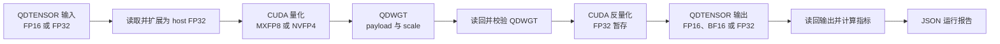

# CUDA MXFP8 / NVFP4 量化与反量化项目总结

## 项目目标与完成范围

本项目实现了一个完整的 CUDA 低精度浮点软件模拟程序。它从 QDTENSOR 文件读取
FP16 或 FP32 的 row-major 矩阵，根据配置量化为 MXFP8 或 NVFP4，按真实 bit 宽度写入
QDWGT 文件，再由 CUDA kernel 反量化为 FP16、BF16 或 FP32，并输出误差、压缩率、
kernel 时间与有效带宽 JSON 日志。

实现覆盖以下完整数据路径：

其中 CPU reference、二进制 I/O、CUDA 量化/反量化、独立单元测试以及批量实验脚本均已
实现。MXFP8 的 `tensor` scale 是为作业配置要求增加的项目扩展；严格 OCP
MXFP8 基线路径为 `block_size = 32` 的 block scaling。NVFP4 固定为每 16 元素局部
scale 加整张张量全局 scale，不支持 tensor-only mode。

更细的数值规范、文件规范和 kernel 源码导读分别见
[docs/format_spec.md](docs/format_spec.md)、[docs/file_format.md](docs/file_format.md) 与
[docs/kernels.md](docs/kernels.md)。

## 低精度格式与数值语义

### 共同量化模型

低精度浮点的 payload 仍是浮点 codebook，而不是 INT code；但它的指数和尾数位数很少，
不能直接覆盖一般 FP32 张量的动态范围。因此先用正 scale 将一组原始值映射到 payload
可表示范围，再进行浮点编码：

$$
z_i = x_i / s,qquad p_i = Q(z_i),qquad
\hat{x}_i = \operatorname{decode}(p_i) \cdot s.
$$

这里 $x_i$ 是原始 FP32 值，$z_i$ 是归一化值，$p_i$ 是实际保存的低精度 bit pattern，
$\hat{x}_i$ 是反量化结果。若 payload 最大有限幅值为 $q_{\max}$，当前组的
$amax = \max_i |x_i|$，避免最大元素饱和至少要求：

$$
s \ge amax / q_{\max}.
$$

在不饱和的 scale 中，较小的 scale 通常更好：它会把小元素推向 payload codebook 的
normal 区域，而不是 subnormal 或零附近。block scale 的价值就是避免一个异常大的元素
用全局 scale 牺牲整张张量中其他区域的分辨率。

元素编码支持两种舍入策略：

- `nearest`：round-to-nearest, ties-to-even（RNE，最近值、平局取偶）。
- `stochastic`：在相邻可表示值 $l$、$h$ 之间，以
  $(a-l)/(h-l)$ 的概率选择较大的 $h$；随机数由 `stochastic_seed` 和全局线性下标的
  无状态 SplitMix64 映射决定，因此 CPU 与 GPU 可逐元素复现。

输入必须是有限 FP16/FP32 值。遇到 NaN 或 $\pm\infty$ 时，公共接口会失败，不产生
可用的量化文件；这避免把未定义的私有 sentinel 混入 NVFP4 数据。

### MXFP8：E4M3 payload 与 E8M0 scale

MXFP8 的元素 payload 固定为 E4M3，一个字节的 layout 为 `S EEEE MMM`：1 bit 符号、
4 bit 指数、3 bit 尾数，指数 bias 为 7。其有限值定义为：

$$
p=(-1)^S 2^{E-7}(1+M/8),\quad E>0,
$$

$$
p=(-1)^S 2^{-6}(M/8),\quad E=0.
$$

第二式是 subnormal 区域：`E = 0` 时没有隐含 leading one。E4M3 的最小 subnormal 为
$2^{-9}$，最小 normal 为 $2^{-6}$，最大有限值为 `448`（`0x7e`）；`0x7f` 和
`0xff` 是 NaN。该 E4M3 变体没有 Inf 编码，有限输入溢出时饱和到 $\pm448$。

每个严格 MXFP8 block 有 32 个 E4M3 元素和一个 E8M0 scale。E8M0 是一个只有 8 bit
指数、没有尾数的浮点 scale：

$$
s_b = 2^{e_b-127},qquad e_b\in[0,254].
$$

因为 E4M3 最大有限值为 448，block 最大幅值 $a_b$ 的理想连续 scale 为
$a_b / 448$。但 E8M0 只能表示 2 的幂，因此实际选择不小于该值的最小 E8M0：

$$
s_b = 2^{\lceil\log_2(a_b/448)\rceil}.
$$

实际实现还会把 E8M0 指数 clamp 到可编码范围。向上取整保证
$a_b/s_b\le448$，不会把 block 最大元素饱和；未触及 clamp 时还有
$224 < a_b/s_b\le448$，即最大元素会落入 E4M3 有限范围的上半区。全零 block 写最小
有限 E8M0 scale $2^{-127}$，所有 payload 规范化为正零 `0x00`，因此反量化仍严格为零。

MXFP8 的反量化公式为：

$$
\hat{x}_i = \operatorname{decode}_{\mathrm{E4M3}}(p_i)\cdot s_{b(i)}.
$$

`block` 模式按行每 32 个元素一个 $s_b$；项目扩展的 `tensor` 模式则只计算一个整张
张量的 $amax$，写入唯一的 E8M0 $s_0$，所有元素共享它。

### NVFP4：E2M1 payload、E4M3 local scale 与 FP32 global scale

NVFP4 的元素为 4 bit E2M1 nibble，layout 是 `S EE M`。指数 bias 为 1，正数幅值
codebook 是：

| `EE M` | 0 | 1 | 2 | 3 | 4 | 5 | 6 | 7 |
| --- | ---: | ---: | ---: | ---: | ---: | ---: | ---: | ---: |
| 幅值 | 0 | 0.5 | 1 | 1.5 | 2 | 3 | 4 | 6 |

其中 code 1 是 subnormal，最大有限幅值仅为 6；E2M1 没有 NaN 或 Inf。仅靠一个
E2M1 scale 无法同时覆盖整张张量与保留局部精度，所以 NVFP4 采用两层 scale：

$$
\hat{x}_i = \operatorname{decode}_{\mathrm{E2M1}}(q_i)
\cdot \operatorname{decode}_{\mathrm{E4M3}}(l_{b(i)}) \cdot s_g.
$$

这里 $q_i$ 是 E2M1 nibble，$l_b$ 是每 16 个 rowwise 元素一个的 E4M3 local-scale
code，$s_g$ 是整张张量唯一的 FP32 global scale。global scale 使用解码方向保存，不存
倒数：

$$
a_g=\max_i |x_i|,\qquad
s_g=\begin{cases}
a_g/(448\times6), & a_g>0,\\
1, & a_g=0.
\end{cases}
$$

$448\times6=2688$ 来自两层可表示幅值的乘积：E4M3 local scale 最大为 448，E2M1
payload 最大为 6。因此 $2688s_g$ 是 NVFP4 可由给定 global scale 重构的最大幅值，
选择 $s_g=a_g/2688$ 会恰好让全局最大值落在该边界。随后对每个 block：

$$
a_b=\max_{i\in b}|x_i|,qquad
l_b=Q_{\mathrm{E4M3}}\left(a_b/(6s_g)\right),qquad
q_i=Q_{\mathrm{E2M1}}\left(x_i/(\operatorname{decode}(l_b)s_g)\right).
$$

local scale 也以 RNE 量化到 E4M3。它的作用是把不同 block 的幅值重新对齐到 E2M1 的
`0.5...6` 范围；global scale 则把整个张量压入 E4M3 local-scale 的 `0...448` 范围。
这也是 NVFP4 不接受 `scale_mode = tensor` 的原因：拿掉每 16 元素 local scale 后，
它已不再是 NVFP4 的双层缩放格式。

## 真实 bit 宽度与文件布局

矩阵按 row-major 保存，设形状为 $R\times C$、元素数为 $N=RC$。block 不跨行；每行
block 数为 $\lceil C/B\rceil$，所以 block scale 总数为
$R\lceil C/B\rceil$。这会让最后不足 $B$ 的尾 block 获得独立 scale，但 payload 中不
写补零元素。

| 格式 | payload 布局 | scale 布局 | 每元素核心存储 |
| --- | --- | --- | ---: |
| MXFP8 block | 线性第 $n$ 个元素就是 `payload[n]` 的一个 E4M3 byte。 | 每行每 32 元素一个 E8M0 byte。 | 8 bit + 每 32 元素 8 bit scale。 |
| MXFP8 tensor | 同上。 | 整张张量仅一个 E8M0 byte。 | 约 8 bit。 |
| NVFP4 block | `n` 为偶数写低 nibble，奇数写高 nibble；一个 `uint8_t` 保存两个 E2M1。 | 每行每 16 元素一个 E4M3 byte，另有一个 FP32 global scale。 | 4 bit + 每 16 元素 8 bit local scale。 |

NVFP4 的物理打包关系为：

$$
\operatorname{payload}[\lfloor n/2\rfloor] =
\begin{cases}
(\operatorname{byte}\mathbin{\&}\mathtt{0xf0})\mathbin{|}q_n, & n\text{ 为偶数},\\
(\operatorname{byte}\mathbin{\&}\mathtt{0x0f})\mathbin{|}(q_n\ll4), & n\text{ 为奇数}.
\end{cases}
$$

若 $N$ 为奇数，最后一个物理 byte 的高 nibble 强制写零，并在 QDWGT header 的 flag 中
记录该事实。这既满足“两个 4 bit 元素每字节”的要求，也使读取器能检查尾 nibble 是否
未初始化。

文件容器不直接序列化 C++ struct，而是按 little-endian 固定 offset 逐字段编码：

- QDTENSOR 使用 64-byte header，保存 shape、物理 dtype 和 `tensor_role`；输入只允许
  FP16/FP32，反量化输出允许 FP16/BF16/FP32。
- QDWGT 使用 128-byte header，保存 format、scale mode、rounding、来源 dtype、真实
  payload 位宽、block size、各 section offset/size、NVFP4 global scale 和随机种子。
- QDWGT 的 payload 从 offset 128 开始，local scale section 对齐到 8 bytes。读取器会
  检查 magic、版本、字段组合、section 边界、payload/scale 长度及 NVFP4 尾 nibble。

这种布局使量化文件可脱离当前配置独立读取，也避免 C++ ABI padding、宿主端字节序和
struct 对齐改变文件格式。

## 实现思路与优化过程

### 分层设计与正确性基线

项目将“数值规则”和“并行调度”刻意分离：

- `src/formats/` 实现无状态、`__host__ __device__` 可调用的 FP32 bit helper、E4M3、
  E8M0、E2M1、舍入和 nibble pack/unpack。它不依赖 tensor 形状、文件和 CUDA grid。
- `src/reference/` 用同一套 codec 写普通 C++ 的完整 CPU reference，输出统一的
  `QuantizedTensor`。它是 GPU payload、scale 和反量化数值的逐项比较基线。
- `src/cuda/` 只处理线程映射、规约、访存和 kernel launch；格式转换必须复用
  `formats/` 的函数，避免 CPU/GPU 各维护一份边界规则。
- `src/pipeline/` 以 `thrust::device_vector` 管理 device 所有权，负责 H2D、格式分派、
  kernel launch 与 D2H；host 的 `QuantizedTensor` 专门拥有最终 payload/scale，便于统一
  文件写出和 CPU/GPU 结果交接。
- `src/io/` 固定 QDTENSOR/QDWGT 字节布局；`src/metrics/` 独立计算误差、压缩率、
  Event 时间对应的逻辑有效带宽和 JSON。

开发顺序先建立 codec 与 CPU reference，再构造 QDWGT I/O，最后实现 CUDA。这样遇到
错误时可以首先判断是单元素编码、矩阵 scale、文件写读，还是 GPU 并行映射的问题，而
不是只面对一个总误差结果。

### MXFP8 CUDA 量化与反量化

MXFP8 block size 恰为 32，因此 block mode 的自然映射是**一个 warp 处理一个量化
block**：lane $l$ 读取 block 中列偏移 $l$ 的 FP32，使用 `__shfl_down_sync()` 规约
warp 内 $amax$，lane 0 计算并写唯一 E8M0 scale，再通过 shuffle 广播该 scale；每个有效
lane 独立写一个 E4M3 payload byte。尾 block 的无效 lane 不访存，只向规约贡献零。

一个 CTA 固定为 256 threads，即 8 个 warp，同时处理 8 个逻辑 block。launcher 查询
SM 数和 occupancy，以不超过 `SM × min(4, 可驻留 CTA/SM)` 的 CTA 数发射 persistent
grid；每个 warp 在 kernel 内通过 grid-stride 循环领取后续 block。它减少了海量小 CTA
的调度开销，并保留了对大矩阵的持续并行度。

MXFP8 tensor mode 无法由各 CTA 在一次 kernel 内安全共享最终 $amax$，因此采用三段式：

1. 第一阶段 persistent reduction 使用 `float4` 合并读取和 grid-stride 循环，每个 CTA
   写出一个 `partial_amax` 与 `has_nonfinite` 标记。
2. 第二阶段只启动一个 CTA，规约所有 partial，直接将唯一 E8M0 scale 写入
   `local_scales[0]`。
3. 第三阶段独立编码 kernel 读取这个 scale，并行产生全部 E4M3 payload。

反量化更直接：一维 grid-stride 中每线程解一个或多个 payload。tensor mode 始终读
`scale[0]`；block mode 通过 row、column 计算 rowwise scale index。之后调用同一 E4M3
decode 并乘 scale。

### NVFP4 CUDA 量化与反量化

NVFP4 的 global scale 依赖全张量最大值，因此量化必先走与 MXFP8 tensor mode 类似的
两阶段规约：partial global $amax$，再由单 CTA 写一个 FP32 `global_scale`。之后分两步
处理局部量化：

1. local-scale kernel 使用 `cooperative_groups::thread_block_tile<16>`；一个 16-lane
   tile 处理一个 rowwise local block，规约 $a_b$ 后由 tile leader 写一字节 E4M3 local
   scale。
2. packed-encode kernel 使用 `thread_block_tile<32>`。偶数 lane 唯一拥有一个 payload
   byte：它编码自身的 low nibble、从相邻奇数 lane 取得 high nibble，再进行一次 8-bit
   store。

将 local-scale 与 encode 分为两个 kernel 是有意的优化/正确性取舍，而不是遗漏融合：
local scale 必须先对整个 16 元素 block 的 $amax$ 完成规约；并且 16 元素 rowwise block
与两个线性元素一个 byte 的物理 payload 边界并不总重合。例如奇数列矩阵中，行末和下一
行开头可能共用一个 packed byte，却属于不同 local block。若让各 tile 独立 read-modify-
write 同一 byte，会产生竞争。独立 packed-encode kernel 改为让偶数 lane 成为唯一 byte
writer，同时保留连续、合并的读写。

NVFP4 反量化采取“一个线程一个物理 payload byte”：线程加载一次 byte，分别解低/高
nibble，并为两个线性元素各自推导 rowwise local-scale index。这个细节正确覆盖奇数列时
跨行共用的 byte，避免错误地假设两个 nibble 必定在同一 local block。

### 开发中确认的边界问题

- **rowwise block 与线性 packing 是两种不同分组。** scale 不跨行，但 NVFP4 payload
  按线性元素两两打包；测试专门使用 35 列和奇数元素数覆盖尾 block、跨行 byte 和尾
  nibble。
- **tensor $amax$ 不能在多个 CTA 内直接同步。** 先写 partial workspace、再用单 CTA
  finalize 是正确的跨 CTA 规约方式；workspace 由 pipeline 在三段 kernel 完成前持续持有。
- **非有限值不能只做浮点 max。** NaN 在普通 max 中可能被掩盖，因此规约状态同时保存
  `amax` 与 `has_nonfinite`；D2H 后发现 sentinel 即拒绝量化结果。
- **文件大小和逻辑压缩率不同。** QDWGT 固定 header 与 8-byte section 对齐会降低实际
  落盘压缩率，尤其在小张量上更明显；报告同时保留逻辑和 on-disk 两种定义。
- **误差必须在输出落盘后计算。** 反量化 kernel 内部先得到 FP32；但目标为 FP16/BF16
  时，写 QDTENSOR 还会再窄化一次。app 写出后重新读取输出文件，再和输入扩展后的 FP32
  比较，因此指标反映用户真正获得的结果。

## 最终误差、压缩率与性能结果

### 验证方法

CTest 将 codec、配置、I/O、CPU reference、device 数据结构和 CUDA integration 拆成
独立可执行文件。当前共 18 个测试条目，覆盖：

- E4M3/E8M0/E2M1 的边界、RNE、stochastic、饱和、规范化零和 host/device 一致性；
- QDTENSOR/QDWGT round-trip、header 字段、损坏文件与真实 NVFP4 nibble 布局；
- MXFP8 block/tensor、NVFP4 block 的 CPU reference 与 CUDA payload、local scale、
  global scale、反量化数值逐项对照；
- 35 列 tail block、NVFP4 跨行 packed byte、persistent grid-stride 第二轮工作、三种
  输出 dtype 以及 CUDA Event profile API。

### 最终误差指标

以下具体表格选取 **FP32 输入、FP32 输出、RNE、`1024 × 1025`**，以排除 FP16/BF16
输出窄化以及随机舍入带来的额外变量。GPU 为 NVIDIA RTX 4060（SM89），构建 preset 为
`rtx4060-release`。本表只保留最终数值误差；性能数据统一使用下一节的同进程 benchmark，
不混入本节。

| 格式 / scale | 分布 | max abs | MAE | MSE |
| --- | --- | ---: | ---: | ---: |
| MXFP8 block | uniform | 0.031250 | 0.010417 | 0.000186 |
| MXFP8 block | normal | 0.248401 | 0.017952 | 0.000703 |
| MXFP8 block | outlier | 0.242721 | 0.017784 | 0.000696 |
| MXFP8 tensor | uniform | 0.031250 | 0.010417 | 0.000186 |
| MXFP8 tensor | normal | 0.248401 | 0.017952 | 0.000703 |
| MXFP8 tensor | outlier | 0.242721 | 0.017784 | 0.000696 |
| NVFP4 block | uniform | 0.166666 | 0.044308 | 0.003447 |
| NVFP4 block | normal | 0.593036 | 0.071406 | 0.009053 |
| NVFP4 block | outlier | 1.333329 | 0.149060 | 0.084099 |

该表的数值趋势符合格式预期：

- MXFP8 的 3-bit 尾数与更大的 E4M3 codebook，使 MAE 明显低于仅有 4 bit E2M1
  payload 的 NVFP4；在 normal 输入上，代表性 RNE MAE 为 $0.01795$ 对 $0.07141$。
- NVFP4 的最大优势是存储。它为每个元素支付 4 bit payload 和每 16 元素 1 byte local
  scale，仍显著小于 MXFP8 的 8 bit payload。
- 在本次特定输入里，MXFP8 block/tensor 的误差恰好非常接近；这不是一般性保证。更大、
  更强的局部动态范围差异或更多异常值时，block scale 通常会更有利于小值精度。

### 最终压缩率

对本次 $N=1024\times1025=1,049,600$ 的 FP32 输入，逻辑量化字节数和压缩率为：

| 格式 / scale | payload bytes | local scale bytes | global scale bytes | 逻辑压缩率 | 落盘压缩率 |
| --- | ---: | ---: | ---: | ---: | ---: |
| MXFP8 block | 1,049,600 | 33,792 | 0 | 3.8752× | 3.8748× |
| MXFP8 tensor | 1,049,600 | 1 | 0 | 4.0000× | 3.9995× |
| NVFP4 block | 524,800 | 66,560 | 4 | 7.0995× | 7.0980× |

MXFP8 block 比理想 4× 略小，因为每 32 个元素多保存一个 E8M0 byte；NVFP4 比理想 8×
略小，因为每 16 个元素保存一个 E4M3 local scale，另有 4-byte global scale。落盘压缩率
再低一点，是 QDWGT 128-byte header 和 section 对齐的真实成本。若输入本来是 FP16，
分母只有 2 bytes/element，表中压缩率会大约减半；这不是格式变差，而是原始输入已经
占用更少字节。

### 最终性能指标与分析

最终性能结论以 `outputs/benchmark_suite/summary.md` 的同进程 benchmark 为准。该实验在
RTX 4060（SM89）上对一个 `4096 × 4097` 的 FP32 normal 输入执行，每个真实 TOML 都采用
`warmups = 10`、`repeats = 30`。CUDA Event 位于 H2D 后、D2H 前，故只统计格式专用
kernel；min/mean/median/p95/max 都由 30 个正式样本计算。

| 配置 | quant mean ms | quant median ms | quant p95 ms | quant GB/s | dequant mean ms | dequant median ms | dequant p95 ms | dequant GB/s |
| --- | ---: | ---: | ---: | ---: | ---: | ---: | ---: | ---: |
| MXFP8 block + RNE | 1.161 | 1.071 | 1.456 | 72.717 | 0.695 | 0.577 | 1.229 | 121.425 |
| MXFP8 block + stochastic | 1.551 | 1.471 | 1.977 | 54.448 | 0.665 | 0.598 | 1.002 | 127.065 |
| MXFP8 tensor + RNE | 0.909 | 0.886 | 0.984 | 92.334 | 0.501 | 0.489 | 0.547 | 167.540 |
| MXFP8 tensor + stochastic | 1.272 | 1.222 | 1.613 | 65.947 | 0.535 | 0.535 | 0.629 | 156.770 |
| NVFP4 block + RNE | 2.311 | 2.272 | 2.595 | 33.131 | 0.610 | 0.606 | 0.634 | 125.574 |
| NVFP4 block + stochastic | 2.450 | 2.424 | 2.700 | 31.247 | 0.608 | 0.606 | 0.620 | 125.942 |

这组数据给出以下结论：

- **MXFP8 tensor + RNE 是当前实现的最快路径。** quant median 为 `0.886 ms`，
  dequant median 为 `0.489 ms`。它只保存一个 E8M0 scale；尽管量化需要
  partial/finalize/encode 三段 kernel，仍避免了每个 32 元素 block 的独立 scale 规约与
  写入，因而在本实现和该 shape 下优于 MXFP8 block。
- **stochastic rounding 的成本主要体现在量化。** 相比相同 scale mode 的 RNE，MXFP8
  block 的 quant mean 从 `1.161 ms` 升至 `1.551 ms`，MXFP8 tensor 从 `0.909 ms` 升至
  `1.272 ms`。额外开销来自每元素 SplitMix64 无状态随机数、相邻 code 边界与概率分支。
  NVFP4 的增幅较小（`2.311 ms` 到 `2.450 ms`），因为 global reduction、local-scale 和
  packed encode 已是主要成本，随机舍入在总时间中的占比更低。
- **NVFP4 quant 最重，但其 dequant 稳定。** NVFP4 量化需要 global 两阶段规约、
  16-lane local-scale kernel 和 32-lane packed-encode kernel，因此 quant median 为
  `2.272--2.424 ms`，约为 MXFP8 tensor + RNE 的 2.6--2.7 倍。反量化则由一个线程读一个
  packed byte、同时解两个 E2M1 nibble；median 稳定在约 `0.606 ms`，p95 仅约
  `0.620--0.634 ms`。
- **MXFP8 block 的反量化存在尾部离群样本。** RNE 的 median 是 `0.577 ms`，但 p95 为
  `1.229 ms`、max 为 `1.275 ms`；stochastic 也出现较弱的尾部波动。该现象更像短 kernel
  的 GPU 时钟/桌面调度干扰，而不是数值错误。最终提交应同时报告 median、p95 与 mean，
  不应只选择最小值。
- 表中的 GB/s 是按项目“逻辑读写字节 / CUDA Event 时间”定义的**有效带宽**，不是显存
  理论峰值。量化通常低于反量化，是因为 $amax$ 规约、scale 编码、浮点转换与随机数生成
  增加了计算和同步成本。

当前 benchmark 已复用进程、输入和配置，但每轮仍经由公共 pipeline 创建 stream/device
buffer。它适合作为本项目当前 kernel 实现的可复现实验口径；若追求极限吞吐，下一步应为
pipeline 增加可复用的 persistent device-buffer 会话。

## 软件模拟、GPU 架构与第三方依赖边界

| 组成 | 实现性质 | 说明 |
| --- | --- | --- |
| E4M3、E8M0、E2M1 编解码、RNE/SR、scale 与 nibble pack/unpack | **软件模拟** | 使用普通 FP32 运算和显式 bit 操作实现；没有调用原生 FP8/FP4 tensor-core 指令。 |
| CPU reference | **软件模拟** | 普通 C++ 循环调用与 GPU 共用的 codec，是数值真值基线。 |
| QDTENSOR/QDWGT I/O、header 校验、JSON metrics | **软件实现** | 使用标准 C++，文件字段显式 little-endian 序列化。 |
| GPU quant/dequant | **CUDA 通用 kernel** | 依赖 CUDA runtime、warp shuffle、shared memory、CUDA Event；数值格式本身仍由软件 codec 模拟。 |
| CTA/warp 映射、persistent grid、occupancy 限制 | **GPU 架构感知优化** | 利用 NVIDIA 32-lane warp 的执行模型；当前 preset 编译目标为 RTX 4060 的 SM89。 |
| `thrust::device_vector` | **CUDA Toolkit 的 Thrust 库** | 负责 device buffer 的 RAII 所有权与 host/device 数据转移；kernel 接收 raw device pointer。 |
| `cooperative_groups::thread_block_tile<16/32>` | **CUDA Toolkit 库接口** | 用于 NVFP4 的 16-lane local-scale tile 和 32-lane packed-store warp 协作。 |

项目不依赖 TensorRT、Transformer Engine、cuDNN、cuBLAS 或 Blackwell 专用硬件。资料中的
OCP MX 与 NVIDIA NVFP4 规范用于确定软件数值语义；RTX 4060 没有在本项目中被假定拥有
原生 NVFP4/MXFP8 指令。由于线程映射依赖 32-lane NVIDIA warp，代码不是可直接搬到非
CUDA GPU 平台的通用实现；但格式 codec 的数学规则不依赖 SM89。

## 可继续提升的方向

- 扩展独立 benchmark：复用已分配的 device buffer，在同一进程内多轮 warmup/repeat，
  输出 p50/p95、吞吐与矩阵尺寸曲线。
- 评估 persistent grid 的 CTA/SM 系数、CTA 大小和 vector load 宽度，而不是把当前
  `SM × 4` 启发式当作所有 shape/GPU 的最优值。
- 为 NVFP4 研究更高效的 global reduction 与 local-scale/encode 调度，例如评估安全的
  fusion 边界、异步拷贝和不同的 byte-owner 映射；必须保持奇数列跨行 byte 的无竞争语义。
- 扩充数值实验：多个 stochastic seed 的均值/方差、更多异常值比例、不同 block size 的
  敏感性，以及相对误差/分位数误差图，而不是只看 MAE/MSE。
- 增加可选 E5M2、OCP MXFP4 或更多输入格式，并以新 QDWGT version 扩展 header；不能在
  version 1 中改变已有枚举、payload nibble 顺序或 scale 解码方向。
- 若目标硬件将来提供原生 FP8/FP4 指令，可新增独立硬件加速 backend，并继续保留本项目
  的软件 reference 作为位级/数值对照，不混淆两条实现路径。
