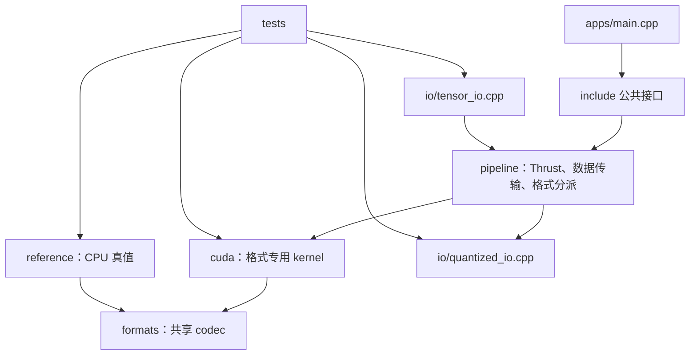
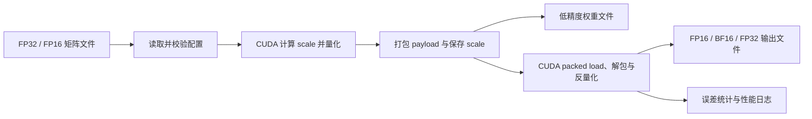

# MXFP8 / NVFP4 量化与反量化

本项目在普通 CUDA GPU 上软件模拟 MXFP8 和 NVFP4 的量化、真实位宽打包、文件保存与 CUDA 反量化。输入为 FP32 或 FP16 的行主序矩阵，输出低精度权重文件、指定精度的反量化矩阵，以及误差和性能日志。

普通 FP8 不属于基础验收范围；可将其作为调试基线、误差对照或扩展功能。

## 功能范围

- 读取 FP32 / FP16 输入矩阵文件，并保留行主序布局；第一版不接受 BF16 输入。
- 按配置进行 per-tensor 或 block-wise scaling，支持 `rounding = nearest` 和 `rounding = stochastic`。
- 编码并打包 MXFP8 和 NVFP4 数据：MXFP8 每个元素占 1 字节；NVFP4 每个字节必须容纳两个 4-bit 元素。
- 保存量化 payload、scale 数组、格式和形状等必要元数据。
- 用 CUDA kernel 将量化数据解包、反量化为 FP16、BF16 或 FP32。
- 类型约束：输入 QDTENSOR 只允许 FP16 / FP32；反量化输出 QDTENSOR 允许 FP16 / BF16 / FP32。QDWGT 的 `source_dtype` 因此也只可能是 FP16 / FP32。
- 对随机、正态分布和含异常值矩阵统计最大绝对误差、MAE、MSE、压缩率和 kernel 性能。

## 工程结构

```text
黄新颖/
├── CMakeLists.txt
├── CMakePresets.json
├── .gitignore
├── README.md
├── Conclusion.md                    # 项目总结：格式、kernel、实验结果与 profiling 记录
├── include/
│   └── quant_dequant/
│       ├── types.hpp                 # 已实现：枚举、TensorDesc、三类方向配置等基础类型
│       ├── config.hpp                # 已实现：量化、反量化、app 三种配置解析接口
│       ├── tensor_io.hpp             # 已实现：输入与反量化输出 QDTENSOR 的读取、写入接口
│       ├── quantized_tensor.hpp      # 已实现：统一 host 量化结果、格式特有不变量校验
│       ├── quantized_io.hpp          # 已实现：QDWGT v1 量化权重文件读写接口
│       ├── quantize.hpp              # 已实现：CPU reference 与 CUDA pipeline 的量化、反量化公共接口
│       └── metrics.hpp               # 已实现：误差、压缩率、带宽与 JSON 运行报告接口
├── src/
│   ├── CMakeLists.txt                # 只列出已存在的 .cpp/.cu，构建 quant_dequant_core
│   ├── quant_dequant.cpp             # 已实现：当前版本信息等轻量库入口
│   ├── config/
│   │   └── config_parser.cpp         # 已实现：key-value 配置解析与分方向校验
│   ├── io/
│   │   ├── tensor_io.cpp             # 已实现：FP32 / FP16 输入和反量化输出
│   │   └── quantized_io.cpp          # 已实现：QDWGT header、payload、scale 读写
│   ├── formats/
│   │   ├── fp32_utils.cuh             # 已实现：IEEE FP32 位操作、指数、RNE 公共工具
│   │   ├── mxfp8_codec.cuh           # 已实现：E4M3/E8M0 的 host/device 编码规则
│   │   └── nvfp4_codec.cuh           # 已实现：E2M1、双层 scale、nibble 打包的 host/device 规则
│   ├── reference/
│   │   ├── reference_detail.hpp      # 已实现骨架：格式专用 CPU reference 内部接口
│   │   ├── reference_dispatch.cpp    # 已实现骨架：按 format 转发 CPU reference 调用
│   │   ├── mxfp8_reference.cpp       # 已实现：MXFP8 CPU 量化、反量化数值循环
│   │   └── nvfp4_reference.cpp       # 已实现：NVFP4 CPU 量化、反量化、双层 scale 与 nibble 打包/解包
│   ├── cuda/
│   │   ├── mxfp8_quantize.cuh        # 已实现：MXFP8 block/tensor-scale CUDA launcher 私有声明
│   │   ├── mxfp8_quantize.cu         # 已实现：block-scale warp kernel 与 tensor-scale 两阶段 amax/编码 kernel
│   │   ├── mxfp8_dequantize.cuh      # 已实现：MXFP8 反量化 launcher 私有声明
│   │   ├── mxfp8_dequantize.cu       # 已实现：MXFP8 E4M3/E8M0 解码、tensor/block scale 索引 kernel
│   │   ├── nvfp4_quantize.cuh        # 已实现：NVFP4 量化 launcher 私有声明
│   │   ├── nvfp4_quantize.cu         # 已实现：全局规约、16-lane local scale、32-lane packed store kernel
│   │   ├── nvfp4_dequantize.cuh      # 已实现：NVFP4 反量化 launcher 私有声明
│   │   └── nvfp4_dequantize.cu       # 已实现：NVFP4 packed load、解包与反量化 kernel
│   ├── pipeline/
│   │   ├── device_quantized_tensor.cuh # 已实现：pipeline 私有 Thrust quantize 输入、量化结果、tensor 规约工作区与反量化 FP32 输出对象
│   │   ├── pipeline_detail.hpp         # 已实现：MXFP8/NVFP4 CUDA 格式专用内部入口声明
│   │   ├── quantize.cpp               # 已实现：MXFP8/NVFP4 的预检、H2D、kernel 分派、D2H 与 QuantizedTensor 构造
│   │   └── dequantize.cpp             # 已实现：MXFP8/NVFP4 H2D、反量化 launcher 与 D2H
│   ├── common/
│   │   ├── cuda_stream.cuh            # 已实现：non-blocking CUDA stream 的 RAII 所有权
│   │   ├── cuda_stream.cu             # 已实现：stream 创建、同步与析构
│   │   ├── cuda_timer.cuh             # 已实现：绑定指定 stream 的 CUDA Event RAII kernel 计时器
│   │   └── cuda_timer.cu              # 已实现：Event 创建、状态机、同步与 elapsed time
│   └── metrics/
│       └── metrics.cpp                 # 已实现：误差、压缩率、带宽与 JSON 报告实现
├── apps/
│   ├── CMakeLists.txt
│   └── main.cpp                      # 已实现：完整 QDTENSOR→QDWGT→QDTENSOR→JSON 命令行编排
├── configs/
│   ├── mxfp8_{block,tensor}_{nearest,stochastic}_{fp16,bf16,fp32}.toml # 已实现：12 个 MXFP8 实验配置
│   └── nvfp4_block_{nearest,stochastic}_{fp16,bf16,fp32}.toml          # 已实现：6 个 NVFP4 实验配置
├── tests/
│   ├── CMakeLists.txt                # 已实现：为每个测试模块构建独立 CTest 可执行文件并配置标签
│   ├── test_entry_main.cpp           # 已实现：由 CMake 绑定单个 run_*_tests() 的可复用入口
│   ├── test_config.cpp               # 已实现：配置解析、默认值和非法配置测试
│   ├── test_cuda_dispatch.cpp         # 已实现：CUDA pipeline 参数校验和 MXFP8/NVFP4 格式分派测试
│   ├── test_device_quantized_tensor.cu # 已实现：device buffer 长度、格式不变量和 move-only 语义测试
│   ├── test_tensor_io.cpp            # 已实现：QDTENSOR 的 FP16/FP32 I/O 与损坏文件测试
│   ├── test_mxfp8_codec.cu           # 已实现：-0 规范化与 host/device codec 一致性测试
│   ├── test_quantized_tensor.cpp     # 已实现：MXFP8/NVFP4 payload、scale 元数据不变量测试
│   ├── test_reference_dispatch.cpp   # 已实现：CPU reference 输入校验与格式转发骨架测试
│   ├── test_mxfp8_reference.cpp      # 已实现：CPU block/tensor quantize-dequantize 与文件 round-trip 测试
│   ├── test_mxfp8_cuda.cu            # 已实现：GPU tensor/block 量化→反量化、CUDA/CPU payload/scale/数值与 NaN 哨兵对照
│   ├── test_mxfp8_dequantize_cuda.cu # 已实现：CUDA/CPU tensor/block 反量化和三种输出类型对照
│   ├── test_quantized_io.cpp         # 已实现：QDWGT round-trip、header 与损坏文件测试
│   ├── test_nvfp4_codec.cu           # 已实现：E2M1、E4M3 scale、nibble 顺序与 host/device 一致性测试
│   ├── test_nvfp4_reference.cpp       # 已实现：NVFP4 CPU 双层 scale、跨行 packed byte 与非有限输入测试
│   ├── test_nvfp4_cuda.cu            # 已实现：NVFP4 CUDA/CPU payload、scale 与 global scale 对照
│   ├── test_nvfp4_dequantize_cuda.cu # 已实现：NVFP4 CUDA/CPU packed 反量化和三种输出类型对照
│   └── test_end_to_end.cu            # 后续：文件 -> 量化 -> 文件 -> 反量化的端到端测试
├── benchmarks/
│   ├── CMakeLists.txt            # 构建 quant_dequant_bench 可执行文件
│   └── benchmark_main.cpp        # 独立 warmup 和 CUDA Event 计时
├── docs/
│   ├── format_spec.md            # 位表示、缩放和舍入的唯一规范
│   ├── format_codecs.md          # `src/formats` 位编码实现原理与源码导读
│   ├── kernels.md                # `src/cuda` 量化/反量化 kernel 的调度与规约设计
│   ├── file_format.md            # 二进制 header 与 payload 布局
│   ├── configuration.md           # 配置对象、字段、解析与读取接口
│   ├── app.md                     # 完整命令行、运行流程、输出与指标边界
│   ├── experiments.md             # 矩阵生成、端到端 suite 与实验结果汇总
│   ├── tests.md                   # CTest 条目、标签、运行与新增测试约定
└── scripts/
    ├── generate_tensor.py         # 已实现：uniform/normal/outlier 的 FP16/FP32 QDTENSOR 生成器
    ├── run_e2e_suite.py           # 已实现：真实 app 批量运行、JSON/产物校验与 Markdown 汇总
    └── run_benchmark_suite.py     # 已实现：真实 TOML 的同进程 CUDA warmup/repeat 性能遍历
```

其中 `src/` 只构建 `quant_dequant_core` 静态库；`apps/`、`tests/` 与 `benchmarks/` 各自构建可执行文件并链接该库。树中的“后续”表示已经确定的目标文件名，但当前**不能**写入 `src/CMakeLists.txt`，否则 CMake 会因找不到源文件而失败。

各层只承担一种职责：

- `formats/` 是无状态的数值和 bit primitive。它只回答“一个 float 如何成为 E4M3”或“一个 nibble 如何解码”，不知道矩阵形状、文件和 CUDA grid。
- `formats/fp32_utils.cuh` 是格式层的内部公共基座，不是对外 API。它集中处理 FP32 的符号、NaN、subnormal、指数和 RNE，避免 MXFP8、NVFP4 各自复制不同的边界语义；`mxfp8_codec.cuh` 提供 E4M3/E8M0 规则，`nvfp4_codec.cuh` 在其 E4M3 local scale 基础上提供 E2M1、NVFP4 双层 scale 与 nibble 打包规则。
- `reference/` 用同一套 codec 在 host 上实现完整矩阵流程，是 CUDA 结果的真值来源；MXFP8 与 NVFP4 的量化、反量化都已完成。NVFP4 量化先求全局 amax 与 FP32 `global_scale`，再写每个 rowwise 16 元素 block 的 E4M3 local scale，最后按线性相邻元素打包 E2M1 nibble；反量化逐个 physical payload byte 解包，并让 low/high nibble 分别推导自己的 rowwise local-scale 下标。reference 是普通 `.cpp`，它调用仅含 `__host__ __device__` 数值原语的格式头文件，但不发射 CUDA kernel。
- `cuda/` 只负责线程映射、block reduction、合并访存和 packed load/store。格式公式必须调用 `formats/`，不能在 kernel 内另写一份。`mxfp8_quantize.cuh` 声明 block-scale 与 tensor-scale launcher；block-scale kernel 使用一 warp 对应一组 32 元素、一个 CTA 对应 8 个 warp 的映射。其网格大小取“逻辑所需 CTA 数”和 `SM 数 × min(4, occupancy 上限)` 的较小值，warp 再用 grid-stride 继续处理后续量化 block；因此是固定网格的 persistent kernel（持久化 kernel）调度。tensor-scale kernel 参考 V7 reduction：第一阶段以 `SM 数 × 4` CTA、`float4` 合并加载和 grid-stride 生成 partial amax/NaN-Inf 标记；第二阶段仅一个 CTA 用同一 warp/shared-memory 规约结构合并 partial，并由 thread 0 直接写唯一的 E8M0 `scale[0]`；第三阶段启动独立编码 kernel。`mxfp8_dequantize.cu` 则以一维 grid-stride 让每个线程解码一个或多个 E4M3 payload；tensor 模式读取唯一的 scale 0，block 模式按 `row * blocks_per_row + column / 32` 读取 E8M0 scale。真正的 `__global__` kernel 只定义在 `.cu` 文件中。
- `pipeline/` 是唯一了解 Thrust device buffer 和 CUDA launcher 的编排层。公共 API `quantize_cuda()` 和 `dequantize_cuda()` 仍接收 `HostTensor` 或 `QuantizedTensor`，先完成 host 侧校验，再按 MXFP8/NVFP4 转发到 `pipeline_detail.hpp` 中的格式专用入口。MXFP8 block-scale 量化已构造 `DeviceQuantizationInput`、执行 H2D、分配 `DeviceQuantizedTensor`、调用 persistent kernel，并以 Thrust device iterator 回传 scale 和 payload；tensor-scale 额外分配只在本次调用内存活的 `DeviceTensorQuantizationWorkspace`，使第一、二阶段规约和编码 kernel 完成前 partial 数组始终有效。NVFP4 量化复用这一工作区先做全局两阶段 amax reduction 并写一个 FP32 `global_scale`，随后以 `thread_block_tile<16>` 写 E4M3 local scale，再以 `thread_block_tile<32>` 让偶数 lane 独占写 packed E2M1 byte；D2H 检查 global/local scale 后构造统一 host `QuantizedTensor`。两种反量化都复用 `DeviceQuantizedTensor` 作为 H2D 的低精度输入，以及 `DeviceDequantizationOutput` 保存 device FP32 结果；NVFP4 kernel 以一个线程读取一个 packed byte，分别解包并解码两个 nibble，从而正确覆盖奇数列产生的跨行 byte。`quantize.cpp`、`dequantize.cpp` 不定义 kernel，因而保留 `.cpp` 后缀；但它们实例化 `thrust::device_vector` 的 CUDA 后端模板，CMake 必须将这两个源文件交给 NVCC 编译。这里使用 `thrust::device_vector`，但不再额外设计一个泛用 GPU Tensor 类。
- `io/` 只处理磁盘字节布局。`tensor_io.cpp` 面向 QDTENSOR；`quantized_io.cpp` 面向 QDWGT，且只接收已完成量化的 `QuantizedTensor`。
- `quantized_tensor.hpp` 不是通用张量封装，只是量化结果的 host 侧所有权对象：描述信息、真实位宽 payload、local scale，以及 NVFP4 的 `global_scale`。
- `metrics.hpp` / `metrics.cpp` 是不依赖 CUDA 的指标层：以 FP32 数组计算误差、从描述和量化结果推导逻辑字节数/压缩率、按约定公式换算有效带宽，并序列化 `RunReport` JSON。它不读取文件或发射 kernel；app 在完成 I/O 后把产物大小和最终数值交给它。
- `common/cuda_stream.cuh` / `.cu` 拥有每次 profile pipeline 调用独占的 non-blocking CUDA stream；它负责将 H2D、event、格式专用 kernel 与 D2H 串在同一条有序队列中。
- `common/cuda_timer.cuh` / `.cu` 是绑定该 stream 的 CUDA Event RAII（资源获取即初始化）计时器。`quantize_cuda_profiled()` 和 `dequantize_cuda_profiled()` 都在 H2D 后记录 start event、在最后一个 kernel 后记录 stop event、随后才执行 D2H，因此返回的 `kernel_ms` 只包含该次调用的 device kernel 时间，不包含内存传输、分配、文件 I/O 或 CUDA context 初始化。



这个依赖方向的关键是：`formats/` 永远不依赖 CUDA kernel、Thrust 或文件 I/O；而测试可分别定位 codec、量化流程和文件布局的问题。

## 实现顺序

当前已经完成基础类型、配置解析、普通张量 I/O，以及 `test_config.cpp`、`test_tensor_io.cpp`。接下来的文件按以下顺序创建最稳妥：

1. `src/formats/fp32_utils.cuh`、`src/formats/mxfp8_codec.cuh` 与 `tests/test_mxfp8_codec.cu` 已完成；后续扩展测试向量，覆盖 E4M3、E8M0、RNE、饱和和 stochastic rounding 的全部位级边界。
2. `include/quant_dequant/quantized_tensor.hpp` 已完成；接着实现 `src/reference/mxfp8_reference.cu`，用该统一 host 结果类型得到不依赖 GPU 的完整 MXFP8 block/tensor 参考结果。
3. `include/quant_dequant/quantized_io.hpp`、`src/io/quantized_io.cpp` 与 `tests/test_quantized_io.cpp` 已完成：QDWGT v1 使用逐字段 little-endian 序列化，覆盖实际 round-trip、section 对齐和损坏文件拒绝。
4. `include/quant_dequant/quantize.hpp`、`src/reference/reference_dispatch.cpp`、`src/reference/reference_detail.hpp` 与 `tests/test_reference_dispatch.cpp` 已完成 CPU reference 公共接口与格式分派。
5. `src/reference/mxfp8_reference.cpp` 与 `tests/test_mxfp8_reference.cpp` 已完成：以 `QuantizedTensor` 产出完整 MXFP8 CPU block/tensor 参考结果，并验证 payload、E8M0 scale、反量化值和文件 round-trip。
6. `src/pipeline/pipeline_detail.hpp`、`src/pipeline/quantize.cpp`、`src/pipeline/dequantize.cpp` 与 `tests/test_cuda_dispatch.cpp` 已完成 CUDA pipeline 的格式分派与数据传输边界。MXFP8 tensor/block-scale 量化均已完成预检、H2D、`DeviceQuantizationInput` / `DeviceQuantizedTensor` 构造、kernel 分派、D2H 和 `QuantizedTensor` 交付；tensor 模式还拥有调用期临时 `DeviceTensorQuantizationWorkspace`。反量化已完成 QDWGT 的 H2D、`DeviceDequantizationOutput` 分配、kernel、D2H 和 `HostTensor` 交付。
7. `src/cuda/mxfp8_quantize.cuh`、`src/cuda/mxfp8_quantize.cu` 与 `tests/test_mxfp8_cuda.cu` 已完成 MXFP8 的两种 CUDA 量化路径。block-scale 使用 warp-per-32-element persistent 映射；tensor-scale 使用 V7 风格 `float4` grid-stride partial reduction、单 CTA final reduction/scale 写入和独立编码 kernel。测试在有 GPU 时以 nearest 和 stochastic rounding 分别逐字节对比 CPU reference 的 payload/E8M0 scale，再把 GPU 量化 D2H 返回的同一个 `QuantizedTensor` 直接传入 GPU 反量化，并对比 CPU reference 的最终 FP32 数值；同时覆盖 tail block、两种模式的 grid-stride 循环和 NaN 哨兵。`src/cuda/mxfp8_dequantize.cu` 与 `tests/test_mxfp8_dequantize_cuda.cu` 已完成 CUDA 反量化：对 tensor/block scale 模式和 FP16/BF16/FP32 输出描述分别与 CPU reference 比较。
8. NVFP4 的 CPU reference、CUDA quantize/dequantize kernel、pipeline 与 CPU/GPU 对照测试已经完成。反量化以一个线程读取一个 packed byte，low/high nibble 分别按自己的 row/column 推导 local-scale，覆盖跨行 byte、尾 nibble 和 FP16/BF16/FP32 输出描述。
9. CUDA profile pipeline 已完成：`quantize_cuda_profiled()` 与 `dequantize_cuda_profiled()` 返回功能结果和纯 kernel Event 时间；`CudaStream`、`CudaEventTimer` 以及 profile 集成测试覆盖其资源生命周期、计时状态机和 MXFP8 tensor-scale 的 CPU/GPU 端到端一致性。
10. `apps/main.cpp` 已完成完整流程：读取完整配置和输入 QDTENSOR、CUDA profile 量化、写并读回真实 bit-width QDWGT、CUDA profile 反量化、写目标 FP16/BF16/FP32 QDTENSOR、读回实际输出计算误差，并将产物大小、压缩率、kernel 时间和带宽写为 JSON。命令行和报告边界见 [`docs/app.md`](docs/app.md)。
11. `configs/`、`scripts/generate_tensor.py` 与 `scripts/run_e2e_suite.py` 已完成实验层自动化：18 份真实 TOML 覆盖 MXFP8 的 block/tensor、nearest/stochastic、三种输出类型，以及 NVFP4 的 block、nearest/stochastic、三种输出类型；脚本再遍历 uniform、normal、outlier 和 FP16/FP32 输入，实际调用 release app、验证每个 QDWGT/QDTENSOR/JSON 的字段和文件大小，并输出均值/中位数汇总。详见 [`docs/experiments.md`](docs/experiments.md)。

## 配置文件

配置对象的职责边界、全部字段、文本语法、三种 loader 与错误处理见
[`docs/configuration.md`](docs/configuration.md)。本节只保留项目级概览。

配置文件采用简单的 `key = value` 文本格式，例如 `configs/nvfp4_block_nearest_fp16.toml`：

```toml
format = "nvfp4"
block_size = 16
scale_mode = "block"
output_type = "fp16"
rounding = "nearest"
target_gpu = "RTX 4060"
```

| 字段 | 可选值 | 含义 |
| --- | --- | --- |
| `format` | `mxfp8` / `nvfp4` | 目标低精度格式。 |
| `block_size` | 正整数 | `mxfp8` 默认 32，`nvfp4` 默认 16；block 模式下每组连续元素共享一组缩放信息。 |
| `scale_mode` | MXFP8：`tensor` / `block`；NVFP4：仅 `block` | 全张量共享 scale，或每个 block 单独保存 scale；NVFP4 必须保留每 16 元素的 local scale。 |
| `output_type` | `fp16` / `bf16` / `fp32` | CUDA 反量化输出数据类型。 |
| `rounding` | `nearest` / `stochastic` | 编码时的舍入策略；随机舍入应支持确定性随机种子，方便复现测试。 |
| `stochastic_seed` | 可选非负整数，默认 `0` | 仅在 `rounding = "stochastic"` 时使用；`nearest` 模式下只能省略或写 `0`。 |
| `target_gpu` | GPU 型号字符串 | 仅记录在报告和日志中，不改变数值语义。 |

配置文本保持作业要求的平面 `key = value` 形式，但程序内部不会把全部字段强行
传给每个数值接口：

- `QuantizationConfig` 只含 `format`、`block_size`、`scale_mode`、`rounding` 和可选 `stochastic_seed`。量化 CPU reference、CUDA quantize 和单独量化命令只接收它。
- `DequantizationConfig` 只含 `output_type`。同一份 QDWGT 可以分别反量化为 FP16、BF16 或 FP32，因此反量化接口只接收它。
- `AppConfig` 只供 `apps/main.cpp` 编排完整流程使用，组合前两者及仅用于日志的 `ReportConfig::target_gpu`；它不能作为量化或反量化 kernel/pipeline 的参数。

对应 loader 分别为 `load_quantization_config()`、`load_dequantization_config()` 和
`load_app_config()`。前两个允许各自的最小单方向配置：单独量化文件不要求
`output_type` 或 `target_gpu`；单独反量化文件只需 `output_type`。完整 app 配置
则要求表中的所有必填字段。包含额外已知字段的完整配置也可被单方向 loader
投影使用。

`scale_mode = "block"` 时，block 按行划分：每一行独立按连续的 `1 × block_size` 元素分组，MXFP8 使用 `block_size = 32`，NVFP4 使用 `block_size = 16`。一行末尾不足整块时逻辑补零，payload 只保存原始元素；scale 数量为 `num_rows * ceil(num_cols / block_size)`。精确的编码、scale、舍入和打包规则以 [`docs/format_spec.md`](docs/format_spec.md) 为准；若要按源码理解 E4M3、E8M0、E2M1 和相关 helper，可阅读 [`docs/format_codecs.md`](docs/format_codecs.md)。

## 输入和输出文件

### 输入张量

输入张量文件由 header 和连续 data 组成：

```text
[header]
num_rows: int64
num_cols: int64
dtype: string                  # fp32 或 fp16

[data]
values: dtype[num_rows * num_cols]  # 行主序
```

输入文件的 `tensor_role` 必须为 `input`，且 `dtype` 只能是 FP16 或 FP32。读取后程序会把两者统一扩展为 host FP32，供 scale 计算、量化编码和误差统计使用；原始物理类型仍保留在 QDWGT 的 `source_dtype` 中。BF16 只支持作为反量化输出文件的类型。

### 量化参数

完整 app 的量化参数来自上节的配置文件。程序启动时必须校验：格式与 block size 的组合是否合法、输入 dtype 是否受支持，以及输出 dtype 是否受支持；单方向工具则只校验自己所需的那一组配置。

### 低精度权重

低精度权重文件是二进制文件，应至少包含：

- magic 和版本号，用于识别文件格式。
- `num_rows`、`num_cols`、原始元素数量与原始输入 dtype。
- `format`、`block_size`、`scale_mode`、`rounding`。
- payload 字节数、scale 数量、scale 的存储类型，以及 NVFP4 所需的全局 scale 元数据。
- 紧随 header 的 packed data 和 scale 数组。

NVFP4 的 payload 大小必须为 `ceil(num_elements / 2)` 字节。偶数线性下标写入低 4 bit、奇数线性下标写入高 4 bit；不足两个元素时，未使用的半字节清零。反量化 kernel 必须用 packed load 读取字节后解出两个元素，不能将每个 4-bit 元素以一个 `uint8_t` 保存。

MXFP8 的 payload 为每元素 8 bit；scale 的数量为 1（tensor 模式）或 `num_rows * ceil(num_cols / block_size)`（block 模式）。NVFP4 仅支持 block 模式，必须按格式规范保存每个 16 元素 block 的局部 scale 与一个全局 scale；配置和 QDWGT header 中的 `NVFP4 + tensor` 会被拒绝。

### 反量化张量与日志

- 反量化张量按行主序保存，dtype 由 `output_type` 决定，可为 FP16、BF16 或 FP32；其 `tensor_role` 必须为 `dequantized_output`。建议复用输入张量的 header 结构，使输出文件可独立读取。
- 日志建议使用 JSON 或 CSV，每次运行一条记录，包含矩阵形状、配置、目标 GPU、误差和性能数据。
- 必须输出：最大绝对误差、MAE、MSE、压缩率、量化 kernel 时间、反量化 kernel 时间和有效内存带宽（GB/s）。

## 执行流程



误差统计以原始输入 FP32 值为参考；FP16 输入先转换为 FP32 参考值再计算误差。性能统计应在 warmup 后用 CUDA Event 分别测量量化与反量化 kernel，避免把文件 I/O、内存分配和首次 CUDA 初始化混入 kernel 时间。

## 格式实现约束

- **MXFP8**：实现指定 MXFP8 元素编码、block scaling、打包存储和 CUDA 反量化；默认 block size 为 32。
- **NVFP4**：实现 NVFP4 数值编码、元素局部缩放、全局缩放、4-bit 打包/解包和 CUDA 反量化；默认 block size 为 16。
- **scale_mode**：MXFP8 支持 `tensor` 与 `block`；NVFP4 严格只支持 `block`，以保留其全局 scale 加 16 元素局部 scale 的分层规则。格式特有的 scale 规则统一记录在 `docs/format_spec.md`。
- **边界数据**：全零、极小值、极大值、NaN、Inf、非整 block 长度和奇数个 NVFP4 元素必须有明确且可测试的处理规则。

MXFP8 和 NVFP4 的精确 codebook、scale 数据类型、饱和规则以及 NaN/Inf 语义必须在开发前写入 `docs/format_spec.md`。这些是数值正确性的依据，不能仅依赖 kernel 代码中的隐含实现。

输入张量、量化权重、反量化张量与 JSON 日志的固定 header、section offset、字节序和校验规则见 [`docs/file_format.md`](docs/file_format.md)。实现 I/O 时必须逐字段序列化，不能直接写入 C++ struct。

## 验证与性能评测

测试应分为格式单元测试、文件 I/O 测试和端到端 CUDA 测试：

- 用已知 bit pattern 验证编码、解码以及 NVFP4 高低半字节顺序。
- 与 CPU 参考实现逐元素比对 CUDA 的量化结果、scale 和反量化结果。
- 分别对随机矩阵、正态分布矩阵和含异常值矩阵输出误差统计。
- 覆盖 MXFP8 的 tensor/block 模式、NVFP4 的 block 模式及其 tensor 非法组合、FP16/FP32 输入、三种输出类型、尾 block 与奇数长度 payload。
- benchmark 与正确性测试分离；报告中标明 `target_gpu`、CUDA 版本、矩阵形状、warmup 次数和重复次数。

## 构建与运行

在本目录下使用 `CMakePresets.json` 独立构建，不依赖仓库根目录的 `CMakeLists.txt`。`rtx4060-release` 与 `rtx4060-debug` 均会将 `QUANT_DEQUANT_CUDA_ARCHITECTURES` 固定为 `89`，即 NVIDIA RTX 4060 的 compute capability。

项目的 `.cpp` 使用 C++20。受 CMake 3.22 对 CUDA20 编译选项支持不足的限制，`.cu` 暂使用 CUDA C++17；因此 kernel 与 `__host__ __device__` codec 不应依赖 C++20 独有语法。

```shell
cd "02_quant_dequant/黄新颖"
cmake --preset rtx4060-release
cmake --build --preset rtx4060-release -j
ctest --preset rtx4060-release --output-on-failure

./build/rtx4060-release/apps/quant_dequant \
  --input data/input_fp32.bin \
  --config configs/nvfp4_block_nearest_fp16.toml \
  --quantized-output outputs/weights_nvfp4.bin \
  --dequantized-output outputs/dequant_fp16.bin \
  --report outputs/run_nvfp4.json
```

### 按模块运行测试

测试不再汇总为单个 `quant_dequant_tests` 进程。每个 `test_*.cpp` / `test_*.cu`
源文件各自生成一个独立 CTest 条目，因此失败时能直接定位到配置、I/O、codec、
CPU reference 或某条 CUDA pipeline。先列出当前条目：

```shell
ctest --preset rtx4060-release -N
```

常用筛选方式如下：

```shell
# 只运行一个 NVFP4 CUDA 反量化测试。
ctest --preset rtx4060-release \
  -R '^quant_dequant_nvfp4_dequantize_cuda_tests$' --output-on-failure

# 运行全部带 cuda 标签的测试；无 CUDA device/driver 时，数值对照测试会明确跳过。
ctest --preset rtx4060-release -L cuda --output-on-failure

# 只运行不需要实际 CUDA device 的 unit 测试。
ctest --preset rtx4060-release -L unit --output-on-failure

# 仅筛选 NVFP4 测试；可与 -L cuda 联合使用。
ctest --preset rtx4060-release -L nvfp4 --output-on-failure
```

CTest 标签为 `unit`、`integration`、`cuda`、`config`、`io`、`codec`、`reference`、
`model`、`metrics`、`common`、`profile`、`mxfp8` 与 `nvfp4`。标签可组合筛选；例如
`-L cuda -L nvfp4` 只保留同时匹配两个正则表达式的测试。

`build/`、运行产生的 `outputs/`、日志和大规模二进制测试数据应由 `.gitignore` 排除；配置样例、格式文档、测试代码和小型可复现实例应提交到 Git。
