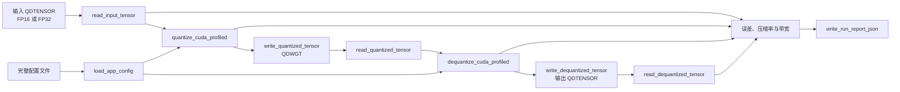

# 完整命令行程序：QDTENSOR → QDWGT → QDTENSOR → JSON

`quant_dequant` 是项目的端到端 CUDA 程序。它不实现新的数值规则；它只把已经
独立验证的配置、QDTENSOR I/O、CUDA pipeline、QDWGT I/O 和 metrics 按一次实验
运行的顺序编排起来。

数值格式见 [format_spec.md](format_spec.md)，文件字节布局见
[file_format.md](file_format.md)，配置字段见 [configuration.md](configuration.md)。

## 命令行

构建 RTX 4060 的 release 版本后，执行文件位于 `build/rtx4060-release/apps/`：

```shell
cd "02_quant_dequant/黄新颖"
cmake --preset rtx4060-release
cmake --build --preset rtx4060-release -j

./build/rtx4060-release/apps/quant_dequant \
  --input data/input_fp32.qdtensor \
  --config configs/mxfp8_block_nearest_fp16.toml \
  --quantized-output outputs/weights.qdwgt \
  --dequantized-output outputs/dequantized.qdtensor \
  --report outputs/run_report.json
```

全部五个路径选项都是必填项：

| 选项 | 含义 | 输入/输出约束 |
| --- | --- | --- |
| `--input` | 原始 QDTENSOR 矩阵。 | 文件的 `tensor_role` 必须为 `input`，dtype 只能为 FP16 或 FP32。 |
| `--config` | 完整 app 的 `key = value` 配置。 | 必须包含量化字段、`output_type` 和 `target_gpu`。 |
| `--quantized-output` | 量化后的 QDWGT 文件。 | 创建或覆盖；NVFP4 payload 真实按两个 FP4 元素每字节打包。 |
| `--dequantized-output` | CUDA 反量化后的 QDTENSOR 文件。 | 创建或覆盖；物理 dtype 由 `output_type` 指定。 |
| `--report` | 误差与性能的 UTF-8 JSON 报告。 | 创建或覆盖。 |

程序会自动创建输出文件的父目录。为了防止意外覆盖，输入、配置和三个输出路径
两两不能是同一个规范化路径。使用 `--help` 可查看该用法。

完整 app 配置示例：

```toml
format = "mxfp8"
block_size = 32
scale_mode = "block"
rounding = "nearest"
output_type = "bf16"
target_gpu = "RTX 4060"
```

NVFP4 时把 `format` 改为 `nvfp4`、`block_size` 改为 `16`，并保持
`scale_mode = "block"`；NVFP4 不接受 tensor mode。

## 一次运行的控制流与数据流



量化和反量化各自使用 profile API。每一阶段内部均采用独占 non-blocking CUDA
stream，提交顺序是：H2D、start event、该阶段全部 kernel、stop event、D2H。
因此 JSON 中的 kernel 时间只统计 device kernel，不包含拷贝、内存分配、文件 I/O
或 CUDA context 初始化。

## 输出与误差定义

app 依次写入 QDWGT、**读回 QDWGT 后再 CUDA 反量化**、写入反量化 QDTENSOR 和 JSON
报告。QDWGT 与 QDTENSOR 写入完成后才查询真实文件大小，因此压缩率中的
`on_disk_compression_ratio` 包含固定 header 和 QDWGT local-scale 对齐 padding。

误差比较的两侧是：

- 参考值：输入 QDTENSOR 被读取并统一扩展后的 FP32 值；
- 实际值：反量化 QDTENSOR **写入后重新读取**并扩展到 FP32 的值。

第二项尤其重要。当 `output_type = fp16` 或 `bf16` 时，CUDA 反量化 kernel 的 FP32
暂存结果在写文件时还会进行一次物理 dtype 窄化。app 读回该文件，使 `max_abs`、
`mae`、`mse` 包含这一次真实落盘误差。

报告字段和带宽公式以 [file_format.md 的“误差与性能日志”](file_format.md#误差与性能日志)
为准。若极短 kernel 被 CUDA Event 的有限分辨率量为 `0.0 ms`，时间字段仍如实写
`0.0`，但带宽字段写 `null`，因为有限字节数除以零没有定义。

## 失败行为

任一阶段失败时程序在标准错误输出中文诊断并返回非零：

- 配置字段、格式/block/scale 组合不合法；
- 输入 QDTENSOR 的 role、dtype、header 或 payload 不合法；
- CUDA runtime、stream、kernel 或 D2H 失败，或输入含 NaN/Inf；
- 输出文件无法写入，或者写出后读回的 QDTENSOR 不合法；
- 指标、压缩率或报告 JSON 无法构造。

配置和输入文件会在创建输出目录、覆盖任何输出前先完成读取和校验。不过一旦开始
写 QDWGT，后续阶段失败时已完成的输出会保留，方便定位哪一阶段失败；下次使用同一
显式输出路径运行会覆盖它们。
