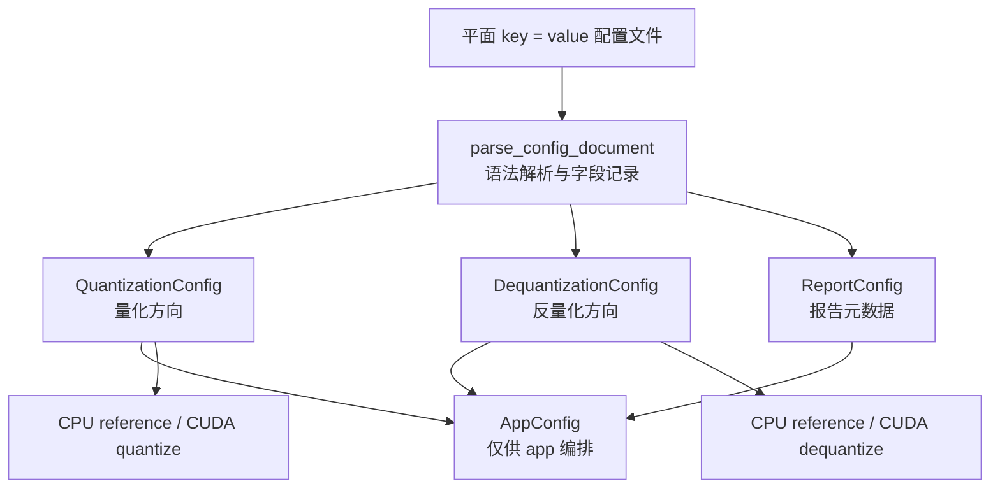

# 配置模块：方向配置、完整 app 配置与解析规则

本项目的配置不是“把一次程序运行涉及的全部参数塞进一个结构体”。量化、反量化和报告属于三个不同的职责：量化不需要知道反量化输出类型，单独反量化也不应被迫填写量化格式。因此，配置模块把**文本配置文件的形式**和**程序内部传递的配置对象**分开设计。

本页说明配置字段、三个配置对象、文本解析规则和读取接口。MXFP8、NVFP4 的数值含义见 [format_spec.md](format_spec.md)；QDTENSOR、QDWGT 的磁盘格式见 [file_format.md](file_format.md)。

## 模块位置与职责

| 位置 | 职责 |
| --- | --- |
| `include/quant_dequant/types.hpp` | 定义 `QuantizationConfig`、`DequantizationConfig`、`ReportConfig`、`AppConfig` 和相关枚举。它们是无 I/O、可在 CPU/CUDA pipeline 间传递的普通值对象。 |
| `include/quant_dequant/config.hpp` | 对外提供三个配置读取接口和 `ConfigError`。app、测试或未来独立工具只应依赖这里。 |
| `src/config/config_parser.cpp` | 实现 `key = value` 文本解析、字段去重、值转换和按方向进行的语义校验。内部的 `ParsedConfigDocument` 不属于公共 API。 |

当前模块**只读取和校验配置**，没有 `write_config(...)` 接口。这是有意的：配置文件通常由用户、实验脚本或命令行生成；程序运行后应把实际配置写入 JSON 性能日志，而不是覆盖用户给定的原始配置。



`AppConfig` 是三个较小配置的组合，不是数值接口的“万能参数”。例如 `quantize_reference()` 只接收 `QuantizationConfig`；它不知道也不需要知道 `output_type` 或 `target_gpu`。

## 三类配置对象

### `QuantizationConfig`

它描述“原始浮点张量如何编码为低精度 payload 与 scale”。当前成员如下：

| 成员 | 类型 | 含义 | 不变量 |
| --- | --- | --- | --- |
| `format` | `QuantFormat` | 目标格式，`kMxfp8` 或 `kNvfp4`。 | 不允许 `kUnknown`。 |
| `block_size` | `uint32_t` | 格式原生 block 的元素数。 | MXFP8 必须是 `32`，NVFP4 必须是 `16`；MXFP8 的 tensor mode 仍保留该固有值。 |
| `scale_mode` | `ScaleMode` | scale 的共享范围。 | MXFP8 可为 `kBlock` 或 `kTensor`；NVFP4 只能为 `kBlock`。 |
| `rounding` | `RoundingMode` | 元素编码的舍入方式。 | 必须是 `kNearest` 或 `kStochastic`。 |
| `stochastic_seed` | `uint64_t` | stochastic rounding 的确定性种子。 | `nearest` 时必须为 `0`；`stochastic` 时允许任意 `uint64_t`，包括 `0`。 |

这里不保存输入 dtype。输入是 FP16 还是 FP32 由 `tensor_role = input` 的
QDTENSOR header 描述，读取后统一转换为 `HostTensor::values` 中的 FP32；这样同一量化配置可复用于 FP16 和 FP32 输入。第一版不接受 BF16 输入；BF16 仅可由反量化阶段作为输出文件的物理类型使用。

### `DequantizationConfig`

它只描述“低精度量化结果应该以何种物理类型写成反量化输出”。

| 成员 | 类型 | 含义 | 合法值 |
| --- | --- | --- | --- |
| `output_type` | `DType` | 反量化后的 QDTENSOR payload dtype。 | `kFloat16`、`kBFloat16`、`kFloat32`。 |

同一份 QDWGT 可以多次读取，并分别输出 FP16、BF16、FP32。因此 `output_type` 不放入 `QuantizedTensor`，也不写成低精度权重自身的数值语义。

### `ReportConfig` 与 `AppConfig`

`ReportConfig` 当前只有 `target_gpu`，它是非空字符串，仅用于报告、日志与实验可复现性说明，不改变量化或反量化的数值结果。

`AppConfig` 将以下对象组合起来：

```cpp
struct AppConfig {
    QuantizationConfig quantization;
    DequantizationConfig dequantization;
    ReportConfig report;
};
```

它仅供 `apps/main.cpp` 这类“从输入到量化、反量化、日志的一次完整运行”使用。数值层应提取其中的 `quantization` 或 `dequantization` 成员，而不是接收整个 `AppConfig`。

## 配置文件字段

配置文件采用平面 `key = value` 形式。值可写成不带引号的标量，也可用双引号包裹；示例中保留引号，便于看清字符串字段。

| 文本字段 | 对应成员 | 可写值 | 含义与限制 |
| --- | --- | --- | --- |
| `format` | `QuantizationConfig::format` | `"mxfp8"`、`"nvfp4"` | 选择目标低精度格式。大小写敏感。 |
| `block_size` | `QuantizationConfig::block_size` | 十进制无符号整数 | MXFP8 只能写 `32`；NVFP4 只能写 `16`。不是“建议默认值”，不匹配即报错。 |
| `scale_mode` | `QuantizationConfig::scale_mode` | MXFP8：`"block"`、`"tensor"`；NVFP4：仅 `"block"` | `block` 表示每行分别分 block 保存 local scale；`tensor` 表示整张矩阵只保存一个 local scale，且仅适用于 MXFP8。 |
| `rounding` | `QuantizationConfig::rounding` | `"nearest"`、`"stochastic"` | 控制元素编码的舍入；scale 自身的编码规则不由该字段改变。 |
| `stochastic_seed` | `QuantizationConfig::stochastic_seed` | 十进制无符号整数，可省略 | 省略时为 `0`。`nearest` 时只能省略或显式写 `0`。 |
| `output_type` | `DequantizationConfig::output_type` | `"fp16"`、`"bf16"`、`"fp32"` | 只决定反量化输出文件的物理 dtype。 |
| `target_gpu` | `ReportConfig::target_gpu` | 非空字符串 | 用于报告说明，例如 `"RTX 4060"`；不参与计算，也不影响 CUDA 架构编译选项。 |

`scale_mode = "block"` 时，block 一律按 row-major 矩阵的**每一行**独立划分；不会跨越行边界。对 `R × C` 矩阵，scale 数量为 $R \times \lceil C / \mathrm{block\_size} \rceil$。MXFP8 使用 32 元素 block，NVFP4 使用 16 元素 block。

## 三种最小配置文件

### 仅量化

适用于将 QDTENSOR 输入写成 QDWGT 的工具或 CPU/CUDA quantize pipeline：

```toml
# mxfp8_quantize.toml
format = "mxfp8"
block_size = 32
scale_mode = "block"
rounding = "nearest"
```

若使用随机舍入，显式提供种子以保证测试可复现：

```toml
format = "mxfp8"
block_size = 32
scale_mode = "block"
rounding = "stochastic"
stochastic_seed = 20260913
```

### 仅反量化

适用于已经存在 QDWGT 文件、只希望输出某种精度张量的工具：

```toml
# dequantize_fp32.toml
output_type = "fp32"
```

不需要 `format`，因为格式、block size、scale mode 和 payload 布局都由 QDWGT header 决定。

### 完整 app

完整 app 在一次运行中连续执行量化、写出低精度权重、反量化和报告，因此需要两侧配置及报告字段：

```toml
# app_mxfp8_block.toml
format = "mxfp8"
block_size = 32
scale_mode = "block"
rounding = "nearest"
output_type = "fp16"
target_gpu = "RTX 4060"
```

同一个完整文件也可以传给单方向 loader。量化 loader 会读取并校验量化字段、忽略其中已知的 `output_type` 和 `target_gpu`；反量化 loader 则只取 `output_type`。这使实验只需维护一份完整配置，同时又不让单方向 API 承担无关字段。

额外已知字段仍会经过基本的文本和值域解析，例如 `format = "fp8"` 依然会被拒绝；但 `load_dequantization_config()` 不会施加“format 与 block_size 必须匹配”这类量化方向的跨字段校验。若要验证整份完整配置，应该调用 `load_app_config()`；若要验证量化配置，应调用 `load_quantization_config()`。

## 读取接口与必填字段

公共头文件是 `include/quant_dequant/config.hpp`。

| 接口 | 返回类型 | 必填字段 | 允许出现但不返回的已知字段 |
| --- | --- | --- | --- |
| `load_quantization_config(path)` | `QuantizationConfig` | `format`、`block_size`、`scale_mode`、`rounding` | `stochastic_seed`、`output_type`、`target_gpu`。 |
| `load_dequantization_config(path)` | `DequantizationConfig` | `output_type` | 量化字段、`stochastic_seed`、`target_gpu`。 |
| `load_app_config(path)` | `AppConfig` | 量化必填字段、`output_type`、`target_gpu` | `stochastic_seed`。 |

调用方式如下：

```cpp
#include <filesystem>

#include "quant_dequant/config.hpp"

const std::filesystem::path config_path{"configs/app_mxfp8_block.toml"};
const quant_dequant::AppConfig app_config =
    quant_dequant::load_app_config(config_path);

// 数值层只取自己真正需要的方向配置。
const quant_dequant::QuantizationConfig quantization =
    app_config.quantization;
const quant_dequant::DequantizationConfig dequantization =
    app_config.dequantization;
```

## 语法与读取流程

解析器并不依赖 TOML 库；虽然示例文件通常使用 `.toml` 扩展名，当前支持的是一个刻意受限的平面 `key = value` 子集。

1. 逐行读取。首行存在 UTF-8 BOM 时会移除；空行会跳过。
2. 删除**引号外**的 `#` 行尾注释，再去除 key 和 value 两端的 ASCII 空白。
3. 在引号外寻找 `=` 分隔符，取得 key 与标量 value。
4. 将七个已知 key 转换到内部对象，同时记录每个字段第一次出现的行号。
5. 根据调用的 public loader，检查该方向的必填字段和跨字段不变量。

例如，下列字符串中的 `#` 是 `target_gpu` 的内容，不是注释：

```toml
target_gpu = "实验机 #2"
```

当前语法边界如下：

- key 不能为空，也不能包含空白。
- 每行必须含有引号外的 `=`；value 不可为空。
- 双引号只能包裹整个 value，必须成对出现；第一版不支持转义序列或字符串内部再出现双引号。
- 未加引号的 value 不能含双引号。
- 整数字段只能是范围内的十进制无符号整数；不接受负数、十六进制或小数。
- 所有已知字段在一份文件中最多出现一次，即使当前 loader 不使用该字段；重复字段会报出首次出现的行号。
- 未知字段会被拒绝，避免拼写错误悄悄改变实验含义。

## 校验失败与 `ConfigError`

任一读取接口遇到文件、语法或语义错误都会抛出 `ConfigError`。异常继承自 `std::runtime_error`，同时保存：

- `filePath()`：出错配置文件的路径；
- `lineNumber()`：从 1 开始的行号。缺少必填字段等不对应单行的错误返回 `0`；
- `what()`：包含路径、可用时的行号和中文诊断信息。

常见错误包括：

| 配置片段 | 错误原因 |
| --- | --- |
| `format = "fp8"` | 当前只支持 `mxfp8` 和 `nvfp4`。 |
| `format = "mxfp8"` 与 `block_size = 16` | format 和 block size 不匹配。 |
| `format = "nvfp4"` 与 `scale_mode = "tensor"` | NVFP4 使用 FP32 global scale 加每个 16 元素 block 的 E4M3 local scale，只支持 block mode。 |
| `rounding = "nearest"` 与 `stochastic_seed = 1` | nearest 没有随机过程，seed 必须是 0。 |
| `output_type = "int8"` | 反量化输出仅支持 FP16、BF16、FP32。 |
| `target_gpu = ""` | 完整 app 的报告字段不能是空字符串。 |
| 同一字段写两次 | 配置语义不明确，解析器拒绝重复 key。 |

## 配置模块与其他模块的边界

- 配置模块不读取 QDTENSOR 或 QDWGT；这属于 `tensor_io` 与 `quantized_io`。
- `QuantizationConfig` 不承载矩阵形状、输入 dtype 或 quantized payload；这些数据分别属于 `TensorDesc`、`HostTensor` 与 `QuantizedTensor`。输入 dtype 由 QDTENSOR header 提供，且第一版只能是 FP16 或 FP32。
- `DequantizationConfig::output_type` 不改变 QDWGT 的解释方式，只决定反量化后的 QDTENSOR 如何落盘；合法输出类型是 FP16、BF16 或 FP32。
- `target_gpu` 是报告元数据；实际 CUDA 架构由 CMake preset 的 `QUANT_DEQUANT_CUDA_ARCHITECTURES` 控制。当前 RTX 4060 preset 使用 `89`。

这条边界使单独的 CPU reference、未来 CUDA pipeline、文件 I/O 与 app 编排都能重用同一份方向配置，而不会互相引入不必要的依赖。
