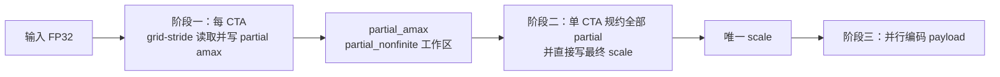
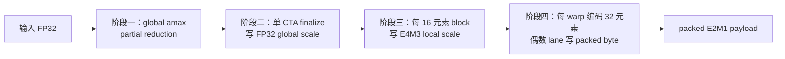

# MXFP8 与 NVFP4 CUDA kernel 设计

本文解释 `src/cuda/` 中量化和反量化 kernel 的**执行映射、数据流与设计原因**。
它关注“一个 CTA、warp、lane 到底处理什么”和“为什么某些 scale 必须走两阶段规约”；
E4M3、E8M0、E2M1 的单元素数值规则见 [format_codecs.md](format_codecs.md)，
文件布局见 [file_format.md](file_format.md)。

## 源文件与入口

| 文件 | host launcher | device kernel | 输入与输出 | 用途 |
| --- | --- | --- | --- | --- |
| `mxfp8_quantize.cu` | `launch_mxfp8_block_quantize()`、`launch_mxfp8_tensor_quantize()` | block 量化、partial amax、finalize、tensor 编码 | FP32 → E4M3 payload + E8M0 scale | 按 `scale_mode` 分别实现 MXFP8 两条量化路径。 |
| `mxfp8_dequantize.cu` | `launch_mxfp8_dequantize()` | `mxfp8DequantizeKernel` | E4M3 + E8M0 → FP32 | 统一处理 MXFP8 block/tensor 两种 scale 索引。 |
| `nvfp4_quantize.cu` | `launch_nvfp4_block_quantize()` | global partial/finalize、local scale、packed encode | FP32 → packed E2M1 + E4M3 local + FP32 global | 实现严格 NVFP4 的双层 scale 与真实 4-bit 写入。 |
| `nvfp4_dequantize.cu` | `launch_nvfp4_dequantize()` | `nvfp4DequantizeKernel` | packed E2M1 + 两层 scale → FP32 | 每线程解一个物理 payload byte。 |

所有 launcher 都接收 `DeviceQuantizationInput`、`DeviceQuantizedTensor` 或
`DeviceDequantizationOutput`。它们由 `src/pipeline/` 使用 `thrust::device_vector`
拥有 device 内存；launcher 只用 `thrust::raw_pointer_cast()` 取得非拥有的 raw device
pointer，因此不会在 kernel 发射点重复进行 H2D/D2H。

## 共同执行模型

### 线性下标、rowwise block 与 scale 下标

对 row-major 的 $R\times C$ 矩阵，元素 $(r,c)$ 的全局线性下标是
$n=rC+c$。block mode 不跨行分块：

$$
\mathrm{blocks\_per\_row}=\left\lceil\frac{C}{B}\right\rceil,
\qquad
\mathrm{scale\_index}=r\cdot\mathrm{blocks\_per\_row}+\left\lfloor\frac{c}{B}\right\rfloor.
$$

MXFP8 使用 $B=32$；NVFP4 使用 $B=16$。尾 block 的无效 lane 不读 global memory，
只把数值零贡献给 `amax` 规约，因此不会改变有效元素的结果。

### CTA、warp 与持久化 grid

量化 kernel 的 CTA 都固定为 256 线程，即 8 个 warp。反量化 kernel 也使用 256 线程。
大张量不会为每个逻辑工作项发射一个 CTA，而使用 **persistent grid（持久化网格）**：

- launcher 查询当前 GPU 的 SM 数，目标为每 SM 最多 4 个常驻 CTA；
- MXFP8 block 与 NVFP4 local-scale 路径额外用 occupancy API 取
  `min(4, 实际可驻留 CTA/SM)`，避免超过寄存器或架构资源上限；
- 小问题只发射足够覆盖首轮工作量的 CTA；大问题发射有限 CTA，kernel 内用 grid-stride
  循环持续处理后续元素、block 或 payload byte。

这降低了大量小 CTA 的调度开销，同时让所有 SM 有持续工作。`SM × 4` 是启发式，不是
对任何 GPU 都最优的常数。

### CUDA stream 与计时边界

`quantize_*_cuda_profiled()` 和 `dequantize_*_cuda_profiled()` 每次调用创建独占的
non-blocking stream。执行顺序为：

```text
H2D → CUDA Event start → 本文列出的全部 kernel → CUDA Event stop → D2H
```

同一 stream 中不同 kernel 按发射顺序执行：例如 finalize kernel 写出的 scale，对后续
encode kernel 已可见，不需要 host 同步。Event 时间只覆盖 kernel，不包括 device 分配、
H2D、D2H、文件 I/O 与 CUDA context 初始化。

### 非有限输入的联合规约

`amax` 不能只规约 `float max`：NaN 可能被最大值逻辑静默忽略。因此 tensor/global 规约
使用 `TensorAmaxState`：

```text
{ amax: 当前有限元素的最大绝对值,
  has_nonfinite: 是否见过 NaN、+Inf 或 -Inf }
```

每个 warp 用 `__shfl_down_sync()` 规约两项；一个 CTA 的 8 个 warp 各由 lane 0 写一项
shared memory，warp 0 再规约这 8 项。最终 `has_nonfinite != 0` 时写入格式的 NaN 哨兵，
pipeline 在 D2H 后将其转为量化失败。正常 API 不会为非有限输入生成可用 QDWGT。

## 为什么 tensor scale 必须两阶段规约

一个普通 CUDA kernel 内可以同步同一 CTA 的线程，却不能同步不同 CTA。若 tensor mode
的多个 CTA 各自得到 `partial_amax`，它们不能在同一发射中安全地决定同一个最终 scale。
因此路径必须分为：



阶段一采用 `float4` 加载：连续线程读取连续的 16-byte 向量，减少循环次数并维持 warp
合并访存。不能整除 4 的最后 1–3 项改为标量 grid-stride 加载，避免越界读取。

第二阶段只有一个 256-thread CTA。每个线程以 block-stride 读取多个 partial，随后复用
warp-shuffle + shared-memory CTA 规约；thread 0 直接调用格式 codec 写最终 scale。这样
不必再额外发射“只写 scale”的第三个规约 kernel。

`DeviceTensorQuantizationWorkspace` 持有 `partial_amax` 与 `partial_nonfinite` 两个
device 数组，其长度等于第一阶段的 persistent CTA 数。workspace 的生命周期覆盖全部
规约与编码 kernel。

## MXFP8 量化

MXFP8 payload 是每元素一个 E4M3 byte，scale 是 E8M0 byte。它支持题目要求的
`scale_mode = block` 与项目扩展的 `scale_mode = tensor`，但两者的 kernel 路径不同。

### block mode：一个 warp 完成一个 32 元素 block

`mxfp8BlockQuantizeKernel` 的映射恰好匹配 MXFP8 block 大小：一个 warp 的 32 个 lane
对应一个 rowwise 32 元素量化 block。

| 对象 | 映射 |
| --- | --- |
| CTA | 256 threads = 8 warp，同时处理 8 个逻辑 MXFP8 block。 |
| warp | 一个 32 元素 rowwise quantization block。 |
| lane `l` | block 中列偏移 `l` 的一个元素。 |
| `local_scales[quant_block]` | 该 warp 处理 block 的唯一 E8M0 scale。 |
| `payload[linear_index]` | 有效 lane 写自己的 E4M3 byte。 |

第一个 block 编号为：

$$
\mathrm{quant\_block}=\mathrm{blockIdx.x}\times8+\mathrm{warp\_id}.
$$

完成后同一 warp 以步长 `gridDim.x × 8` 继续领取后续 block。其一轮工作如下：

1. 每个有效 lane 加载一个 FP32；尾 block 中无效 lane 使用 `0.0F` 且不访问输入。
2. `__ballot_sync()` 汇总非有限 lane。若存在，lane 0 写 `0xff` E8M0 NaN scale 并让整个
   warp 进入下一 block；不会写有意义的 payload。
3. 所有 lane 使用 `__shfl_down_sync()` 做树形最大值规约；lane 0 得到该 block 的 `amax`。
4. lane 0 调用 `compute_mxfp8_scale_code(amax)`，写 E8M0 scale；再用 `__shfl_sync()`
   广播给全 warp。
5. 每个有效 lane 按自己的全局线性下标产生 stochastic 随机数（RNE 时为 0），调用
   `encode_mxfp8_element()`，独占写一个 payload byte。

规约、scale 写入、广播与 E4M3 编码都在一个 warp 内完成，不需要 shared memory、CTA
同步或跨 CTA 通信。这是 block mode 能用一个融合 kernel 的根本原因。

### tensor mode：两阶段 global amax 加独立编码

`mxfp8TensorAmaxPartialKernel`、`mxfp8TensorScaleFinalizeKernel` 和
`mxfp8TensorEncodeKernel` 依次执行：

| 阶段 | kernel | 每个 CTA/线程处理 | 写入 |
| --- | --- | --- | --- |
| 1 | `mxfp8TensorAmaxPartialKernel` | 每线程 grid-stride 遍历多个 `float4` 与尾部标量元素 | 一项 `partial_amax[blockIdx.x]` 与非有限标记。 |
| 2 | `mxfp8TensorScaleFinalizeKernel` | 一个 CTA 的线程分担全部 partial | `local_scales[0]` 的唯一 E8M0 scale。 |
| 3 | `mxfp8TensorEncodeKernel` | 每线程 grid-stride 遍历多个线性元素 | 每元素一个 E4M3 payload byte。 |

阶段 2 在同一个 kernel 内完成最终规约**并**写 `local_scales[0]`。阶段 3 的每个 CTA
只需读取该下标 0 的 scale，不再有 scale 索引分支。若阶段 2 写 `0xff` 非有限哨兵，阶段
3 直接返回，不产生表面上可用的 payload。

因此 MXFP8 的 tensor mode 不可能像 block mode 那样把 scale 与编码融合：在进入编码前，
所有 CTA 都必须看见同一份全局 amax 的结果。

## MXFP8 反量化

`mxfp8DequantizeKernel` 使用一维 persistent grid-stride 映射；一个线程处理一个或多个
逻辑元素。它不需要规约，也没有元素间写冲突。

对每个 `linear_index`，kernel 恢复 $(row,column)$，再选择 scale：

$$
\mathrm{scale\_index}=
\begin{cases}
0, & \mathrm{tensor\ mode}, \\
row\cdot\mathrm{blocks\_per\_row}+\lfloor column/32\rfloor,
& \mathrm{block\ mode}.
\end{cases}
$$

随后调用 `decode_mxfp8_element(payload[index], local_scales[scale_index])`。相邻线程读取
连续 payload 与写连续 FP32 output；block mode 虽多了一次 scale 索引计算，元素级解码
公式完全相同，所以两种 mode 可以共用一个 kernel。

## NVFP4 量化

NVFP4 只支持 `scale_mode = block`，但它仍然需要整张张量的 FP32 `global_scale`，再为
每个 rowwise 16 元素 block 计算 E4M3 `local_scale`。所以它的完整量化流程是四个 kernel：



### global scale：仍是两阶段规约

`nvfp4TensorAmaxPartialKernel` 与 `nvfp4GlobalScaleFinalizeKernel` 的规约结构和 MXFP8
tensor mode 相同：`float4` grid-stride 加载、warp shuffle、8 项 shared memory、warp 0
finalize。区别只在最后写入：

$$
global\_scale=\frac{amax_{tensor}}{448\times6}.
$$

finalize 的 thread 0 调用 `compute_nvfp4_global_scale()`，写出一个 FP32 decode-direction
`global_scale[0]`。即使 NVFP4 不接受 tensor mode，也无法省掉这两阶段：它的 local scale
必须以全张量范围为参考。

### local scale：16-lane Cooperative Group tile

`nvfp4LocalScaleKernel` 每 CTA 有 256 线程。它用
`cooperative_groups::tiled_partition<16>()` 切成 16 个 `thread_block_tile<16>`；因此每个
物理 warp 同时容纳两个独立的 NVFP4 16 元素 block。

| 对象 | 映射 |
| --- | --- |
| CTA | 16 个 16-lane tile，同时首轮处理 16 个逻辑 NVFP4 block。 |
| tile | 一个 rowwise 16 元素 block。 |
| tile lane | block 内一个元素，或尾 block 的无效零贡献。 |
| `local_scales[quant_block]` | tile lane 0 写的 E4M3 local scale。 |

每个 tile 以 `tile.shfl_down()` 做 16-lane `amax` 和非有限标记规约；tile lane 0 调用
`compute_nvfp4_local_scale_code(block_amax, global_scale[0])`。使用 Cooperative Groups 的
好处是 16-lane 子组的同步与 shuffle 语义写在类型中，不必手写 half-warp mask。

该 kernel 与 packed encode 分开，原因不仅是 scale 必须先可见：一个物理 payload byte
可能装两个相邻元素，而在奇数列矩阵中这两个元素还可能跨行。若让两个 16 元素 block
边计算 scale 边以不同线程写 nibble，会产生同一 byte 的 read-modify-write 竞争。

### packed encode：一个 warp 处理 32 个连续元素

`nvfp4PackedEncodeKernel` 重新使用 `thread_block_tile<32>`。每 warp 处理连续 32 个**线性**
元素，而不是一行内固定 32 列；这样跨行时 payload 配对仍遵守 row-major 线性布局。

1. lane `l` 的元素下标是 `first_linear_index + l`，恢复各自的 `(row,column)`，以
   `row × blocks_per_row + column / 16` 读取所属 local scale。
2. 每个有效 lane 调用 `encode_nvfp4_element()`，得到自己的 E2M1 nibble。尾 warp 无效
   lane 初始化为零 code。
3. 所有 lane 参加 `warp.shfl()`。偶数 lane 从紧随的奇数 lane 取得 partner nibble；
   奇数 lane 虽不写，也必须参加这次 collective 操作。
4. 只有偶数 lane 写
   `payload[linear_index / 2] = pack_e2m1_nibbles(own_code, partner_code)`。

这样一个 payload byte 永远只有一个写者，没有 `atomic`，也没有两个线程对同一 byte 的
read-modify-write 竞争。最后一个逻辑元素无 partner 时，无效奇数 lane 提供零，最终 high
nibble 自然清零。

## NVFP4 反量化

`nvfp4DequantizeKernel` 选择“一个线程对应一个**物理 payload byte**”，而不是一个线程
对应一个 nibble：

- thread 读取 `payload[payload_index]` 一次；
- low nibble 对应 `even_index = 2 × payload_index`，必定有效；
- high nibble 对应 `odd_index = even_index + 1`，仅当小于 `element_count` 时解码；
- 两个逻辑元素分别恢复自己的 `(row,column)` 与 local-scale 下标，再乘同一个
  `global_scale[0]`。

最后一点必须分开计算。若列数为奇数，一个 byte 的 even/odd 元素会分属相邻两行，甚至
落在不同的 16 元素 block；它们共享 payload byte，却不一定共享 `local_scale`。每线程
独占 byte 既避免重复读取，也自然保证最后 padding high nibble 不会写到输出。

## 访存、同步和正确性边界

| 场景 | 访存/同步选择 | 原因 |
| --- | --- | --- |
| tensor/global `amax` 第一阶段 | 连续 `float4` load + grid-stride | 合并访存，固定 CTA 数也能覆盖大张量。 |
| CTA 级规约 | warp shuffle → 每 warp 一项 shared memory → warp 0 | 大部分规约不需要 shared memory；只用 8 项 shared memory 跨 warp 汇合。 |
| MXFP8 block amax | 仅 warp shuffle | 32 元素 block 恰为一个完整 warp，不需要 CTA 同步。 |
| NVFP4 local amax | `thread_block_tile<16>` shuffle | 16 元素 block 小于 warp，CG 明确表达两个 half-warp 子组。 |
| NVFP4 packed store | 偶数 lane 独占整字节 store | 两个 nibble 共享 byte，避免写竞争。 |
| 反量化 | 一维 grid-stride，无 shared memory | 每个元素或 byte 相互独立，无规约、无跨线程通信。 |

所有 launcher 在发射后调用 `cudaGetLastError()` 检查参数与 launch 错误；它不等待
kernel 完成。异步执行期错误会在同一 stream 的 D2H 或显式 `stream.synchronize()` 时上报，
从而不在每一次 kernel 后插入不必要的全局同步。

## 路径选择速查

| 格式与 mode | 是否需全局两阶段规约 | 是否需 block-local 规约 | 量化 kernel 数 | 反量化线程粒度 |
| --- | ---: | ---: | ---: | --- |
| MXFP8 block | 否 | 是，warp 内 32-lane | 1 | 一个线程一个 E4M3 元素。 |
| MXFP8 tensor | 是，写唯一 E8M0 scale | 否 | 3 | 一个线程一个 E4M3 元素。 |
| NVFP4 block | 是，写 FP32 global scale | 是，16-lane tile 写 E4M3 local scale | 4 | 一个线程一个 packed byte、最多两个 E2M1 元素。 |
| NVFP4 tensor | 不支持 | 不适用 | 0 | 不适用。 |

在所有路径中，实际 FP16/BF16/FP32 输出的窄化不放在反量化 kernel 内：kernel 和
`HostTensor::values` 始终使用 FP32，之后由 QDTENSOR I/O 按 `output_type` 写为目标物理
dtype。这使同一个 CUDA 解码 kernel 能服务三种输出类型，也让误差统计可以明确包含最终
落盘窄化造成的误差。

## 建议的源码阅读顺序

1. 读 `mxfp8BlockQuantizeKernel`，理解最简单的“一个 warp = 一个 32 元素 block”融合路径。
2. 读 `TensorAmaxState`、`warp_reduce_tensor_amax()` 和 `block_reduce_tensor_amax()`，再读
   MXFP8 tensor mode 的三段 kernel。
3. 读 `mxfp8DequantizeKernel`，理解反量化为何只差一个 scale 索引公式。
4. 读 NVFP4 的 global reduction；它和 MXFP8 tensor mode 结构相同，但最终写 FP32 global
   scale。
5. 读 `nvfp4LocalScaleKernel` 的 16-lane tile，然后读 `nvfp4PackedEncodeKernel` 的
   32-lane packing，重点关注“为什么偶数 lane 才写 byte”。
6. 最后读 `nvfp4DequantizeKernel`，用奇数列、奇数元素数的例子验证它为何分别计算两个
   nibble 的 local-scale 下标。
