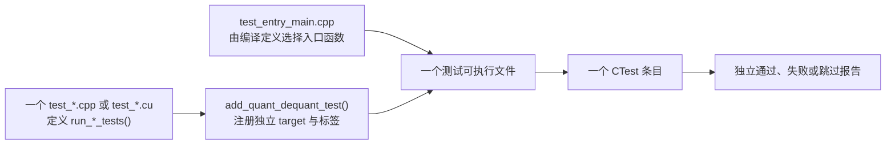

# 测试体系：CTest 条目、标签与新增测试约定

本项目使用 **CMake + CTest** 管理测试，但不依赖 GoogleTest 等第三方框架。每个
`test_*.cpp` 或 `test_*.cu` 文件定义一个 `run_*_tests()` 函数；CMake 为它构建一
个独立可执行文件并注册一个独立 CTest 条目。这样失败报告的最小单位是一个模块，
而不是过去的单个聚合测试进程。

数值格式、scale 和舍入的真值规则见 [format_spec.md](format_spec.md)，QDTENSOR /
QDWGT 的文件边界见 [file_format.md](file_format.md)。本文只说明“如何组织、运行和
扩展测试”。

## 测试执行模型



`tests/test_entry_main.cpp` 不包含业务测试逻辑。CMake 为每个 target 定义
`QUANT_DEQUANT_TEST_ENTRY=run_xxx_tests`，通用入口据此调用目标函数并把其退出码
返回给 CTest。

这种设计有两个直接结果：

- 一个测试失败不会掩盖其他模块的结果；CTest 输出会直接给出失败 target 名称。
- 可以通过名称或标签只运行某一格式、某一层，尤其适合 CUDA kernel 的迭代调试。

代价是每个测试 target 都要单独链接一次 `quant_dequant::core`。对于当前以正确性
和学习为主的小项目，这个编译时间代价换来了更清晰的隔离和诊断。

## 当前测试清单

| CTest 条目 | 源文件 | 标签 | 主要验证内容 |
| --- | --- | --- | --- |
| `quant_dequant_config_tests` | `test_config.cpp` | `unit`, `config` | key-value 配置解析、默认值、非法格式/scale 组合。 |
| `quant_dequant_tensor_io_tests` | `test_tensor_io.cpp` | `unit`, `io` | QDTENSOR 的 FP16/FP32 输入读取、FP16/BF16/FP32 输出写入与读回、role 隔离和损坏文件拒绝。 |
| `quant_dequant_quantized_io_tests` | `test_quantized_io.cpp` | `unit`, `io` | QDWGT round-trip、header、section 对齐与非法文件拒绝。 |
| `quant_dequant_quantized_tensor_tests` | `test_quantized_tensor.cpp` | `unit`, `model` | `QuantizedTensor` 的 payload、local scale、global scale 元数据不变量。 |
| `quant_dequant_metrics_tests` | `test_metrics.cpp` | `unit`, `metrics` | 误差、逻辑字节、压缩率、带宽、JSON null/转义、0 ms CUDA Event 边界与实际报告文件写入。 |
| `quant_dequant_reference_dispatch_tests` | `test_reference_dispatch.cpp` | `unit`, `reference` | CPU reference 的输入校验和 MXFP8/NVFP4 格式派发。 |
| `quant_dequant_mxfp8_reference_tests` | `test_mxfp8_reference.cpp` | `unit`, `reference`, `mxfp8` | MXFP8 CPU 量化、反量化、scale 与文件 round-trip。 |
| `quant_dequant_nvfp4_reference_tests` | `test_nvfp4_reference.cpp` | `unit`, `reference`, `nvfp4` | NVFP4 双层 scale、跨行 packed byte、CPU 反量化。 |
| `quant_dequant_mxfp8_codec_tests` | `test_mxfp8_codec.cu` | `unit`, `codec`, `mxfp8`, `cuda` | E4M3/E8M0 位编码、边界与 host/device codec 一致性。 |
| `quant_dequant_nvfp4_codec_tests` | `test_nvfp4_codec.cu` | `unit`, `codec`, `nvfp4`, `cuda` | E2M1 codebook、E4M3 local scale、nibble 打包与解包。 |
| `quant_dequant_cuda_dispatch_tests` | `test_cuda_dispatch.cpp` | `integration`, `cuda` | CUDA pipeline 公共入口的格式派发与异常边界。 |
| `quant_dequant_device_quantized_tensor_tests` | `test_device_quantized_tensor.cu` | `integration`, `cuda` | Thrust device buffer 的长度、格式不变量和 move-only 生命周期。 |
| `quant_dequant_cuda_timer_tests` | `test_cuda_timer.cu` | `integration`, `cuda`, `common` | non-blocking `CudaStream` 的 RAII 生命周期，以及绑定该 stream 的 CUDA Event 计时器状态机、复用和无 GPU 跳过语义。 |
| `quant_dequant_cuda_profile_tests` | `test_cuda_profile.cu` | `integration`, `cuda`, `profile`, `mxfp8` | `*_cuda_profiled()` 的 H2D → event → kernel → D2H 时序、`kernel_ms` 有效性和 MXFP8 tensor-scale CPU reference 端到端对照。 |
| `quant_dequant_mxfp8_cuda_tests` | `test_mxfp8_cuda.cu` | `integration`, `cuda`, `mxfp8` | MXFP8 CUDA 量化与 CPU reference 的 payload/scale 对照。 |
| `quant_dequant_mxfp8_dequantize_cuda_tests` | `test_mxfp8_dequantize_cuda.cu` | `integration`, `cuda`, `mxfp8` | MXFP8 CUDA 反量化与 CPU reference 的数值、输出 dtype 对照。 |
| `quant_dequant_nvfp4_cuda_tests` | `test_nvfp4_cuda.cu` | `integration`, `cuda`, `nvfp4` | NVFP4 CUDA 量化的 packed payload、local/global scale 对照。 |
| `quant_dequant_nvfp4_dequantize_cuda_tests` | `test_nvfp4_dequantize_cuda.cu` | `integration`, `cuda`, `nvfp4` | NVFP4 packed load/解包、跨行 nibble scale 索引和三种输出 dtype 对照。 |

## 构建与运行

以下命令均在 `02_quant_dequant/黄新颖` 目录执行。RTX 4060 使用 SM89，因此选择
`rtx4060-debug` 或 `rtx4060-release` preset。

```shell
cmake --preset rtx4060-debug
cmake --build --preset rtx4060-debug -j

# 运行全部 CTest 条目；失败时打印对应进程的输出。
ctest --preset rtx4060-debug --output-on-failure
```

先查看可用条目和编号：

```shell
ctest --preset rtx4060-debug -N
```

### 按名称运行

`-R` 接收正则表达式。使用首尾锚点可确保只命中一个完整测试名：

```shell
ctest --preset rtx4060-debug \
  -R '^quant_dequant_nvfp4_dequantize_cuda_tests$' \
  --output-on-failure
```

### 按标签运行

`-L` 以正则表达式匹配标签。多次提供 `-L` 时，CTest 只保留同时匹配所有表达式的
测试，因此可以准确取交集：

```shell
# 所有确实会进入 CUDA pipeline 或 device codec 的测试。
ctest --preset rtx4060-debug -L cuda --output-on-failure

# 只运行 NVFP4 的 CUDA 测试。
ctest --preset rtx4060-debug -L cuda -L nvfp4 --output-on-failure

# 不需要实际 CUDA device 的 host unit 测试。
ctest --preset rtx4060-debug -L unit --output-on-failure

# 仅运行文件格式 I/O 测试。
ctest --preset rtx4060-debug -L io --output-on-failure
```

当前标签含义如下：

| 标签 | 含义 |
| --- | --- |
| `unit` | 单模块正确性测试；通常不需要实际 GPU。 |
| `integration` | 跨越 public API、Thrust device buffer 或 pipeline 的测试。 |
| `cuda` | 编译 CUDA device 代码或测试 CUDA pipeline 的测试。 |
| `config`、`io`、`codec`、`reference`、`model`、`metrics`、`common`、`profile` | 按实现层筛选。 |
| `mxfp8`、`nvfp4` | 按低精度格式筛选。 |

## CUDA 可用性与跳过语义

项目必须能在没有 NVIDIA driver 或没有 GPU 的普通开发/CI 环境中执行 host 测试。
因此 CUDA 测试自身先调用 `cudaGetDeviceCount()`：

- 返回 `cudaErrorNoDevice`、`cudaErrorInsufficientDriver` 或 device 数量为零时，
  测试打印“跳过”说明并以退出码 `0` 结束。
- 其他 CUDA runtime 错误视为真正失败，测试返回非零。
- 在 RTX 4060 上，CUDA 对照测试会实际分配 device buffer、发射 kernel，并将结果
  与 CPU reference 比较。

这表示“CTest 通过”至少说明 host 路径和 CUDA 编译/链接正确；只有在可用 GPU 上
通过 `cuda` 标签测试，才能说明实际 kernel 数值路径也已经执行并通过。

## CUDA kernel 计时边界

`quantize_cuda_profiled()` 与 `dequantize_cuda_profiled()` 为一次调用创建独占的
non-blocking `CudaStream`。操作提交顺序固定如下：

```text
H2D 拷贝 → start event → 量化或反量化的全部 kernel → stop event → D2H 拷贝 → 同步 host
```

同一条 stream 保证 start event 先等待 H2D、stop event 后等待全部 kernel；读取
elapsed time 时同步的是 stop event，因而 `kernel_ms` 是两个 event 间的 device 时间。
它不包括 H2D/D2H、Thrust 容器分配、CPU 配置校验、QDTENSOR/QDWGT 文件 I/O，也不包括
首次使用 CUDA 时的 context 初始化。极短 kernel 可能因 CUDA Event 分辨率得到 `0.0 ms`，
这是合法计时值；实际性能报告宜对足够大的矩阵或多次迭代取统计量。

## 新增测试的约定

新增一个功能时，优先让测试文件与被测模块对应。当前 `metrics` 已遵循这一规则，
由 `tests/test_metrics.cpp` 单独覆盖；未来的新模块也不要把断言塞入无关的 I/O 或
reference 测试中。

1. 在测试源中定义一个返回进程退出码的函数：

   ```cpp
   /** @brief 运行 metrics 模块的正确性测试。 */
   int run_metrics_tests() {
       // 成功返回 0；失败打印可定位诊断并返回非零。
       return 0;
   }
   ```

2. 在 `tests/CMakeLists.txt` 中注册一个独立 target；标签应同时表达层级和格式：

   ```cmake
   add_quant_dequant_test(quant_dequant_metrics_tests
       test_metrics.cpp run_metrics_tests "unit;metrics")
   ```

3. 数值格式 kernel 必须与 CPU reference 对照。测试至少覆盖典型值、零、最大有限
   值、尾 block 和异常输入；NVFP4 还要覆盖奇数元素导致的 tail nibble 与奇数列
   导致的跨行 packed byte。

4. 测试所需的小型二进制样例可以放在 `tests/data/` 并提交 Git；运行生成的大型
   `.bin`、日志和临时输出应写到构建目录或 `outputs/`，继续由 `.gitignore` 排除。

## 诊断顺序

出现失败时，建议按下面的范围逐步缩小：

1. `ctest -R '^具体失败测试名$' --output-on-failure` 复现单项。
2. 位编码、scale、nibble 问题先跑 `codec`，再跑对应的 `reference`。
3. CPU reference 已正确而 CUDA 对照失败时，再运行 `-L cuda -L mxfp8` 或
   `-L cuda -L nvfp4`，检查 H2D、kernel 索引、D2H 和 CPU/GPU 比较诊断。
4. 文件问题先运行 `-L io`；不要用 CUDA 测试来排查 QDTENSOR/QDWGT header。

这样的顺序从无状态数值规则逐步扩展到矩阵流程、文件边界和 device 执行，能避免
一次调试同时混入格式、I/O 与 CUDA 三类问题。
