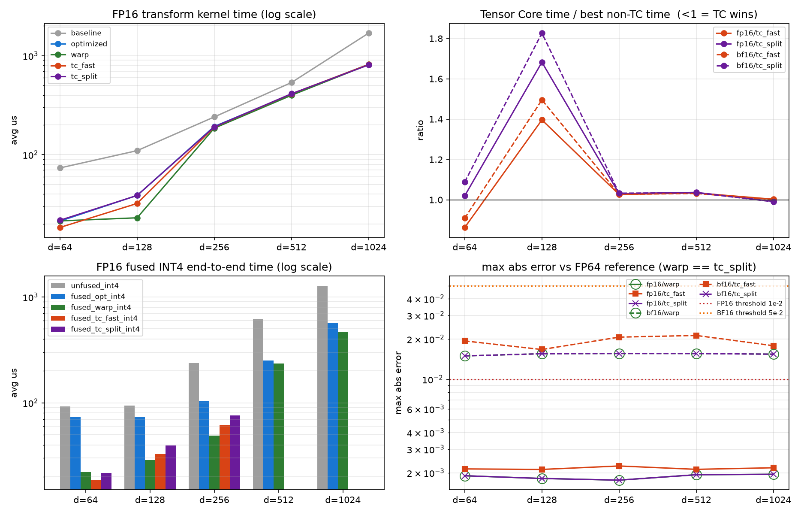

# Tensor Core Hadamard 变换（选题三·进阶项）

> **当前状态摘要。** 完整口径、验收方法与全部实验记录见
> [项目技术报告](../docs/final_report.md)；本文件只讲 Tensor Core 分支自身的
> 算法、构建与结果。
>
> - **严格验收**：参考为 Dao v1.1.0 全张量低精度输出，固定绝对误差
>   （FP16 `<0.01`、BF16 `<0.05`）。132 配置矩阵下 `warp` 为 132/132、误差 0；
>   `tc_fast` 为 96/132、`tc_split` 为 121/132 —— **TC 不能作为普遍合规的替代**。
>   历史的相对误差通过（`PASS(rel)`）不计为验收。
> - **可选调优组合**：`make -C tensor_core h200-tuned`。H200 上相对**各自原配置**，
>   d=64 warp 1.54×，d=128 TC fast/split 1.29×/1.43×，d=256 split 1.47×。
>   这不是对 warp 的加速：d=128 的 warp 仍快于两条 TC 路径。
> - **显式 PTX**（`make -C tensor_core mma-experiment`）：C→B 寄存器重排不经
>   shared memory，L40S d=64 FP16 fast/split 相对向量化 WMMA 快 1.30×/1.41×，
>   但 108 配置严格验收仍是 84/108、101/108。**速度提升不等于数值问题已解决**；
>   该实验未接入默认路径，也没有 TC 融合量化。
> - **精度实验**：`MMA_PRECISION=2` 三段残差为 107/108；`MMA_PRECISION=3`
>   保护式 **split** 达到 108/108 并通过 192 项压力测试，**但慢于 warp**，
>   因此保持非默认。该开关不保护 fast 模式。
> - **benchmark 接口**：提供 `--input_bin`、`--reference_bin`、`--dump_dir`；
>   `validate_tc.py` 明确区分参考库与独立 CPU 参考。
>
> [最终表格与 Roofline](results/verify_17251073/final_library/summary.md)

本目录是主项目 [`FastHadamard-CUDA`](../README.md) 的 Tensor Core 实验分支，对应
项目文档 “选题三 · Hadamard 变换加速” 中的两条要求：

> 2. TensorCore：可使用 TensorCore 进行加速。
>    a. 进阶：和未使用 TensorCore 加速的实现进行对比（Note：实现算法不一定相同）。

以及 “当融合量化时，需验证量化后的结果与先变换后量化的结果一致”。

目录**不修改**主项目已验收的 baseline / 9.1 optimized / 9.2 fused INT4 路径，
而是链接主项目的 `src/hadamard.cu`、`src/hadamard_warp.cu`，在同一块 GPU、同一次
调度、同一套 CUDA Event 计时边界下与 Tensor Core 版本一起评测。

---

## 1. 为什么不能直接把 `H_d @ x` 丢给 Tensor Core

最直觉的做法是把 Hadamard 变换写成稠密矩阵乘 `Y = X @ H_d^T`，让 Tensor Core 去
算。这条路是错的：FHT 的复杂度是 `O(d log d)`，稠密 GEMM 是 `O(d^2)`。d=256 时
每 token 的算术量会从 2048 次加减涨到 65536 次乘加，涨 32 倍。Tensor Core 的峰值
算力相对 FP32 SIMT 大约是 8–16 倍，补不回这 32 倍，而且 FHT 本身是访存受限的
（主项目实测逻辑算术强度只有 1.5–2.0 FLOP/B），加计算量并不能换来时间。

所以 Tensor Core 版本必须换算法，而不是换后端。

## 2. 本实现使用的算法：Kronecker 分块 + 两次 16x16 WMMA

Sylvester 型 Hadamard 矩阵满足 Kronecker 递归：

```text
H_{a*b} = H_a (kron) H_b
```

取 `b = 16`（正好是 WMMA `m16n16k16` 的形状），对 `d >= 64` 有

```text
H_d = H_{d/16} (kron) H_16
```

把一个 token 的 d 个元素按 row-major 摆成 `(d/16) x 16` 的矩阵 `X`，
即 `j = 16*rr + c`，则

```text
y[16*rr+c] = sum_{rr',c'} H_{d/16}[rr,rr'] * H_16[c,c'] * x[16*rr'+c']
           ==>  Y = H_{d/16} @ X @ H_16^T        (H_16 对称，H_16^T = H_16)
```

**关键工程取舍**：为了让每次 mma 都吃满 16x16x16，本实现固定 “一个 warp 处理
256 个连续元素（恰好一个 16x16 tile）”，而不是固定 “一个 warp 处理一个 token”：

| head_dim | 一个 tile 的内容 | 左乘常量矩阵 `A` |
|---:|---|---|
| 64  | 4 个 token，每 4 行一个 | `I_4 (kron) H_4` |
| 128 | 2 个 token，每 8 行一个 | `I_2 (kron) H_8` |
| 256 | 1 个 token，16 行 | `H_16` |
| 512 / 1024 | 一个 token 跨 2 / 4 个 tile | `H_16` |

即左乘因子统一写成块对角常量矩阵 `A = I_k (kron) H_m`（`m = min(d,256)/16`,
`k = 16/m`），于是**任何 head_dim 都归约成同一个两步计算**：

```text
P = X @ H_16     第 1 次 mma：X 是原始低精度输入，FP32 累加
Y = A @ P        第 2 次 mma
```

`d = 512/1024` 时一个 token 跨 `d/256` 个 tile，对应 `H_d = H_{d/256} (kron) H_256`：
先在每个 tile 内做上面两步，再对 accumulator **逐元素**做 `log2(d/256)` 级蝶形。
同一 fragment 类型的第 `e` 个元素在各 tile 中对应相同的 `(row, col)`，所以这一级
完全在寄存器里完成，不需要额外的 shared memory 往返。

单 token 的乘加次数：`d/16 * 16 * 16 * 2 = 32d` 次（两次 mma 各 `d*16` MAC）。
对 d=256 是 8192 MAC，比 FHT 的 2048 次加减多，但比稠密 GEMM 的 65536 少 8 倍，
而且这些 MAC 全部跑在 Tensor Core 上。

## 3. 精度问题与 `tc_split`

WMMA 的 accumulator 是 FP32，但 operand 必须是 FP16/BF16。第 1 次 mma 的输入就是
原始张量，不需要额外输入转换；但 FP32 累加也不能对任意动态范围保证精确。
主要问题在于**中间结果 `P` 必须舍入回低精度才能喂给第 2 次 mma**，
这一步是 FHT 路径没有的额外舍入。

本目录给出两种模式：

| 模式 | mma 次数 | 中间结果 | 效果 |
|---|---:|---|---|
| `tc_fast`  | 2 | `P_hi = round(P)` | 最快，多一次低精度舍入 |
| `tc_split` | 3 | `P_hi = round(P)`，`P_lo = round(P - P_hi)` | 等效尾数 11→22 bit（BF16 8→16 bit） |

`tc_split` 把 `A @ P` 拆成 `A @ P_hi + A @ P_lo` 并累加到同一个 FP32
accumulator。这能减小中间舍入误差，但不能保证最终输出与 FP32 FHT 普遍逐位一致；
`tc_fast` 也不能无条件保证题目绝对误差阈值。两者均需严格参考测试。

这是本目录的主要发现：**Tensor Core 上做正交变换，精度不是“能不能用”的问题，
而是“愿意多花一次 mma 换回多少尾数”的问题。**

## 4. 融合 INT4

`hadamard_tc_fused_int4_kernel` 在同一个 kernel 里完成 “Tensor Core 变换 ->
per-token max -> scale -> INT4 打包”，量化协议与主项目 9.2 完全一致：

```text
scale = max(abs(x)) / 7          # 全零 token 用 scale = 1
q = clamp(round_to_nearest_even(x / scale), -7, 7)
byte = (q_even & 0x0f) | ((q_odd & 0x0f) << 4)
```

由于每个 lane 固定负责 8 个连续元素，`d <= 256` 时一个 token 恰好由连续的
`d/8` 个 lane 覆盖，所以 per-token max 就是一次宽度为 `d/8` 的 sub-warp
`__shfl_xor_sync` 归约——**没有 shared memory，没有 barrier**。写回是每 lane 一次
32-bit store。

`d > 256` 时一个 token 跨多个 tile，sub-warp 归约不成立，融合路径返回 `-1`，
由调用方回落到非 TC 的融合 kernel。这是刻意的限制，不是未实现。

## 5. 非 Tensor Core 对照：`warp` kernel

题目要求的 “与未使用 TensorCore 的实现对比” 如果只跟教学 baseline 比，会高估
Tensor Core 的价值。因此本轮同时给主项目补了一版更强的非 TC 实现
（[`../src/hadamard_warp.cu`](../src/hadamard_warp.cu)），并把它作为公平参照：

- 每线程持有 `head_dim/32` 个元素，一个 warp 恰好一个 token；
- `stride < d/32` 的蝶形在寄存器数组内完成，其余 5 级全部 `__shfl_xor_sync`；
- **零 shared memory、零 `__syncthreads()`**；
- global 访问宽度提升到 `head_dim/16` 字节（d=256 即 128-bit）。

对照的是 9.1 版本 “每线程 2 个元素 + d>=128 仍需跨 warp shared 交换 + barrier”
的结构性开销。

## 6. 构建与运行

```bash
# 需要 SM >= 80（BF16 WMMA 要求）。L40S=89, A100=80, H100/H200=90
make CUDA_ARCH=89 -j4

# 单配置
./build/hadamard_tc_bench --batch 4 --seq 1024 --heads 32 --head_dim 256 \
    --dtype fp16 --normalize true --warmup 20 --iters 100

# 冒烟（64/128/256，FP16+BF16）
make smoke

# 全矩阵：FP16/BF16 x d=64/128/256/512/1024 + normalize=false + tail fallback
make sweep
```

集群上一次跑完 “构建 + 全矩阵 + nsys + ncu + 汇总图表”。从主项目根目录执行：

```bash
sbatch tensor_core/slurm/tc_bench.slurm
```

产物落在 `results/tc_<job-id>/`：`tc_results.csv`、`tc_summary.md`、
`figures/tc_performance.png`、`nsys_*`、`ncu/`。

## 7. 验收口径

benchmark 同时报告三条互补的正确性指标，它们不能相互替代：

1. **与全张量低精度外部参考的 `reference_max_abs_error`** —— 对应题目
   FP16 `< 1e-2`、BF16 `< 5e-2`。FP64 采样 `max_abs_error` 仅作诊断；
2. **与 9.1 optimized FHT 输出的逐位一致率** —— 说明该实现是否严格等价于已经用
   官方 `fast_hadamard_transform` 验收过的路径；
3. **融合 INT4 与 “同算法先变换后量化” 的逐位比较** —— 对应题目 “融合量化的结果
   需与先变换后量化的结果一致”。这个检查必须**按算法配对**：`fused_tc_fast` 与
   `tc_fast` 的输出比，否则比的是两种算法的数值差异，而不是融合本身是否正确。

---

## 8. 实测结果（L40S，job `17083405`）

环境：NVIDIA L40S（SM 8.9，142 SM，96 MiB L2，864 GB/s），driver 580.82.07，
CUDA 13.0.88。规模 131072 tokens、`normalize=true`、20 次 warmup + 100 次
CUDA Event 计时。五条变换路径与五条融合路径在同一进程、同一 stream、同一份输入
上依次评测，因此可以直接相减。

### 8.1 变换 kernel 时间（avg us）

| dtype | d | baseline | optimized (9.1) | warp | tc_fast | tc_split | warp/optimized | 最快 |
|---|---:|---:|---:|---:|---:|---:|---:|---|
| FP16 | 64 | 73.43 | 21.31 | 21.41 | **18.38** | 21.73 | 1.00x | tc_fast |
| FP16 | 128 | 109.80 | 38.73 | **23.01** | 32.13 | 38.71 | 1.68x | warp |
| FP16 | 256 | 240.66 | 193.00 | **185.31** | 190.17 | 190.98 | 1.04x | warp |
| FP16 | 512 | 535.94 | 408.04 | **398.28** | 411.84 | 412.89 | 1.02x | warp |
| FP16 | 1024 | 1692.54 | 819.10 | 814.22 | 816.45 | **807.51** | 1.01x | tc_split |
| BF16 | 64 | 73.36 | 21.38 | 21.40 | **19.44** | 23.27 | 1.00x | tc_fast |
| BF16 | 128 | 109.55 | 38.72 | **23.02** | 34.42 | 42.05 | 1.68x | warp |
| BF16 | 256 | 240.89 | 192.91 | **185.18** | 190.17 | 191.23 | 1.04x | warp |
| BF16 | 512 | 536.53 | 407.62 | **398.46** | 410.94 | 412.46 | 1.02x | warp |
| BF16 | 1024 | 1699.60 | 817.35 | 813.50 | 814.51 | **805.48** | 1.00x | tc_split |

### 8.2 融合 INT4 端到端时间（avg us）

| dtype | d | unfused | fused_opt (9.2) | fused_warp | fused_tc_fast | fused_tc_split |
|---|---:|---:|---:|---:|---:|---:|
| FP16 | 64 | 92.81 | 73.38 | 22.09 | **18.58** | 21.70 |
| FP16 | 128 | 94.37 | 73.55 | **28.82** | 32.85 | 39.39 |
| FP16 | 256 | 237.67 | 103.85 | **48.82** | 62.01 | 75.83 |
| FP16 | 512 | 621.32 | 251.85 | **235.50** | n/a | n/a |
| FP16 | 1024 | 1276.55 | 573.32 | **469.59** | n/a | n/a |
| BF16 | 64 | 92.99 | 73.41 | 21.99 | **19.88** | 23.61 |
| BF16 | 128 | 94.17 | 73.66 | **28.68** | 35.16 | 42.89 |
| BF16 | 256 | 237.65 | 103.45 | **48.32** | 66.58 | 86.24 |
| BF16 | 512 | 621.11 | 251.41 | **235.25** | n/a | n/a |
| BF16 | 1024 | 1277.13 | 556.81 | **468.59** | n/a | n/a |

`fused_opt` 一列复现了主项目 9.2 的已验收数字（原报告 73.34 / 73.41 / 104.47 us），
可作为本轮与历史数据可比的锚点。

### 8.3 精度

| dtype | d | 实现 | max_abs_error | max_ulp | 与 optimized 逐位一致率 |
|---|---:|---|---:|---:|---:|
| FP16 | 64 | warp | 1.901e-03 | 0.500 | 100.00% |
| FP16 | 64 | tc_fast | 2.138e-03 | 1.244 | 59.80% |
| FP16 | 64 | tc_split | 1.901e-03 | 0.500 | 100.00% |
| FP16 | 128 | warp | 1.813e-03 | 0.500 | 100.00% |
| FP16 | 128 | tc_fast | 2.119e-03 | 0.995 | 58.68% |
| FP16 | 128 | tc_split | 1.813e-03 | 0.500 | 100.00% |
| FP16 | 256 | warp | 1.762e-03 | 0.500 | 100.00% |
| FP16 | 256 | tc_fast | 2.249e-03 | 0.924 | 57.99% |
| FP16 | 256 | tc_split | 1.762e-03 | 0.500 | 100.00% |
| BF16 | 64 | tc_fast | 1.935e-02 | 1.051 | 59.76% |
| BF16 | 64 | tc_split | 1.495e-02 | 0.500 | 99.97% |
| BF16 | 128 | tc_fast | 1.669e-02 | 1.013 | 58.67% |
| BF16 | 128 | tc_split | 1.553e-02 | 0.500 | 99.97% |
| BF16 | 256 | tc_fast | 2.066e-02 | 0.962 | 57.97% |
| BF16 | 256 | tc_split | 1.559e-02 | 0.500 | 99.94% |

三个结论：

1. `tc_split` 减小中间舍入误差；这组 FP16 d=64/128/256 输出逐位一致，
   但 BF16 和更大维度并非普遍一致。token-peak ULP 不能证明逐元素正确舍入。
2. `tc_fast` 的采样 FP64 误差较小，但参考对象和采样范围不等于全张量库验收；
   是否满足 PDF 必须用低精度参考输出、相同 scale 和严格绝对阈值另行验证。
3. 历史 CSV 实际为 10 个主配置 + 3 个 FP16 非归一化配置 + 1 个尾部配置。
   已执行的融合检查与同算法未融合结果逐位一致；旧尾部配置跳过了 TC 融合。
   历史 `sweep_exit_code=0` 包含相对误差放宽，不能视为 PDF 全面验收通过。

### 8.4 为什么 Tensor Core 只在 d=64 赢

同一 trace（FP16/d=128、16384 tokens）导出的 launch 结构给出了直接答案：

| kernel | avg us | grid | block | regs/thread | shared/block | resource-limit occupancy |
|---|---:|---:|---:|---:|---:|---:|
| baseline FHT | 14.831 | 16384 | 128 | 18 | 512 B static | 100% |
| optimized FHT (9.1) | 5.827 | 8192 | 128 | 20 | 1024 B static | 100% |
| **warp FHT** | **3.743** | 4096 | 128 | 21 | **0** | 100% |
| tc_fast | 4.931 | 2048 | 128 | 34 | 9728 B dynamic | 83.3% |
| tc_split | 5.834 | 2048 | 128 | 31 | 12800 B dynamic | 66.7% |
| standalone INT4 quant | 9.906 | 16384 | 64 | 18 | 12 B static | 100% |
| fused INT4 (9.2) | 10.225 | 16384 | 64 | 18 | 524 B static | 100% |
| tc_fast + INT4 | 5.191 | 2048 | 128 | 30 | 9728 B dynamic | 83.3% |
| tc_split + INT4 | 6.210 | 2048 | 128 | 30 | 12800 B dynamic | 66.7% |
| **warp FHT + INT4** | **4.762** | 4096 | 128 | 19 | **0** | 100% |

WMMA 路径的代价不在 mma 本身，而在 **accumulator 与 matrix_b 的 fragment 布局
不同，第 1 次 mma 的结果必须经 shared memory 中转**。这一块 scratch 让每个 block
占用 9.7–12.8 KB shared memory，把 resource-limit occupancy 从 100% 压到
83.3%/66.7%，同时多出一次 shared 写 + 一次 shared 读 + 两次 `__syncwarp()`。

而 warp FHT 这边，蝶形全在寄存器和 shuffle 里，shared memory 用量是 0。所以：

- **d=64**：FHT 需要 6 级蝶形（1 级寄存器 + 5 级 shuffle），两条 mma 一次替掉全部
  6 级，且一个 warp 顺带处理 4 个 token —— 这里 Tensor Core 净赚：FP16 下
  transform 快 1.16x（最好的非 TC 21.31 -> 18.38 us）、融合 INT4 快 1.19x
  （22.09 -> 18.58 us）；BF16 下分别是 1.10x 和 1.11x；
- **d=128/256**：FHT 的级数只增加到 7/8 级（仍然是 5 级 shuffle + 2/3 级寄存器），
  mma 能省下的绝对时间不变，但 shared 中转的成本不变甚至更高。变换路径上 TC 在
  d=128 落后 1.40x、d=256 落后 1.03x（该维度已接近访存上限，差异被压平）；
  融合路径上分别落后 1.14x 与 1.27x（融合 kernel 计算占比更高，shared 中转的
  相对代价也更大）；
- **d=256 的该组 L40S 样本**：纯变换收敛到约 185–190 us。131072 tokens x
  256 x 2 B x 2（读+写）=134 MB，按 864 GB/s 名义上限约需 155 us，支持
  访存占比较高的解释；不能推出任意 d、GPU 或融合实现均没有优化空间。

结论：**Hadamard 变换是访存受限算子，Tensor Core 的收益窗口只在 “蝶形级数相对
访存量足够多” 的小 d 区间**。这正是题目 Note 里 “实现算法不一定相同” 的意义 ——
换算法确实能在 d=64 上赢，但赢的幅度受 roofline 约束，不可能出现数量级差异。

### 8.5 nsys / ncu

- Nsight Systems：`results/tc_<job>/nsys_tc_stats_*.csv` 与
  `nsys_summary/`（上表即由此导出）。一条 trace 记录 263 次 `cudaLaunchKernel`、
  180 次 `cudaEventSynchronize`，与 benchmark 的 “1 次校验 + warmup + 计时迭代”
  逐条对应。
- Nsight Compute：L40S 分区的 performance counter 被 DCGM 占用
  （`Profiling failed because a driver resource was unavailable`），原始日志保留在
  `results/tc_<job>/ncu/`。硬件计数器因此改在 Hopper 节点上单独采集
  （`slurm/tc_ncu_h200.slurm`），H200 `gh115` 三个 kernel 全部成功：

| 指标 | warp | tc_fast | tc_split |
|---|---:|---:|---:|
| NCU duration us | 4.992 | 7.712 | 9.248 |
| SM throughput % | 33.88 | 21.65 | 21.99 |
| DRAM throughput % | 17.58 | 11.36 | 9.47 |
| DRAM GB/s | 841.1 | 544.5 | 454.2 |
| achieved occupancy % | 65.25 | 72.01 | 65.67 |
| registers/thread | 21 | 30 | 32 |
| dynamic shared KB/block | 0.000 | 9.728 | 12.800 |
| stall long scoreboard | 10.64 | 4.10 | 2.97 |
| stall short scoreboard | 1.90 | **12.94** | **11.07** |
| stall mio throttle | 1.34 | **10.52** | **12.82** |
| stall barrier | **0.00** | 1.06 | 1.32 |

  **stall 构成是上面那套解释的直接硬件证据**：warp FHT 的 `stall barrier` 精确为
  0（对应零 shared / 零 barrier 的设计），主导 stall 是 `long scoreboard`
  —— 它在等显存，这正是访存受限算子该有的样子，DRAM 被推到 841 GB/s。两条
  Tensor Core kernel 的主导 stall 换成了 `short scoreboard` 与 `mio throttle`
  （shared memory / MIO 压力），`long scoreboard` 反而降到 3–4：它们不是在等显存，
  而是在等自己那次 accumulator → matrix_b 的 shared memory 中转，DRAM 只到
  544 / 454 GB/s。`tc_split` 多的那次 mma 让 shared 压力进一步上升，
  duration 从 7.71 增到 9.25 us —— 精度换性能的代价在计数器上可见。

  achieved occupancy 不能单独读：`tc_fast` 的 72.01% 反而高于 warp 的 65.25%，
  但它的 block 数只有 warp 的一半；解释时间差的是 stall 构成和 DRAM 吞吐。
  口径：计数器采自 H200、端到端时间采自 L40S，两组数字不混算，也不用 NCU 的
  duration 替代无 profiler 的 CUDA Event 计时。完整产物见
  [`results/tc_ncu_17083350/`](results/tc_ncu_17083350/README.md)。



---

## 9. 文件

| 文件 | 内容 |
|---|---|
| `include/hadamard_tc.cuh` | host API、`TcMode`、算法推导注释 |
| `src/hadamard_tc.cu` | WMMA kernel（变换 / 融合 INT4）与 host 分发 |
| `src/tc_bench.cu` | 五条变换路径 + 四条融合路径的正确性与 A/B 计时 |
| `scripts/run_tc.sh` | 全矩阵扫描 |
| `scripts/summarize_tc.py` | CSV -> markdown 表格 + 四联图 |
| `scripts/summarize_tc_ncu.py` | 从 610 列 NCU raw CSV 抽出结构诊断指标 |
| `slurm/tc_bench.slurm` | 集群一键：构建、扫描、nsys、ncu、汇总 |
| `slurm/tc_ncu_h200.slurm` | Hopper 节点上单独采 warp/tc_fast/tc_split 的硬件计数器 |
| `CMakeLists.txt` | 与 Makefile 等价的 CMake 构建 |
| `results/tc_<job-id>/` | CSV、markdown 摘要、四联图、nsys/ncu 原始产物 |
| `results/tc_ncu_<job-id>/` | H200 上的真实硬件计数器与精简表 |
