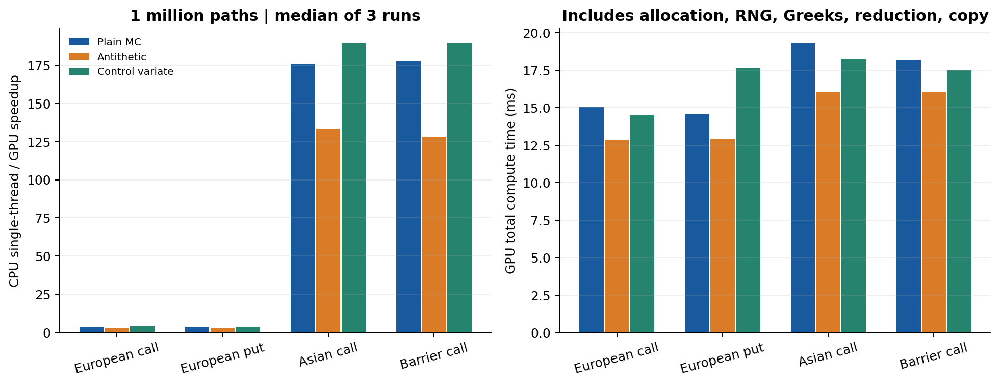
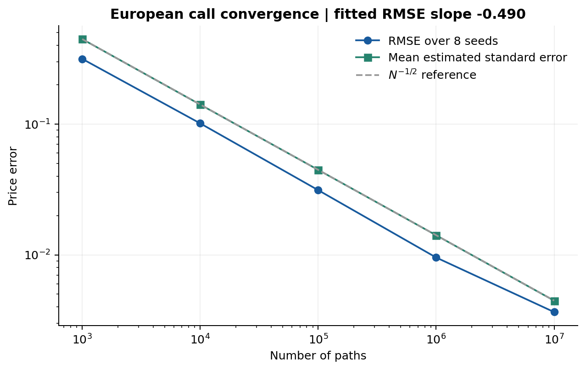
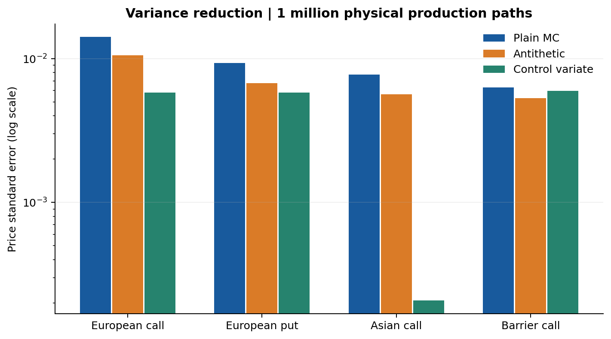
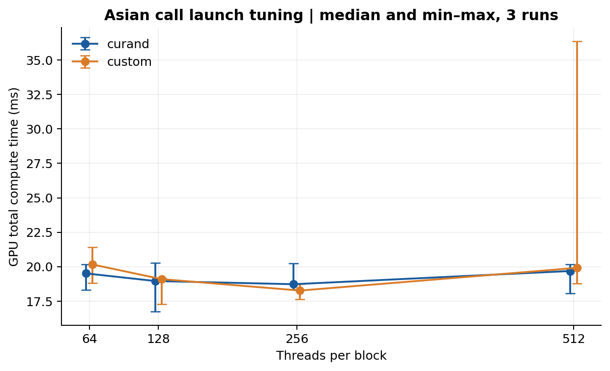

# 金融衍生品定价与风险估计：CUDA 项目报告

## 1. 目标与完成范围

本项目实现 GPU 蒙特卡洛衍生品定价系统，覆盖题目要求的输入解析、GPU 主计算、误差指标、欧式解析参考、结果文件和性能日志。进一步实现欧式看跌、算术平均亚式看涨、上敲出看涨、Delta/Gamma/Vega、两种方差缩减策略及两种随机数实现。

开发和执行环境为 WSL2 Ubuntu 26.04、NVIDIA GeForce RTX 4070 Laptop GPU（8GB）、Intel Core i7-12800HX，CUDA Toolkit 12.4、g++ 13.4、C++17；驱动和完整环境采集在 `results/environment.json`。仅在本机 NVIDIA 平台实测，没有声明国产平台适配。

## 2. 金融模型调研与方法选择

风险中性、无股息、常数无风险利率及波动率的 Black–Scholes 模型满足

\[
dS_t=rS_tdt+\sigma S_tdW_t,\qquad
S_t=S_0\exp((r-\sigma^2/2)t+\sigma W_t).
\]

通过独立标准正态增量构造 `W(t)`，对监控日期使用上述精确转移。这避免 Euler 离散 GBM 的时间推进偏差。欧式合约只取 `T` 的终值，CPU/GPU 都自动执行一个时间步，避免用多步路径人为抬高 CPU 成本。

欧式解析定价速度远快于模拟，因此在实际业务中应优先使用解析式。本选题选择 Monte Carlo，是为了用统一框架处理没有简单算术平均解析式的路径依赖收益，并利用路径间独立性并行。有限差分/PDE 和树方法需要另外设计状态网格与边界，算术平均增加状态维度；本项目没有实现或声称比较这些确定性方法。

合约定义如下：

- 欧式看涨：`exp(-rT) max(S_T-K,0)`；看跌：`exp(-rT) max(K-S_T,0)`。
- 亚式：`A = (1/m) sum_{i=1}^m S(iT/m)`，收益 `exp(-rT) max(A-K,0)`。
- 障碍：离散上敲出看涨，无返还；`S0` 和 `m` 个监控点任一价格 `>=B`，收益为零。

离散日期属于合约定义，增加 `m` 会改变亚式/障碍合约。不能把固定日期定价的抽样收敛解释成连续监控障碍的无偏估计。连续监控可在后续加入 Brownian bridge 修正。

欧式校验使用双精度 Black–Scholes：

\[
C=S_0\Phi(d_1)-Ke^{-rT}\Phi(d_2),\quad
d_1=\frac{\log(S_0/K)+(r+\sigma^2/2)T}{\sigma\sqrt T},\quad d_2=d_1-\sigma\sqrt T.
\]

程序独立处理 `T=0` 与 `sigma=0`，并允许负利率。

## 3. 随机数、方差缩减与误差分析

### 3.1 可重现采样

使用 Philox4x32-10 计数型生成器：种子作为 key，路径编号作为 subsequence，4 个输出为一组。支持 CUDA `curand_init/curand4` 与自定义 Philox 两种实现；CPU 使用自定义整数算法复现 cuRAND 的位流。二者共用 Box–Muller 正态变换，而不是将不同库的正态变换误认为逐位相同。

均匀数取 23 位等距小区间中点，严格位于 `(0,1)` 且可由 FP32 精确表示，避免 `log(0)`。正态值和路径状态采用 FP32，累计统计采用 FP64。有限精度均匀数与正态尾部截断是数值误差来源；它们不被统计置信区间覆盖。默认参数下已有解析和独立 FP64 检查，不能据此断言任意极端参数都达到相同精度。

每个路径 ID 的随机流独立于线程块配置，主样本使用低半段 ID，先导样本从 `2^63` 开始，避免控制系数估计和正式定价复用同一随机样本。

### 3.2 标准误与稳定归约

对独立折现收益 `X_i`，价格和标准误为

\[
\hat V=\bar X,\qquad SE=\sqrt{M_2/[n(n-1)]},\qquad
CI_{95\%}=\bar X\pm1.95996398454SE.
\]

Welford 在线更新、Chan 分块合并保留计数、均值、中心二阶矩，避免直接计算 `sum(x*x)-sum(x)^2/n` 在近零方差下消减。CI 是中心极限定理下的渐近区间；极少样本、极罕见敲出/深虚值事件下不能保证实际覆盖率。小规模边界测试检查数值行为，不能代替样本量充分的统计推断。

单次 Monte Carlo 绝对误差不会随 `N` 严格单调；实验对 8 个种子计算 RMSE，并同时绘制平均标准误和 `N^-1/2` 参考线。

### 3.3 对偶采样

复用一组正态数，分别计算 `Z` 与 `-Z` 两条路径，统计观测为二者收益的均值。输入的 `num_paths=N` 表示物理路径数，独立观测只有 `N/2` 个。价格、Greeks 和标准误均按路径对计算，不能用 `N` 作为独立观测数。

### 3.4 控制变量

使用独立先导样本估计 `beta=Cov(X,Y)/Var(Y)`，正式估计为

\[
\hat V=\bar X-\beta(\bar Y-E[Y]),\qquad
M_{2,adj}=M_{2,X}+\beta^2M_{2,Y}-2\beta C_{XY}.
\]

条件于先导样本，beta 是固定系数，因此主样本的方差与 CI 可按上式计算。若控制变量方差近零则 beta=0。先导样本默认 8192 条，另计路径工作量，其耗时包含在 CPU/GPU 基准内。

欧式和障碍取折现终值 `Y=e^-rT S_T`，理论均值 `S0`。亚式取离散几何平均看涨收益。设 `G=(prod S_i)^(1/m)`：

\[
\mu_G=\log S_0+(r-\sigma^2/2)T(m+1)/(2m),
\quad v_G=\sigma^2T(m+1)(2m+1)/(6m^2),
\]
\[
E[Y]=e^{-rT}\{e^{\mu_G+v_G/2}\Phi(d+\sqrt{v_G})-K\Phi(d)\},
\quad d=(\mu_G-\log K)/\sqrt{v_G}.
\]

上述公式由离散 `log(S_i)` 的联合正态分布和 `Cov(W_i,W_j)=min(t_i,t_j)` 直接求和得到，采样日期与算术平均严格一致。障碍收益非单调，终值控制变量效果可能弱，实验中如实给出效果，未对其保证加速或降方差。

## 4. 风险指标

欧式/亚式 Delta 使用 pathwise 导数；`dS_t/dS0=S_t/S0`。Vega 使用 `dS_t/dsigma=S_t(W_t-sigma*t)`，亚式对各日期导数取平均。Vega 输出对波动率单位 1.0 的导数。

Gamma 使用相同路径的现货正负 1% bump 中心差分。GBM 对初始现货线性，能够按比例缩放终值、均值和最大值，不额外重新生成随机路径。障碍 Delta 也使用共享随机数中心差分，并在每个 bump 下重新判断是否敲出。

离散障碍收益不连续，简单 pathwise Vega 会漏掉穿越障碍边界的贡献，因此程序明确输出 `null`，没有输出不正确的指标。Gamma 和障碍 Delta 的标准误不包含有限 bump 偏差；用户可调步长并另行做敏感性分析。控制变量不调整 Greeks，避免把价格控制系数直接误用于风险指标。

## 5. CUDA 并行设计与优化

每个线程通过 grid-stride loop 处理若干独立路径/路径对。线程局部只保存 Brownian 累积、终值、最大值、算术/几何平均所需累积和以及统计量，不存储 `N*m` 路径矩阵。GPU 直接生成随机数、演化路径、计算收益和风险指标。

warp 内用 shuffle 合并统计量，warp 结果写共享内存，首个 warp 再合并为 block 结果。第二个 kernel 在 GPU 上归约 block 数组，CPU 仅接收固定大小统计量。没有逐路径 host/device 数据传输和浮点原子累加；额外显存为 `(blocks+1)*sizeof(Moments)`。

CPU 负责解析、参数与尺寸校验、解析参考、JSON 输出；单线程基线使用同样的路径语义、风险计算、方差控制和随机输入。CPU 不是调用 GPU 得出的伪基线，也没有把 GPU 数据生成开销排除在比较外。

主要优化策略：

1. 欧式单步精确终值，路径依赖按监控日期计算。
2. RNG、路径和收益融合，省去随机矩阵和路径矩阵的全局访存。
3. Philox 一次产生 4 个整数，Box–Muller 每组产生 4 个正态数并缓存复用。
4. 对偶路径复用 RNG，Greeks 复用路径状态。
5. FP32 路径 + FP64 中心统计，在消费级 GPU 上平衡精度和速度；没有启用全局 fast-math。
6. 比较 cuRAND / 自定义生成器和 64/128/256/512 线程块，不凭单次计时宣布最优配置。

开发中曾发现 1024 线程块因统计量寄存器需求无法启动。最终把公开支持的范围限定为 32–512，并为模拟 kernel 设置匹配的 launch bounds；测试覆盖非 2 的幂的 96 线程块、非整块路径数和不同网格大小。

## 6. 正确性验证

`tests/validate.py` 完全通过后才进行性能实验，覆盖：

- 四类合约 × 三种方差策略，CPU/GPU 价格、标准误和 Greeks 一致性。
- 独立 Python Black–Scholes 与欧式统计误差范围。
- 独立 Python FP64 Philox/GBM 亚式参考，以及 Philox 已知测试向量。
- cuRAND / 自定义随机流等价、种子重现、不同 launch 配置的不变性。
- 零波动、到期、负利率、深实值/虚值、初始已触障、确定性亚式。
- 单监控点亚式等于欧式，欧式 Delta/Gamma/Vega 与解析风险指标一致。
- 无效数值、未知参数、非法路径数和配置边界。

测试阈值区分抽样误差和 CPU/GPU 浮点差异；性能数据保留两后端实际价差。完整案例列表在 `results/validation.json`，内存检查与 profiler 记录见 `results/` 的对应文本文件。

## 7. 实测结果与讨论

以下表格与图形由 `scripts/analyze.py` 从 `results/benchmark.csv` 和原始 JSON 生成。没有用理论速度或第三方设备数据替代本机测量。

<!-- RESULTS_START -->
### 百万路径：价格、精度与性能

参数：S0=K=100，r=0.03，σ=0.2，T=1；亚式/障碍 256 步，障碍 B=130，seed=1234。每组合重复 3 次。

| 合约 | 策略 | GPU价格 | 标准误 | CPU ms 中位数 | GPU ms 中位数（范围） | 加速比中位数 |
|---|---|---:|---:|---:|---:|---:|
| european_call | none | 9.43417830 | 0.0141291 | 58.114 | 15.066 (13.568–22.807) | 3.86× |
| european_call | antithetic | 9.42370863 | 0.0105211 | 35.801 | 12.842 (12.731–14.004) | 2.79× |
| european_call | control_variate | 9.41598796 | 0.00579823 | 60.201 | 14.528 (14.051–15.105) | 4.14× |
| european_put | none | 6.45024294 | 0.0093477 | 55.036 | 14.579 (14.145–17.736) | 3.75× |
| european_put | antithetic | 6.46493495 | 0.00676233 | 35.211 | 12.930 (12.830–16.623) | 2.72× |
| european_put | control_variate | 6.46054131 | 0.00579823 | 61.282 | 17.643 (14.151–22.525) | 3.50× |
| asian_call | none | 5.28931162 | 0.00773441 | 3392.506 | 19.331 (17.442–28.538) | 175.74× |
| asian_call | antithetic | 5.28701567 | 0.00563627 | 2162.231 | 16.079 (15.408–27.745) | 133.70× |
| asian_call | control_variate | 5.29917043 | 0.000208536 | 3456.086 | 18.245 (17.826–21.298) | 189.62× |
| barrier_call | none | 3.41441135 | 0.00629754 | 3226.325 | 18.160 (17.417–20.433) | 177.66× |
| barrier_call | antithetic | 3.42278002 | 0.00530693 | 2035.909 | 16.031 (14.855–18.541) | 128.13× |
| barrier_call | control_variate | 3.41701236 | 0.00595516 | 3313.578 | 17.488 (17.232–19.341) | 189.48× |

全部实测 CPU/GPU 价格最大差异为 **2.64e-07**。两后端使用同一随机流，但浮点超越函数和统计归约顺序不同，因此不要求价格逐位相等。

### 千万路径容量与冷启动

| 合约 | 路径数 | 价格 ± 95% 半宽 | CPU ms | GPU ms | 加速比 | 含初始化加速比 | 主路径/s | 显存工作区 |
|---|---:|---:|---:|---:|---:|---:|---:|---:|
| european_call | 10000000 | 9.41781505 ± 0.008748 | 555.617 | 26.108 | 21.28× | 2.83× | 3.83e+08 | 55392 B |
| asian_call | 10000000 | 5.30158266 ± 0.004801 | 33621.313 | 61.603 | 545.78× | 150.48× | 1.62e+08 | 55392 B |
| barrier_call | 10000000 | 3.41532489 ± 0.003907 | 31918.235 | 62.384 | 511.64× | 145.17× | 1.6e+08 | 55392 B |

百万路径欧式普通 MC 的含初始化加速比中位数为 **0.288×**。短任务是否获益必须区分上下文已建立和冷启动；大规模路径依赖任务即使包含初始化仍明显超过单线程 CPU。上表千万路径每合约只测一次，不能把该行当作稳定吞吐的重复统计。

### 抽样收敛

| N | 8种子 RMSE | 平均 SE | 95% 区间覆盖数 |
|---:|---:|---:|---:|
| 1000 | 0.3154776 | 0.4468963 | 8/8 |
| 10000 | 0.1013055 | 0.1410168 | 8/8 |
| 100000 | 0.0312551 | 0.0446661 | 8/8 |
| 1000000 | 0.0095408 | 0.0141174 | 8/8 |
| 10000000 | 0.0036504 | 0.0044622 | 8/8 |

log(RMSE)–log(N) 的拟合斜率为 **-0.490**，可与理论 -0.5 对照；仅 8 个种子，覆盖率和斜率存在明显统计不确定性。

### 方差缩减效果

| 合约 | 对偶：普通SE²/对偶SE² | 控制变量：普通SE²/控制SE² | 控制变量独立pilot beta |
|---|---:|---:|---:|
| european_call | 1.80× | 5.94× | 0.638510 |
| european_put | 1.91× | 2.60× | -0.361490 |
| asian_call | 1.88× | 1375.60× | 1.034952 |
| barrier_call | 1.41× | 1.12× | 0.098973 |

亚式几何控制变量的原始/调整后样本方差比为 **1375.6×**。其收益在于更小定价误差；并不意味着相同路径数的 kernel 更快。对偶与控制变量互斥，控制变量多算 8192 条先导路径。

### 线程块和随机数实现比较

| block_size | cuRAND 中位数 ms | custom 中位数 ms |
|---:|---:|---:|
| 64 | 19.517 | 20.164 |
| 128 | 18.966 | 19.103 |
| 256 | 18.734 | 18.274 |
| 512 | 19.692 | 19.919 |

笔记本共享显示 GPU 的调度与频率变化使小任务耗时有波动。图中展示全部范围；默认 256 线程是通用配置，本实验不足以证明它在所有负载下最优。
<!-- RESULTS_END -->

### 计时口径

`total_ms` 包含显存分配、随机数、先导样本、路径、Greeks、全部归约、结果回传和显存释放；不含首次 CUDA 上下文初始化、输入读取与结果文件写入。`simulation_ms` 包含 block 内归约；`reduction_ms` 仅计第二阶段全局归约，二者均由 CUDA event 测量。

这里的 event 时间是同一 CUDA stream 上两个事件间的间隔；首次 launch 的惰性模块加载或 CPU 提交延迟也可能使该间隔包含空闲时间。因此它不是 profiler 分离出的纯 kernel active duration，CSV 的 `kernel_ms` 列沿用这个模拟区间值。基准没有把这部分首次 launch 开销剔除。

上下文初始化单列 `context_setup_ms`；`cold_speedup` 把它加入 GPU 总时间。`input_io_ms` 和含双方运行时间的 `process_before_output_ms` 另行记录。吞吐定义为主样本物理路径数除以总计算时间；控制变量先导样本计入时间但不计入主样本吞吐分子。

每次实验独立进程，重复三次并使用中位数；GPU 操作系统调度、笔记本频率和共享显示负载会产生波动，因此同时报告区间。没有将短欧式任务的冷启动成本隐藏为吞吐提升。单线程 CPU 比較满足题目基线要求，不代表与多核 CPU、SIMD 专门优化库或闭式公式相比的速度。

### Nsight 和内存检查的实际结果

已使用 Nsight Systems 2023.4.4 采集并手动转换报告，成功导出 CUDA API 统计（`results/nsys_stats.txt`）。百万路径普通亚式运行有 2 次 kernel launch、2 次显存分配和 1 次结果回传；API 统计中 launch 总耗时约 13.108 ms，其中一次约 13.033 ms，另一次约 0.075 ms。这说明首次提交开销在短任务中占比大，支持后续复用上下文/预热的优化方向。同步等待约 5.653 ms，不能直接解释为某一 kernel 的独占耗时。

当前工具链未采集到 GPU kernel activity 和 GPU memcpy activity，不能据此报告 occupancy、SM 利用率、访存带宽或纯 kernel duration。Nsight Compute target 安装缺少 sections/rules 文件，未成功分析。Compute Sanitizer 因 WSL/WDDM 调试接口未启用而失败，**不能称为 memcheck 通过**；已有成功的实机功能测试和 CPU/GPU 对照，但它们不能替代内存检查。原始错误、复现命令及范围说明见 `results/profiling.md`。本项目没有更改系统驱动调试设置。

## 8. 局限与后续方向

- 当前模型不含股息、随机利率、波动率曲面、跳跃和美式提前行权。
- 路径使用 FP32，长路径和极端参数需另外评估数值误差，可增加全 FP64 对照。
- 正态伪随机并不提供严格随机性证明；可进一步引入 Sobol QMC，并用随机扰动重复实验估计误差。
- Gamma 和障碍 Delta 使用有限差分；可增加多 bump 收敛分析、likelihood-ratio 或平滑收益估计器。
- 持久化 CUDA context、复用缓冲区和批量合约可显著降低短任务启动占比。
- 专门拆分“只定价”和“定价+风险”kernel，可减少不需要风险指标时的寄存器压力。
- 可加入 Brownian bridge 连续障碍监控、国产平台移植和多 GPU 批量分发；这些均为后续工作，未声称已完成。

## 9. 参考资料

1. [NVIDIA GPU Gems 2，Options Pricing on the GPU](https://developer.nvidia.com/gpugems/gpugems2/part-vi-simulation-and-numerical-algorithms/chapter-45-options-pricing-gpu)：Black–Scholes 与 GPU 定价方法背景。
2. [NVIDIA GPU Gems 3，Efficient Random Number Generation and Application Using CUDA](https://developer.nvidia.com/gpugems/gpugems3/part-vi-gpu-computing/chapter-37-efficient-random-number-generation-and-application)：随机数和亚式 Monte Carlo 背景。
3. [NVIDIA cuRAND Device API](https://docs.nvidia.com/cuda/curand/device-api-overview.html)：Philox 初始化、subsequence 和向量化输出；实际构建使用本机 CUDA 12.4 头文件。
4. [Salmon 等，Parallel Random Numbers: As Easy as 1, 2, 3](https://www.thesalmons.org/john/random123/papers/random123sc11.pdf)：计数型并行 RNG。
5. [NYU，Monte Carlo Simulation](https://math.nyu.edu/~cai/Courses/Derivatives/compfin_lecture_6.pdf)：衍生品 Monte Carlo 和几何亚式控制变量。

实现与几何控制变量公式在本报告中独立解释；性能、正确性与收敛结论来自随附的本机实验。
