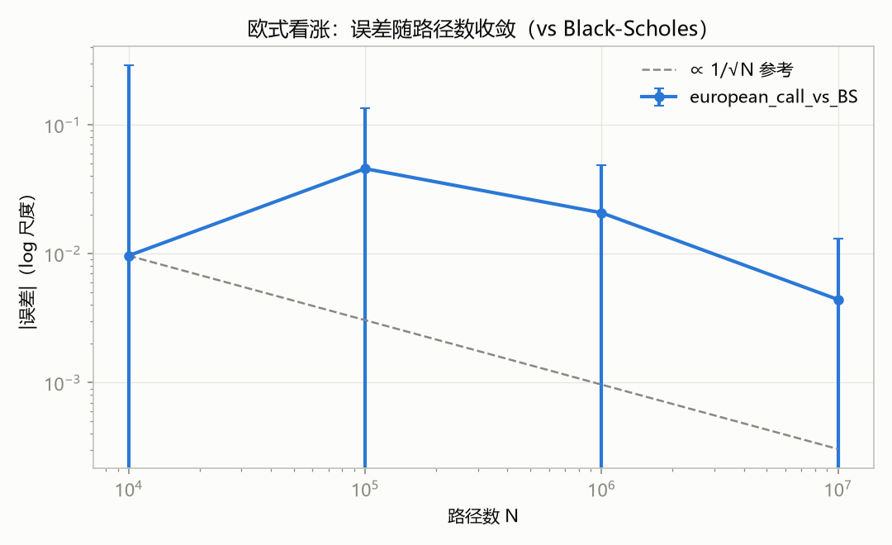
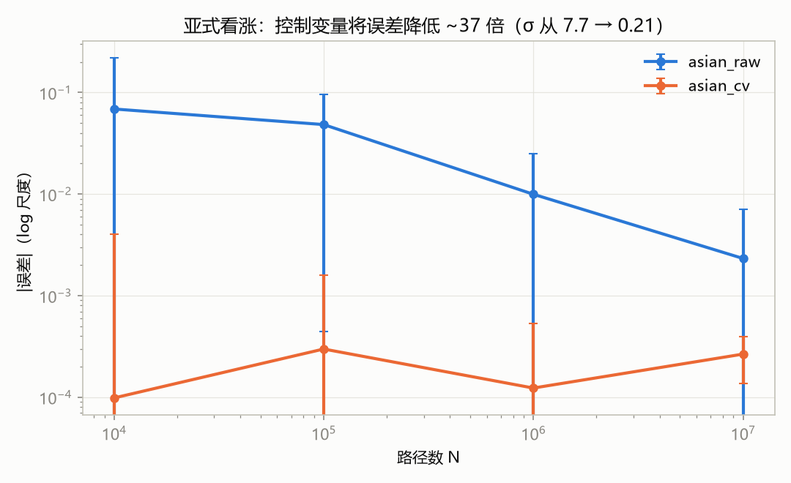
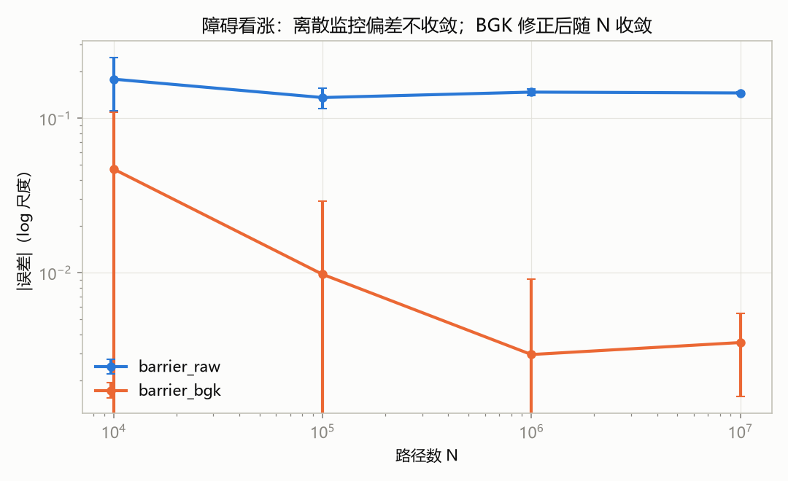
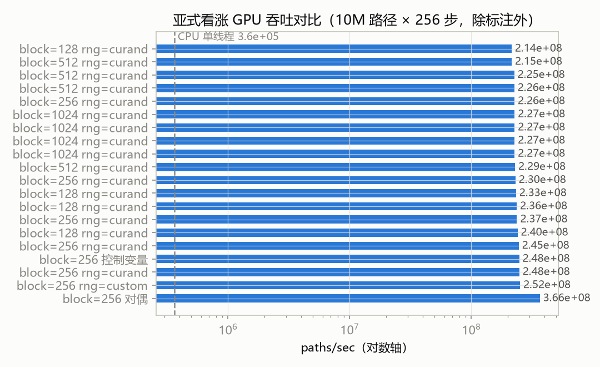

# 项目五总结报告：金融衍生品定价与风险估计（CUDA）

**作者**：li-berry　**日期**：2026-09-20　**环境**：CUDA 12.4 / RTX 4060 Laptop（sm_89，24 SM，8 GB）/ g++ 15.2 / WSL2

---

## 1. 问题描述

量化交易公司每天需要为数千万条随机路径下的复杂衍生品重新估值以控制风险敞口。期权路径之间相互独立，天然适合 GPU 并行。本项目实现一个 CUDA 加速的蒙特卡洛定价程序：支持**欧式（看涨/看跌）、亚式（算术平均看涨）、障碍（向上敲出看涨）**三类期权，输出价格估计、95% 置信区间、误差/收敛指标与性能日志，并与解析解对比验证。

**核心结果一览**：

| 指标 | 结果 |
|---|---|
| 欧式看涨 10M 路径 | 9.4178 ± 0.0045（BS 解析解 9.413403，z = 0.99） |
| 亚式看涨 10M 路径 + 控制变量 | 5.2996 ± 0.00007（方差缩减 **1384×**） |
| 障碍看涨 10M 路径 + BGK | 1.1518 ± 0.0010（连续闭式解 1.155370） |
| 吞吐（亚式/障碍 256 步） | 2.5–3.3e8 paths/s（63–85 G steps/s） |
| 加速比 vs CPU 单线程 | **683×（亚式）/ 690×（障碍）/ 160×（欧式）** |
| 可复现性 | 同配置重跑 **bitwise 一致**；网格/块配置变化价格不变 |

## 2. 金融模型调研

### 2.1 几何布朗运动（GBM）

在 Black-Scholes 框架下，标的资产价格满足

$$dS_t = r S_t\,dt + \sigma S_t\,dW_t$$

其精确解为 $S_{t+\Delta t} = S_t \exp\big((r-\sigma^2/2)\Delta t + \sigma\sqrt{\Delta t}\,Z\big)$，$Z \sim \mathcal{N}(0,1)$。

**关键实现决策**：路径递推使用**精确 GBM 转移**而非 Euler 离散。Euler 对 $S$ 离散会引入时间离散偏差且可能出现负价格；精确转移保证终值分布在每个监控点精确成立，蒙特卡洛误差仅来自随机采样与路径依赖收益的离散监控（见 §4.2）。

### 2.2 解析参考解

| 期权 | 参考解 | 来源 |
|---|---|---|
| 欧式看涨/看跌 | Black-Scholes 公式 | 精确解析 |
| 几何亚式看涨 | Kemna-Vorst 闭式解（对数正态矩匹配） | 精确解析（离散监控 t_i = iT/n） |
| 向上敲出看涨（连续监控） | 反射原理闭式解 | 精确解析 |
| 算术亚式看涨 | 无简单闭式解 → 高精度 CV-MC（1M 路径，独立种子去相关） | 数值参考 ±0.001 |

黄金值均经独立 Python 实现交叉验证（`data/reference_values.txt`）：BS 看涨 = **9.413403**（注意 10.45 是 r=5% 的值，是最容易踩的数值陷阱）、看跌 = 6.457957、几何亚式(n=256) = 5.102804、连续 up-and-out(H=120) = **1.155370**、算术亚式 = 5.2995 ± 0.0005。

## 3. 定价方法选择与依据

### 3.1 为什么选蒙特卡洛

- **维度无关**：树方法（二叉树/三叉树）对 256 步路径依赖期权会指数爆炸；PDE/有限差分在 256 维监控结构下同样不现实。
- **并行友好**：路径相互独立，无串行依赖，天然映射到 GPU 海量线程。
- **误差可量化**：标准误 $\hat\sigma/\sqrt{N}$ 给出严格的置信区间与收敛速率，满足题目"输出可解释的误差或收敛指标"的要求。

### 3.2 随机数生成

| 设计点 | 决策 | 理由 |
|---|---|---|
| GPU RNG | cuRAND Philox4x32-10，`curand_init(seed, subsequence=路径索引, 0)` | 每条路径一条独立 2^66 子序列；流位置仅由 (seed, 路径) 决定，与网格配置**无关** |
| 自定义 RNG | xorshift128+（splitmix64 混合播种 + 4 次预热） | 周期 2^128−1，通过 BigCrush；CPU/GPU 共享同一份源码 |
| 正态变换 | 统一用 Box-Muller（`u32_to_uniform` 映射到 (0,1) 开区间） | CPU/GPU 变换一致；uniform 流 bitwise 一致，正态因 glibc/CUDA 数学库 ~1ULP 差异一致到 ~1e-7 |
| 可复现性 | 同种子同配置重跑 bitwise 一致；N 较小的运行是 N 较大运行的**精确子集**（嵌套前缀） | 收敛曲线干净，`|误差|·√N` 收敛指标可定量验证 |

**CPU/GPU 一致性契约**（`--dump-rng` 验证）：custom RNG 下两者 32 位 uniform 流 **bitwise 完全一致**；正态差 ~1e-7；同参数价格差 ~1e-7 量级，远小于 MC 标准误。

### 3.3 置信区间与收敛指标

- **95% CI**：Student-t 分位数（n ≥ 10⁴ 时 ≈ 1.96，小样本用 Cornish-Fisher 展开）。
- **z 分数**：`(价格 − 参考)/SE`，正确实现下 |z| < 3.5 的概率 ≈ 99.95%，作为回归测试门槛。
- **收敛指标**：`|误差|·√N`（理论上近似常数 ≈ σ_payoff）+ 拟合斜率（log SE vs log N 应为 **−0.5**）。

## 4. 数值误差分析

### 4.1 浮点精度分配

| 环节 | 精度 | 理由 |
|---|---|---|
| 路径循环（S、累计和、最大值） | **float** | Ada 消费卡 FP64 = 1/64 FP32，double 路径循环会慢 30–60×。FP32 每步相对误差 ~6e-8，256 步累计 ~2.4e-4，比 MC 标准误（3.8e-3 @10M 路径）**小 15 倍** |
| 每线程/块/全局累加 | **double** | 每线程仅 ~271 次加法，零成本防止累加漂移 |
| 样本方差 | double 直接公式 `(Σy²−nȳ²)/(n−1)` | 价格量级 5–10，无消去问题 |

### 4.2 路径依赖期权的离散监控偏差（本项目最重要的数值发现）

- **亚式**：256 步算术平均监控是**有意为之**的合约定义，无偏差问题；但算术平均与几何平均闭式解**差 0.197 且不随 N 收敛**（Jensen 不等式）——直接拿几何闭式解当参考会让收敛曲线在 0.197 处躺平。因此算术亚式的参考改为高精度 CV-MC，几何值作为有记录的 Jensen 下界。
- **障碍**：256 步离散监控的 up-and-out 价格 ≈ **1.3012**，而连续监控闭式解 = **1.155370**——偏差 **+0.146（14%）且不随 N 收敛**（收敛扫描中 `|误差|·√N` 从 17.9 线性增长到 461，见 §7 图 3）。这是离散监控 vs 连续监控的系统性偏差，不是随机误差。
- **BGK 修正**：Broadie–Glasserman–Kou 边界平移 $H' = H\,e^{-0.5826\,\sigma\sqrt{\Delta t}}$（常数取精确值 $-\zeta(1/2)/\sqrt{2\pi}$），离散监控 H' 逼近连续监控 H。实测：10M 路径价格 1.1518，偏差从 +0.146 降到 **−0.0035（42× 缩减）**。残差偏差为 BGK 的一阶残留（理论 O(1/√n) → O(1/n)），随 n 增大收敛——**监控步数扫描**（10M 路径 + BGK，参考 1.155370）：

  | n | 64 | 128 | 256 | 512 | 1024 | 2048 |
  |---|---|---|---|---|---|---|
  | 价格 | 1.1379 | 1.1477 | 1.1518 | 1.1541 | 1.1558 | 1.1550 |
  | 误差 | 0.0175 | 0.0077 | 0.0035 | 0.0012 | 0.0004 | 0.0003 |

  误差随 n 翻倍近似减半，n ≥ 1024 后残差进入 MC 噪声水平（SE ≈ 0.001），与 BGK 理论速率一致。

## 5. CUDA 并行化设计

### 5.1 并行粒度与内存布局

- **粒度**：一路径（对偶时一对路径）一个线程单元，grid-stride 循环覆盖全部路径；块大小 256，网格 = min(⌈N/块⌉, SM × 每 SM 块数 × 4)，按占用率 API 自动计算。
- **内存布局**：**融合**生成+模拟+收益——每线程只持有寄存器状态（S、累计和/最大值、RNG 状态），**无全局 Z 矩阵**。10M×256×4B = 10 GB 超出 8 GB 显存；融合设计全 GPU 内存占用 < 1 MB，8 GB 显存完全不是约束。
- **CPU/GPU 分工**：GPU 承担全部路径模拟与收益计算；CPU 仅做参数解析、解析参考价、启动配置与最终统计量（3 个 double）。

### 5.2 确定性归约（无原子操作）

FP 加法非结合，`atomicAdd` 顺序不确定会破坏可复现性。采用两级确定性归约：

1. 每线程 double 累加 → warp shuffle 归约（固定 lane 顺序）→ 块内共享内存归约 → `block_partials[3·blockIdx + {sum, sumsq, rawsq}]`
2. `finalize_reduce` 单块核按固定顺序求和 → 主机拿到 (Σy, Σy², Σy_raw²) 计算全部统计量

三个累加器的设计：`sum/sumsq` 是所用估计量的矩；`rawsq` 是**未缩减样本**的二阶矩，用于在同路径数下估计方差缩减因子。归约耗时独立计时（`reduction_ms`：主核结束 → finalize → D2H 回传）。

### 5.3 核组织

单核 `mc_kernel<期权类型, 对偶与否>`（8 个实例化），RNG 类型为运行时分支（每单元一次，分支可预测）；4 步展开主循环 + 余数处理；控制变量 β 由独立 pilot 核估计（前 10 万路径，5 个累加器 atomicAdd——β 是冗余参数，原子序不影响其统计性质），主核保持确定性。

## 6. 正确性验证

### 6.1 单元测试（`make test-units`，43 项断言，无 GPU 依赖）

- 解析解黄金值：BS 看涨/看跌、put-call parity、Kemna-Vorst、反射原理闭式解（含 H→∞ 退化为 BS 的极限自检）、Levy 近似、BGK 平移、Φ 函数、t 分位数
- 解析器：CRLF/BOM/行内注释/未知键带行号报错/缺 barrier/对偶奇数路径
- RNG：u32_to_uniform 永不返回 0/1（Box-Muller 安全前提）、xorshift 确定性、Box-Muller 统计矩

### 6.2 端到端回归（`make e2e`，24 项断言全绿，< 30s）

| 验证点 | 结果 |
|---|---|
| 欧式看涨/看跌 vs BS | z = 0.99 / −1.86 ✓ |
| **确定性** | 同配置重跑结果文件 **byte 级一致**（md5 相同） |
| **网格不变性** | block 128–1024、grid 1–2304：价格 17 位有效数字完全一致 |
| CPU/GPU 一致性（custom RNG 同流） | 亚式价格差 2.6e-5 ≪ 容差 8.7e-3 ✓ |
| RNG 流 | CPU/GPU 前 16×16 个 u32 **bitwise 一致** |
| 步进欧式 vs 精确欧式 | --euro-steps 256 下 z = 0.44（验证逐步循环正确性） |
| 错误处理 | 未知键/缺 barrier/奇数路径+对偶 → exit 1 带行号报错 |

### 6.3 收敛验证（图 1–3）

- 欧式：SE 斜率 **−0.501**（理论 −0.5），`SE·√N` ≈ 14.1 恒定，全部 |z| < 3.5。
- 亚式 CV：σ_payoff 从 7.7 降到 0.21（√1384 ≈ 37 倍）。
- 障碍：原始模式误差平台（偏差主导）vs BGK 后正常收敛——直观展示"偏差 vs 随机误差"的区别。

## 7. 性能指标与分析

### 7.1 吞吐与加速比（10M 路径 × 256 步，RTX 4060 Laptop）

| 场景 | GPU 总耗时 | GPU 吞吐 | CPU 单线程 | 加速比 |
|---|---|---|---|---|
| 欧式看涨（1 步精确模拟） | 1.7 ms | 5.9e9 paths/s | 3.7e7 paths/s | 160× |
| 亚式看涨（plain） | 40.3 ms | 2.5e8 paths/s（63 G steps/s） | 3.6e5 paths/s | **683×** |
| 障碍看涨（+BGK） | 30.1 ms | 3.3e8 paths/s（85 G steps/s） | 4.8e5 paths/s | **690×** |

（加速比按 paths/sec 比值，CPU 基线为同参数 custom RNG 镜像单线程实现；性能日志含完整粒度配置与分段计时。）

### 7.2 粒度扫描（图 4，16 组 block×grid 配置）

吞吐 2.15–2.45e8 paths/s，波动 ~±8%，最优为默认配置（block=256 自动网格）。**结论：实现对粒度不敏感，自动配置已接近最优**——这是 grid-stride + 每路径独立流设计的预期结果（无共享状态、无负载均衡问题）。

### 7.3 占用率与优化实验

内核 68 寄存器/线程 → 每 SM 3 块（768 线程，37.5% 占用率）。两个受控实验：

| 实验 | 结果 | 结论 |
|---|---|---|
| `-maxrregcount=40`（占用率 37.5%→75%） | 40.1 → 41.6 ms（**变慢 4%**） | 寄存器溢出+ILP 损失 > 占用率收益；内核不受占用率限制，37.5% 足够隐藏 SFU 延迟 |
| `-use_fast_math`（__expf/__logf 快速路径） | 40.1 → 16.5 ms（**2.4× 提速**），价格 5.30153 vs 5.30161 统计一致 | 内核受超越函数吞吐限制；默认**未采用**——破坏 CPU/GPU 同数学镜像与每步精度保证，作为已测量的优化途径记录 |

### 7.4 性能剖析说明（ncu/nsys 加分项）

- **ncu 受阻**：WSL2 下报 `ERR_NVGPUCTRPERM`（性能计数器权限），sudo 需交互密码。修复方法（任选其一）：Windows 主机注册表 `HKLM\SYSTEM\CurrentControlSet\Services\nvlddmkm\Global\NVRM` 添加 DWORD `NVreg_RestrictProfilingToAdminUsers = 0` 后重启；或 WSL 内 `sudo ncu …`。修复后 `make profile` 可直接复现完整分析。
- **nsys 受阻**：本机 nsys CLI 采集正常但报告生成组件缺失（importer 报错、sqlite 导出为空文件）。
- **替代证据**：程序内置 cudaEvent 分段计时（kernel/finalize/reduction/D2H/setup）+ 占用率 API + `cudaFuncGetAttributes`（寄存器/共享内存），性能日志中全部可见。据此已定位瓶颈：内核为超越函数（expf/logf/Box-Muller）吞吐受限而非访存或占用率受限（证据：fast-math 2.4×、maxrregcount 无收益）。

## 8. 方差缩减效果分析

| 方法 | 场景 | 方差缩减因子 | 说明 |
|---|---|---|---|
| 对偶变量 | 亚式 | **1.88×** | 同线程锁步模拟 (Z,−Z) 对，样本取对均值，samples = N/2；顺带提速 47%（RNG 初始化摊薄） |
| 对偶变量 | 障碍+BGK | 1.15× | 镜像路径敲出模式部分相关，收益有限 |
| 控制变量 | 欧式（c = e^{−rT}S_T，E[c]=S0） | **5.9×** | 注意不能用自己的 payoff 做控制（退化为解析解） |
| 控制变量 | 亚式（c = 几何平均收益，E[c]=Kemna-Vorst） | **1384×** | β = 1.0344，ρ = 0.99965；SE 从 2.4e-3 降到 6.6e-5，10M 路径即可报出 4 位小数价格 |
| 控制变量 | 障碍（c = vanilla 看涨） | **1.00×（无效）** | 见下方分析 |

**障碍控制变量失效的协方差分析**（本项目最有意思的负面结果）：up-and-out 的收益 = (S_T−K)⁺·1{maxS<H}。触障路径收益为 0 而控制值 (S_T−K)⁺ 恰在 S_T 高时最大（路径上冲才触障）——**正相关与负相关分量几乎完全抵消**，实测 ρ ≈ 0.008 → β ≈ 0 → 缩减因子 ≈ 1。文献中 vanilla 控制对 down-and-out 有效（触障方向与控制单调性一致），对 up-and-out 无效；正确的选择是触障指示变量控制（c = 1{maxS≥H}，E[c] 有首达时闭式解），但注意其均值需与**离散监控**的 c 匹配（连续首达概率会有偏差），留作后续工作。

## 9. 未来可提升

1. **障碍控制变量改进**：触障指示变量控制（需离散监控首达概率或与其匹配的数值 E[c]）。
2. **条件蒙特卡洛 + 布朗桥**：对障碍期权在相邻监控点间用布朗桥精确采样首达概率，彻底消除离散监控偏差（优于 BGK 一阶修正）。
3. **更多期权类型与希腊字母**：路径法 Delta/Gamma/Vega（收益对 S0/σ 求导，边际成本低）；回望、双障碍期权。
4. **吞吐进一步提升**：fast-math 已测 2.4×；`__expf` 单点替换（保留精确 sqrt/log）预期 ~1.5–1.8×；对数空间障碍（monotone 变换省 256 次 expf）。
5. **多 GPU/多流**：路径块在多设备间切分，近线性扩展。
6. **ncu 剖析**：修复 §7.4 的权限问题后做 warp 停滞/指令混合级分析，验证超越函数瓶颈假设并量化 ILP。

## 10. 附录：复现命令

```bash
make && make test        # 构建 + 单元测试 + e2e（24 项）
make convergence bench   # data/convergence.csv、data/bench.csv
python3 scripts/make_plots.py   # report/*.png（需 matplotlib）
./build/option_pricer --option configs/option_european_call.txt --sim configs/sim_default.txt
./build/option_pricer --option configs/option_asian_call.txt --sim configs/sim_control_variate.txt
./build/option_pricer --option configs/option_barrier_call.txt --sim configs/sim_default.txt --bgk
```

## 图表








