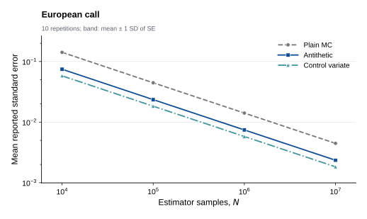
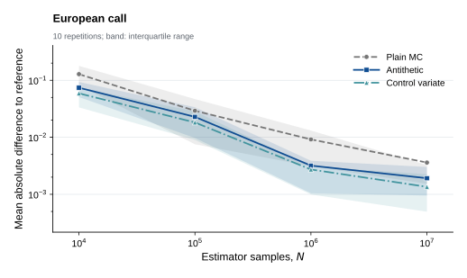
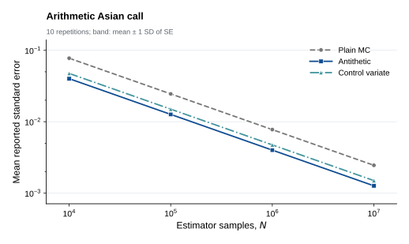
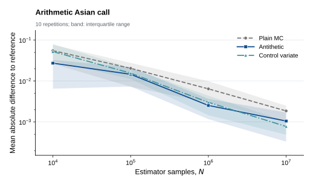
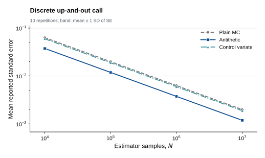
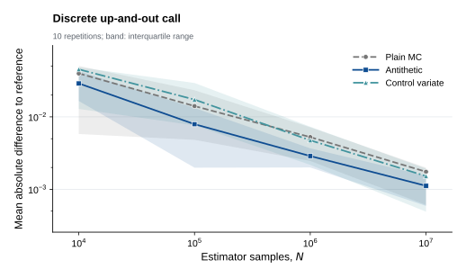
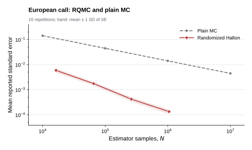
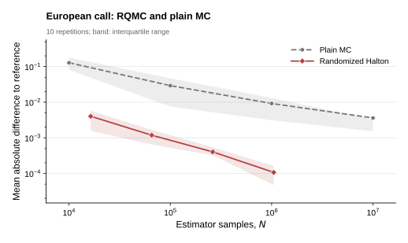

# CUDA 加速的衍生品定价与风险估计：方法、实现与实验分析

## 摘要

本文设计并实现了一套基于 CUDA 的蒙特卡洛衍生品定价系统，以统一接口支持
欧式看涨、算术平均亚式和离散监控障碍期权，并提供 CPU 参考、误差估计与
性能记录。围绕定价精度和计算效率，实验比较普通蒙特卡洛、反向变量、控制
变量及随机化 Halton 方法，并考察美式期权、随机波动率、局部波动率和风险
敏感度扩展的后端一致性。单张 RTX 5090 上的 32 项价格与风险指标检查全部通过，其中 GBM
欧式和美式结果分别与解析解及 2,000 步 CRR 二叉树核对。每个样本规模的
10 次独立重复表明，三类基础合约的标准误差具有接近 $-0.5$ 的对数收敛
斜率；在一千万估计样本下，欧式控制变量估计的跨运行标准差较普通蒙特卡洛
降低 66.1%。采用 FP64 计算的 256 步亚式定价，在 7 次运行中达到
$281.49\pm1.45\,\mathrm{ms}$ 的调用时间和 $35.53\pm0.18$ 百万路径/秒的
端到端吞吐，相对指定单线程 CPU 基准的吞吐加速为 $226.60\pm1.34$ 倍，
其中误差范围表示样本标准差。Nsight Systems 分析进一步揭示了初始化、
路径计算与归约的时间构成，为工作区复用及多情景计算优化提供依据。

**关键词：** 蒙特卡洛；衍生品定价；CUDA；方差缩减；风险敏感度；准蒙特卡洛

## 1. 引言

风险管理需要对多个产品和市场情景反复估值。蒙特卡洛方法通过模拟标的价格
路径计算折现收益，能够统一处理多种随机模型和路径依赖合约；其计算成本
随路径数、时间步数以及风险敏感度的扰动情景数增长。路径之间的独立性
适合 GPU 并行，而可信的加速结果还要求数值参考、统计不确定性与性能计时
具有一致的定义 [1–3]。

本项目选择蒙特卡洛作为主方法，主要考虑其合约扩展性和并行结构。欧式、
平均价格与障碍触发条件可以共享路径演化过程，分别通过收益函数实现。
对于能够高效求解的低维问题，解析公式和树方法提供独立参考：本文使用
Black–Scholes 解析解验证欧式期权，使用 CRR 二叉树核对美式 GBM 定价。
由此将统一的路径模拟框架与针对具体产品的参考方法结合。

金融蒙特卡洛的效率研究同时关注采样方法与估计量设计。Boyle 等 [12]
讨论了方差缩减、低差异点集、风险敏感度和提前行权等问题，说明增加路径数
并非改善估值的唯一途径。本文沿用这些数值方法，将研究重点放在统一
CPU/CUDA 接口下的实现、一致性检查及误差—时间比较，而非提出新的
定价模型。已有文献用于说明设计依据，性能结论来自本文指定环境的实测。

本文研究三个问题：CUDA 并行实现与 CPU 计算是否一致；样本数与方差缩减
策略如何影响估计误差；路径计算在完整定价调用中获得多大吞吐收益。为此，
系统显式区分估计样本与物理路径，记录随机种子及计时边界，并使用多次重复
实验评价收敛性、误差与性能。除基础合约外，系统还实现美式最小二乘定价、
复杂波动率模型和风险敏感度，以考察共享计算框架的适用范围。

## 2. 研究范围与实验配置

| 项目 | 正式实验配置 |
|---|---|
| GPU | 单张 NVIDIA GeForce RTX 5090，32,607 MiB，计算能力 12.0 |
| 驱动 / CUDA | NVIDIA 驱动 610.43.02；CUDA Toolkit 12.8.61 |
| 编译器 | CMake 3.31.4；G++ 13.3.0；Release + `-lineinfo` |
| 随机数设置 | 固定主种子，按重复编号派生并记录 |
| 重复次数 | 收敛/方差缩减 10 次；性能 7 次 |
| 样本规模 | MC：$10^4,10^5,10^6,10^7$；QMC 总样本：$2^{14},2^{16},2^{18},2^{20}$ |
| 路径依赖设置 | 256 个监控时点；独立 CPU 参考使用 $2\times10^6$ 条路径 |
| 基础合约参数 | $S_0=K=100$，$r=0.03$，$\sigma=0.2$，$T=1$ 年；$B=130$，无分红 |
| 计算精度与线程块 | CPU/CUDA 路径、收益及统计均为 FP64；每线程块 256 个线程 |

表1汇总正式实验环境与基础合约参数。日志字段 `total_runtime_ms` 记录一次
定价接口调用的主机墙钟时间，包括设备内存分配与释放、路径计算、统计归约、
结果回传及同步。配置和结果文件读写、额外的风险敏感度计算及参考解生成位于
该计时区间之外。性能实验采用独立程序启动方式。CPU 基准保持相同的产品、
模型、步数、精度和方差缩减设置；CPU 与 CUDA 分别使用 MT19937_64 和
Philox 生成伪随机正态样本，形成统计上可比的采样条件。

## 3. 金融模型与数值方法

### 3.1 风险中性价格与收益定义

设 $G$ 为到期收益，$T$ 为到期时间，$r$ 为无风险利率，价格为风险中性测度
$\mathbb Q$ 下的折现期望 $V=\mathbb E_{\mathbb Q}[e^{-rT}G]$。无分红条件下，
几何布朗运动（GBM）及其精确离散转移为 [1]：

$$
\begin{aligned}
\mathrm dS_t &= rS_t\,\mathrm dt+\sigma S_t\,\mathrm dW_t,\\
S_{t+\Delta t} &= S_t\exp\!\left[
\left(r-\frac{\sigma^2}{2}\right)\Delta t
+\sigma\sqrt{\Delta t}\,Z\right],\qquad Z\sim\mathcal N(0,1).
\end{aligned}
$$

令 $t_j=jT/M$，其中 $M$ 为监控步数，$(x)^+=\max(x,0)$。三类基础看涨
合约采用以下收益定义：

$$
\begin{aligned}
G_{\mathrm E} &= (S_T-K)^+,\\
G_{\mathrm A} &= \left(\frac1M\sum_{j=1}^{M}S_{t_j}-K\right)^+,\\
G_{\mathrm B} &= (S_T-K)^+\,
\mathbf1\!\left\{\max_{1\leq j\leq M}S_{t_j}<B\right\}.
\end{aligned}
$$

欧式 GBM 直接采样终值，有效时间步数为 1。亚式平均采用各步末价格，障碍
期权采用无返还的离散监控向上敲出条款，触及障碍 $B$ 即失效。正式障碍
参数满足 $S_0<B$，监控从首个步末开始。GBM 的精确转移消除了固定监控
网格上的路径离散误差；连续监控与离散监控的合约差异另在第9节讨论。

欧式看涨的 Black–Scholes 参考价格及风险敏感度为：

$$
\begin{aligned}
d_1 &= \frac{\ln(S_0/K)+(r+\sigma^2/2)T}{\sigma\sqrt T},
&d_2 &= d_1-\sigma\sqrt T,\\
C_{\mathrm{BS}} &= S_0\Phi(d_1)-Ke^{-rT}\Phi(d_2),\\
\Delta &= \Phi(d_1),
&\Gamma &= \frac{\phi(d_1)}{S_0\sigma\sqrt T},\\
\mathcal V &= S_0\phi(d_1)\sqrt T.
\end{aligned}
$$

其中 $\Phi$ 与 $\phi$ 分别为标准正态分布函数和密度。本文以 $\mathcal V$
表示 Vega，按波动率变化 1.0 的敏感度报告；换算为一个百分点的波动率变化
时，应将该值除以 100。

### 3.2 蒙特卡洛估计与方差控制

对 $N$ 个折现收益样本 $Y_i=e^{-rT}G_i$，普通蒙特卡洛（MC）以样本均值
估计价格，并由样本方差计算标准误差 [3]：

$$
\begin{aligned}
\widehat V &= \frac1N\sum_{i=1}^{N}Y_i,\qquad
s_Y^2=\frac1{N-1}\sum_{i=1}^{N}(Y_i-\widehat V)^2,\\
\operatorname{SE}(\widehat V)&=\sqrt{\frac{s_Y^2}{N}},\qquad
I_{0.95}=\left[\widehat V-z_{0.975}\operatorname{SE},\,
\widehat V+z_{0.975}\operatorname{SE}\right],
\end{aligned}
$$

其中 $z_{0.975}=1.9599639845$，$I_{0.95}$ 为度量采样不确定性的大样本
近似置信区间。收敛实验通过多次重复的平均绝对误差和经验标准差评价稳定性。

反向变量法以正负正态变量产生一对收益，并将成对平均作为一个估计样本：

$$
Y_i^{\mathrm{AV}}=\frac{Y(Z_i)+Y(-Z_i)}2.
$$

配置中的 `num_paths` 记录 $N$ 个估计样本，反向变量模式实际生成 $2N$ 条
物理路径，标准误差按 $N$ 个成对平均计算。成对收益负相关时可降低方差 [12]，
其额外路径成本在第6.2节结合实测时间评价。

控制变量法选取 $X_i=e^{-rT}S_T^{(i)}$。在 GBM 下，
$\mathbb E_{\mathbb Q}[X_i]=S_0$，据此构造：

$$
\begin{aligned}
\widehat b&=\frac{s_{XY}}{s_X^2},\\
\widehat V_{\mathrm{CV}}&=\overline Y-\widehat b(\overline X-S_0),\\
s_{\mathrm{CV}}^2&=s_Y^2+(\widehat b)^2s_X^2-2\widehat b\,s_{XY}.
\end{aligned}
$$

这里 $s_{XY}$ 为样本协方差。控制量可直接从现有路径终值取得，适于与收益
计算融合。实现从同一批样本估计 $\widehat b$，并将修正后的样本方差代入
标准误差公式；其有限样本性质及系数估计的不确定性在第9节讨论。

### 3.3 随机数生成与随机化 Halton

CUDA 伪随机路径使用 cuRAND Philox 和 `curand_normal_double`，并以
`curand_init(seed, path_id, 0)` 分配路径随机流 [5]；CPU 使用 MT19937_64。
Philox 属于 Salmon 等 [7] 提出的计数器型随机数生成器，便于按应用索引
组织并行随机流。本文将随机流绑定路径编号，而非执行线程，以保持调度变化
下的路径对应关系；具体生成与正态变换仍由 cuRAND 完成。

固定种子可复现各自后端的结果。Halton 序列以不同互素基数的基数反演
构造多维点集 [8]。本文再对各维加入均匀随机平移并取模 1，采用
Cranley–Patterson 类型的随机化思路 [9]，随后通过逆正态变换生成样本。
CPU 与 CUDA 使用相同的索引、平移及变换，提供共享点集上的实现对照。

随机化准蒙特卡洛（RQMC）将总样本数 $N$ 分配给 $R=8$ 个随机平移，每个
平移使用 $n=N/R$ 个点。设第 $q$ 个平移的估值为 $\widehat V_q$，则

$$
\begin{aligned}
\widehat V_{\mathrm{RQMC}}&=\frac1R\sum_{q=1}^{R}\widehat V_q,\\
\operatorname{SE}_{\mathrm{RQMC}}&=
\sqrt{\frac1{R(R-1)}\sum_{q=1}^{R}
\left(\widehat V_q-\widehat V_{\mathrm{RQMC}}\right)^2}.
\end{aligned}
$$

误差估计来自平移之间的波动，程序仍以 $z_{0.975}$ 构造近似区间。一次
运行中的 8 个随机平移与收敛实验中的 10 次外层重复分别承担区间估计和
重复性评价的作用。同一平移内的点具有结构性依赖，不能直接按独立随机
样本计算误差；以独立随机化后的积分估计为重复单位，是随机化方法提供
误差评估的关键 [9]。本文仅采用平移随机化，不包含数字扰乱或路径维度重排。

实验脚本 `run_sweep.py` 通过 SplitMix64 风格哈希，将主种子和重复编号
确定性地映射为每次运行的种子。同一次重复在不同样本规模和方差策略之间
共享随机流前缀，形成共同随机数（CRN）配对；不同重复采用不同派生种子。
亚式与障碍参考使用独立于主实验的固定种子。所有种子均按预定规则产生，
具体取值随配置与结果保存。

### 3.4 扩展模型与风险敏感度

以下扩展沿用前述路径模拟与统计接口，分别改变波动率过程、行权规则和
待估计量。基础合约的收敛与性能构成本文主要实验，扩展部分侧重实现核对。

#### 3.4.1 复杂波动率模型

局部波动率扩展采用 $\sigma(S)=\sigma_0(S/S_0)^\beta$，每步固定当前
局部波动率后更新对数价格。Heston 模型则引入随机方差与相关布朗运动 [4]：

$$
\begin{aligned}
\mathrm dS_t&=rS_t\,\mathrm dt+\sqrt{v_t}S_t\,\mathrm dW_t^S,\\
\mathrm dv_t&=\kappa(\theta-v_t)\,\mathrm dt
+\xi\sqrt{v_t}\,\mathrm dW_t^v,\\
\mathrm d\langle W^S,W^v\rangle_t&=\rho\,\mathrm dt.
\end{aligned}
$$

离散实现采用非负投影 Euler。令 $v_j^+=\max(v_j,0)$，每一步计算

$$
\begin{aligned}
Z_j^v&=\rho Z_j^S+\sqrt{1-\rho^2}\,Z_j^{\perp},\\
v_{j+1}&=\max\!\left\{v_j+\kappa(\theta-v_j^+)\Delta t
+\xi\sqrt{v_j^+\Delta t}\,Z_j^v,\,0\right\},\\
S_{j+1}&=S_j\exp\!\left[
\left(r-\frac{v_j^+}{2}\right)\Delta t
+\sqrt{v_j^+\Delta t}\,Z_j^S\right],
\end{aligned}
$$

其中 $Z_j^S$ 和 $Z_j^{\perp}$ 为独立标准正态变量。方差在更新后投影到
非负区间；这一具体离散规则决定了复杂模型的 CPU/CUDA 对照条件。
Lord 等 [11] 表明，负方差修正规则会影响 Heston 模拟的离散偏差。
因此，保持方差非负是实现约束，并不意味着有限时间步下的估值无偏；
本文保留明确的投影递推式，以便后续与其他离散方案在相同步数下比较。

#### 3.4.2 美式行权

美式期权采用 Longstaff–Schwartz 最小二乘蒙特卡洛（LSM）方法 [2]。
程序保存模拟路径并反向遍历行权时点，在价内样本上以
$\{1,x,x^2\}$（$x=S/K$）为基函数拟合未来折现现金流。回归系数由加入
微小对角正则项的正规方程求得，并据延续价值与即时收益更新行权决策。
本实现采用离散行权网格，并在同一批路径上进行回归和估值；GBM 美式
参考采用 2,000 步 CRR 二叉树 [6]。

#### 3.4.3 风险敏感度

风险敏感度（Greeks）由中心有限差分估计。以 $h$ 为价格扰动、$\eta$ 为
波动率扰动，共需基础情景及四个扰动情景：

$$
\begin{aligned}
\widehat\Delta&=\frac{\widehat V(S_0+h)-\widehat V(S_0-h)}{2h},\\
\widehat\Gamma&=\frac{\widehat V(S_0+h)-2\widehat V(S_0)
+\widehat V(S_0-h)}{h^2},\\
\widehat{\mathcal V}&=\frac{\widehat V(\sigma+\eta)
-\widehat V(\sigma-\eta)}{2\eta}.
\end{aligned}
$$

各情景复用相同种子与路径编号，以 CRN 减小差分噪声 [12]。这种配对
保留了扰动前后路径的相关性，但不能消除有限差分的截断偏差。
Broadie 与 Glasserman [10] 研究了路径导数和似然比等直接估计方法，
可作为后续减少重复模拟的比较对象。本文采用有限差分以复用各模型的
定价接口，尚未实现这两类直接估计量。

Heston 的 Vega
定义为对初始波动率 $\sqrt{v_0}$ 的敏感度；局部波动率的现货价格扰动
同时改变归一化参数 $S_0$，因此对应上述参数化模型整体的敏感度。
美式伪随机验证使用 200,000 条路径、64 步及 $h/S_0=0.01$；Halton
验证使用 131,072 条路径、64 步及相同价格扰动比例。当前风险指标输出为
点估计，其有限差分与回归误差在实验和讨论中评价。

## 4. 系统架构与 CUDA 并行设计

### 4.1 路径融合与两阶段归约

CPU 负责配置解析、输入检查、任务调度、参考计算与文件输出；CUDA 负责随机
数生成、路径演化、收益计算及普通产品的两阶段统计归约。每个线程块包含
256 个线程，线程块数为
$B_{\mathrm{blk}}=\min\{\lceil N/256\rceil,32n_{\mathrm{SM}}\}$，其中
$n_{\mathrm{SM}}$ 为流式多处理器数量。单个样本由一个线程完成，线程通过
网格跨步循环处理多个样本。随机流绑定路径编号 `path_id`，使路径与随机数
的对应关系保持独立于线程调度。

路径生成、收益计算及五个统计量
$\sum_iY_i$、$\sum_iY_i^2$、$\sum_iX_i$、$\sum_iX_i^2$、$\sum_iX_iY_i$
在同一内核中完成。欧式、亚式和障碍合约只保留当前价格、累计均值与触障
标志，避免保存完整中间路径。计算复杂度为 $O(NM)$，全局统计存储为
$O(B_{\mathrm{blk}})$。

块内共享内存按 `[统计量][线程]` 排列，采用树形归约，占用
$5\times256\times8=10\,240$ 字节。各块的五个结果按 `[线程块][统计量]`
写入全局数组，随后由第二个内核的五个线程块分别合并，最终回传五个
双精度数，共 40 字节。这种融合结构减少了中间数据写入和结果传输。

路径、收益、正态样本和统计量均使用 FP64。CPU 采用在线 Welford 算法
累积协方差，GPU 根据归约后的原始矩计算方差。CUDA 事件计时 API 返回
单精度毫秒读数，数值计算精度仍为双精度。归约顺序和方差相消的影响在
第9节统一讨论。

### 4.2 美式路径矩阵与主机协作

LSM 需要反向访问历史价格，采用 FP64 路径矩阵
`paths[path_id*(M+1)+step]`，空间复杂度为 $O(NM)$。该布局使一条路径的
时间序列连续，而固定时点下相邻线程的访问间隔为 $M+1$ 个元素。程序在
分配前检查路径矩阵与工作区是否超过可用显存的 90%。

每个行权时点，GPU 为各线程块计算八个回归统计量，共传回
$8B_{\mathrm{blk}}$ 个双精度数。CPU 合并统计量并求解 $3\times3$ 正规
方程，再将三个系数作为内核参数传入，GPU 据此更新行权决策与现金流。
最终现金流统计也由 CPU 完成块间合并。这一计算分工保留了路径和行权
更新的并行性，同时引入随行权步数增长的回传与同步成本。

### 4.3 多 GPU 扩展设想（未实测）

受实验资源限制，本研究未开展多 GPU 运行与验证，全部实验数据与性能结论
均来自单张 RTX 5090。本节仅保留待验证的扩展设想。

拟通过主机异步任务划分样本并派生设备种子。若第 $d$ 张卡
处理 $N_d$ 个样本、输出 $\widehat V_d$ 和 $\operatorname{SE}_d$，且各
分区估计相互独立，则可按样本数加权合并：

$$
\widehat V_{\mathrm{multi}}=\sum_d w_d\widehat V_d,\qquad
\operatorname{SE}_{\mathrm{multi}}=
\sqrt{\sum_d w_d^2\operatorname{SE}_d^2},\qquad
w_d=\frac{N_d}{\sum_kN_k}.
$$

拟为各分区分配不同种子，但仍需验证分区独立性；若美式 LSM 在每卡
独立拟合行权策略，还需检验其与单卡全样本回归的差异。

## 5. 实验方法

### 5.1 正确性验证

验证由单元测试、后端对照和参考方法核对组成。单元测试涵盖配置读取、
看涨看跌平价、确定性路径收益、反向样本计数及复杂模型退化情形；正式
验证矩阵包含 8 个配置，每个配置比较价格及 Delta、Gamma、Vega。对于
具有解析或 CRR 参考的 GBM 合约，再检查两端与参考值的偏差。

三种欧式模型的伪随机验证使用 50,000 个样本和 64 步配置，Halton 验证
使用 16,384 个总样本、8 个随机平移和 32 步配置；其中 GBM 欧式的有效
步数为 1。Heston 参数为 $v_0=\theta=0.04$、$\kappa=2$、$\xi=0.30$、
$\rho=-0.70$，局部波动率指数为 $\beta=-0.25$。价格相对扰动为 0.001，
美式为 0.01，波动率绝对扰动为 0.001。其余市场参数见表1，美式路径规模
见第3.4节。验证采用预先固定并随配置保存的随机种子。

设 $a,b$ 为待比较的风险指标，$k$ 表示单个计算后端。脚本采用以下固定
容差进行工程验收：

$$
\begin{aligned}
\tau_{\mathrm{CPU,GPU}}^{V}
&=5\sqrt{\operatorname{SE}_{\mathrm{CPU}}^2
+\operatorname{SE}_{\mathrm{GPU}}^2}+0.02,\\
\tau_{k,\mathrm{ref}}^{V}&=5\operatorname{SE}_k+0.02,\\
\tau^{g}(a,b)&=\max\!\left\{0.01,\,
0.10\max(\lvert a\rvert,\lvert b\rvert)\right\}.
\end{aligned}
$$

价格或风险指标的绝对差不超过对应容差时判为通过。验收容差与估计量的
置信区间用途不同；共享 Halton 点集的比较主要用于检验实现一致性。
无外部参考的复杂模型仅执行 CPU/CUDA 对照，并在表2中明确标示。

### 5.2 收敛与性能实验

收敛阶段包含 3 类合约、4 个样本规模、3 种方差策略及每组 10 次重复，
共 360 次 CUDA 定价；欧式 RQMC 另含 4 个规模、每组 10 次重复。
令 $J$ 为外层重复次数，第 $j$ 次估值为 $\widehat V_j$，每组统计量定义为

$$
\begin{aligned}
\overline V&=\frac1J\sum_{j=1}^{J}\widehat V_j,\qquad
\operatorname{SD}_{\mathrm{emp}}=
\sqrt{\frac1{J-1}\sum_{j=1}^{J}(\widehat V_j-\overline V)^2},\\
\overline{\operatorname{SE}}&=\frac1J\sum_{j=1}^{J}\operatorname{SE}_j,
\qquad
\operatorname{MAE}_{\mathrm{ref}}=
\frac1J\sum_{j=1}^{J}\lvert\widehat V_j-V_{\mathrm{ref}}\rvert.
\end{aligned}
$$

对四个规模的 $\log\overline{\operatorname{SE}}$ 与 $\log N$ 进行最小二乘
拟合，用斜率描述收敛速率。亚式和障碍采用相同监控网格、独立种子的
200 万路径 CPU 控制变量结果作为固定参考，因此其绝对误差指标表示与
该有限样本参考的差异。性能阶段另做 7 次价格计算，使用 20 万路径的
单线程 CPU 吞吐作为基准，数值参考计算与性能计时分别进行。

## 6. 实验结果与统计分析

### 6.1 CPU/GPU 正确性与参考解

正式验证覆盖三种欧式模型及美式 GBM，分别采用伪随机和 Halton 采样，共
8 个配置、32 个检查项，全部通过预定容差。其中 16 项具有 BS 或 CRR
参考，其余 16 项验证复杂模型的后端一致性。表2列出价格结果，表3列出
伪随机风险指标及参考值。Halton 价格在输出精度下相同，部分风险指标仅有
约 $10^{-13}$ 量级的归约末位差异。

| 产品/模型 | 采样方式 | CPU 价格 | GPU 价格 | 独立参考 | 结果 |
|---|---|---:|---:|---:|---|
| 欧式看涨 / GBM | 伪随机 | 9.373172 | 9.492463 | BS 9.413403 | 通过 |
| 欧式看涨 / GBM | Halton | 9.406298 | 9.406298 | BS 9.413403 | 通过 |
| 欧式看涨 / Heston | 伪随机 | 9.240923 | 9.321938 | 未提供 | 通过 |
| 欧式看涨 / Heston | Halton | 9.291140 | 9.291140 | 未提供 | 通过 |
| 欧式看涨 / 局部波动率 | 伪随机 | 9.467428 | 9.538818 | 未提供 | 通过 |
| 欧式看涨 / 局部波动率 | Halton | 9.315648 | 9.315648 | 未提供 | 通过 |
| 美式看跌 / GBM | 伪随机 | 6.721328 | 6.718851 | CRR 6.742521 | 通过 |
| 美式看跌 / GBM | Halton | 6.741382 | 6.741382 | CRR 6.742521 | 通过 |

| 产品 | 指标 | CPU | GPU | 解析/CRR 参考 | 结果 |
|---|---|---:|---:|---:|---|
| 欧式看涨 | Delta | 0.598214 | 0.602873 | 0.598706 | 通过 |
| 欧式看涨 | Gamma | 0.017655 | 0.019897 | 0.019333 | 通过 |
| 欧式看涨 | Vega | 38.4320 | 39.0180 | 38.6668 | 通过 |
| 美式看跌 | Delta | -0.426887 | -0.430295 | -0.426511 | 通过 |
| 美式看跌 | Gamma | 0.022525 | 0.023307 | 0.022520 | 通过 |
| 美式看跌 | Vega | 38.5515 | 38.5056 | 38.5738 | 通过 |

欧式伪随机 GPU 估计的 Delta、Gamma、Vega 相对解析值的绝对相对误差
分别为 0.70%、2.91%、0.91%；美式伪随机结果相对 CRR 的对应误差为
0.89%、3.50%、0.18%。美式 Halton 的 Gamma 为 0.013386，CRR 参考为
0.022520，绝对差 0.009134，相对差 40.56%。后一项虽满足 0.01 的绝对
容差，仍显示二阶敏感度的精度明显弱于价格，其数值原因与改进方向见第9节。

### 6.2 蒙特卡洛收敛与方差缩减

欧式 Black–Scholes 参考价格为 9.413403。亚式和障碍的 200 万路径 CPU
控制变量参考分别为 $5.299157\pm0.006563$ 与 $3.411301\pm0.008264$，
此处区间为名义 95% 置信区间，相应标准误差约为 0.003348 和 0.004216。
图1—6分别给出三类合约的平均标准误差与相对参考的平均绝对差。

图中标记表示 10 次运行的均值。标准误差图的阴影为所报告 SE 的均值加减
一个跨运行样本标准差；绝对差图的阴影为 10 个绝对差的第 25–75 百分位范围。
后者不要求关于均值对称，可在对数坐标中保留非负误差的分布信息。两类阴影
均描述重复波动，不是均值的置信区间，也不包含固定 CPU 参考自身的不确定性。

九条 MC 标准误差曲线的对数拟合斜率介于 $-0.5008$ 与 $-0.5002$，与
$O(N^{-1/2})$ 收敛规律一致。普通欧式的平均绝对误差由 $N=10^4$ 时的
0.1280 降至 $N=10^7$ 时的 0.003608，控制变量由 0.05896 降至 0.001352。
解析参考上的误差下降与标准误差的平方根收敛共同表明，增加样本数能够
稳定改善本组欧式定价精度。

表4汇总 $N=10^7$ 时 10 次重复的统计量；反向变量对应 $2\times10^7$ 条
物理路径。表中的 SD 为跨运行经验标准差，SE 为单次报告标准误差的均值，
两者之比用于检查不确定性估计的校准。最后一列为相同估计样本数下，相对
普通 MC 的 SD 降幅。

| 产品 | 方法 | 平均价格 | 经验 SD | 平均 SE | SD/SE | SD 降幅 |
|---|---|---:|---:|---:|---:|---:|
| 欧式 | 普通 MC | 9.413883 | 0.005305 | 0.004462 | 1.189 | — |
| 欧式 | 反向变量 | 9.413506 | 0.002346 | 0.002351 | 0.998 | 55.8% |
| 欧式 | 控制变量 | 9.413379 | 0.001797 | 0.001833 | 0.980 | 66.1% |
| 亚式 | 普通 MC | 5.299441 | 0.002218 | 0.002450 | 0.905 | — |
| 亚式 | 反向变量 | 5.299378 | 0.001357 | 0.001264 | 1.073 | 38.8% |
| 亚式 | 控制变量 | 5.299168 | 0.000974 | 0.001497 | 0.651 | 56.1% |
| 障碍 | 普通 MC | 3.412483 | 0.002132 | 0.001993 | 1.070 | — |
| 障碍 | 反向变量 | 3.411790 | 0.001261 | 0.001185 | 1.064 | 40.9% |
| 障碍 | 控制变量 | 3.412392 | 0.001875 | 0.001885 | 0.995 | 12.1% |













表4显示，固定估计样本数下，控制变量在欧式与亚式中获得最低的经验 SD，
分别下降 66.1% 和 56.1%；障碍合约采用反向变量的 SD 更低。障碍收益在
触障时归零，使其与终值资产的关系不再简单单调，这可解释控制变量收益较小
的现象。该解释来自收益结构，实验尚未单独测量收益与控制量的相关系数。
亚式控制变量的 SD/SE 为 0.651，提示其校准仍需更多独立重复评价。

为同时考虑误差和成本，进一步采用

$$
\mathcal E=\frac1J\sum_{j=1}^{J}
\operatorname{SE}_j^2\,t_j^{\mathrm{call}},
$$

其中 $t_j^{\mathrm{call}}$ 为第 $j$ 次定价调用的墙钟时间。该指标以报告
标准误差为代理，值越低表示当前规模下误差与时间的组合越好。表5列出
原始汇总数据中的 $\mathcal E$，单位为价格平方乘毫秒，括号内为相对
普通 MC 的归一化值。

| 产品 | 普通 MC | 反向变量 | 控制变量 |
|---|---:|---:|---:|
| 欧式 | 0.003025（1.000） | 0.0006864（0.227） | 0.0004168（0.138） |
| 亚式 | 0.001726（1.000） | 0.0005403（0.313） | 0.0006304（0.365） |
| 障碍 | 0.001141（1.000） | 0.0004748（0.416） | 0.001009（0.884） |

按 $\mathcal E$ 衡量，欧式仍以控制变量最好，亚式和障碍则以反向变量
更好。反向路径共享随机数，因此增加一条路径的计算成本低于完全独立地
重新模拟。表4与表5的亚式排序差异表明，固定样本下的经验波动和包含成本
的误差指标回答不同问题。本文据此将方差策略选择与合约类型、误差指标和
计时边界共同考虑。

### 6.3 随机化准蒙特卡洛

图7、图8展示欧式随机化 Halton 的标准误差和平均绝对误差。在总样本
$N=2^{20}=1\,048\,576$、8 个随机平移、每平移 131,072 个点的设置下，
10 次外层重复得到平均价格 9.413379、经验 SD 0.0001332、平均 SE
0.0001336，SD/SE 为 0.997。相对 100 万路径的普通 MC，平均绝对误差
降低约 98.8%，平均 SE 降低约 99.1%。两组样本规模略有差异，该比较
反映所测配置下的数值收益。





四个样本规模上的平均 SE 对数斜率约为 $-0.922$，低于本实验 MC 的
$-0.5$。欧式终值只需一个随机维度，有利于低差异点集发挥作用。10 次
运行相对解析值的平均绝对误差为 0.0001068；该统计量先计算各次绝对差
再平均，避免不同运行的正负误差在汇总价格中抵消。高维路径依赖产品的
RQMC 表现仍需另外考察。

## 7. 性能与剖析结果

### 7.1 计时边界与重复性能

性能实验采用 GBM 亚式看涨期权、控制变量、$10^7$ 个估计样本和 256 个
时间步，此时估计样本数等于物理路径数。表6汇总 7 次运行的均值与样本
标准差，标准差按 $J-1=6$ 计算。

| 指标 | 7 次均值 | 样本标准差 |
|---|---:|---:|
| GPU 定价调用时间（ms） | 281.493 | 1.446 |
| 路径计算事件区间（ms） | 163.553 | 0.071 |
| 第二阶段归约事件区间（ms） | 0.010240 | 输出精度下相同 |
| GPU 端到端吞吐（M paths/s） | 35.526 | 0.181 |
| GPU 路径计算与归约吞吐（M paths/s） | 61.139 | 0.027 |
| CPU 20 万路径定价时间（ms） | 1275.706 | 1.676 |
| GPU/单线程 CPU 吞吐率比 | 226.602 | 1.336 |

CPU 平均吞吐为 0.1568 百万路径/秒。令 $t_{j,\mathrm{GPU}}$ 和
$t_{j,\mathrm{CPU}}$ 为第 $j$ 次调用时间，逐次吞吐加速比定义为

$$
A_j=\frac{N_{\mathrm{GPU}}/t_{j,\mathrm{GPU}}}
{N_{\mathrm{CPU}}/t_{j,\mathrm{CPU}}},\qquad
N_{\mathrm{GPU}}=10^7,\quad N_{\mathrm{CPU}}=2\times10^5.
$$

表6报告 $A_j$ 的均值与标准差，因而 $226.6$ 倍描述两种规模上的吞吐
比较。性能阶段平均价格为 5.299484、经验 SD 为 0.000938、平均 SE 为
0.001497，与准确性阶段结果相容。两阶段前七个种子相同，性能阶段主要
用于计时稳定性评价。

路径计算事件区间包含随机数生成、收益、统计量累积及块内归约；
`reduction_ms` 仅对应第二阶段块间归约。定价调用时间与两个事件区间
均值之差为 117.93 ms，占调用时间的 41.9%，反映设备分配、初始化、
主机调度和回传等额外成本。该比例说明完整调用性能仍有较大的优化空间。

### 7.2 Nsight Systems 性能剖析

Nsight Systems 采用 1,048,576 条路径和 256 步亚式配置。实际路径计算
内核用时 17.584 ms，归约内核用时 0.004 ms；CUDA API 中两次
`cudaMalloc` 共用时 135.022 ms，事件同步用时 17.574 ms，设备至主机
传输仅为 40 字节。第一次分配占两次分配总时间的绝大部分，说明独立
程序启动中的初始化与分配是重要开销。

API 同步等待与设备计算存在时间重叠，应分别解读。该次剖析中，路径计算
事件区间为 20.585 ms，长于实际
内核活动时间，差额可能包含事件之间的启动间隙。因此本文分别使用设备
活动时间解释内核执行、使用事件区间量化计算阶段、使用墙钟时间评价
完整调用。三类计时共同支持第7.1节的时间构成分析。

这些观察形成两个优化方向：通过常驻进程和工作区复用摊薄初始化开销；
通过多扰动情景融合或随机数状态复用减少 Greeks 的重复工作。前者需要
冷热启动对照，后者需要权衡寄存器占用并保持 CRN 语义，均留待后续
消融实验验证。受宿主机性能计数器访问权限限制，Nsight Compute 未能完成
采集。因此本次剖析依据 Nsight Systems 时间线，硬件性能计数器数据未获得。

## 8. 数值验证与实现讨论

早期美式伪随机验证在 50,000 个样本下得到 CPU/GPU Gamma
0.035113 与 0.023349，差 0.011763，未通过 0.01 阈值。随后将该验证配置
固定为 200,000 个样本、64 步，并显式记录 1% 的价格扰动，复测差降至
0.000783。实现此前已对美式和障碍的价格扰动设置 1% 下限，因此主要
改进是增加样本量，并通过明确配置和 CRR 对照稳定验证流程。该过程
属于正式实验前的开发期校准，说明二阶风险指标对采样规模具有较强敏感性。

数值参考与性能基准采用不同的设计目标：前者通过解析解、树模型或大样本
估计评价精度，后者固定计算配置并重复测量调用时间。将两者分别组织，
有助于避免参考解计算成本混入 GPU 计时，也使误差与吞吐结论能够按各自的
样本规模解释。随机种子、输入配置和后端标识随结果保存，以支持独立复算。

## 9. 有效性威胁、局限与后续工作

### 9.1 数值精度与统计解释

当前置信区间描述采样误差，其覆盖范围不含模型、监控、回归和有限差分
偏差。控制变量系数由同一样本拟合，估计量存在有限样本偏差的可能，标准
误差也未额外校正系数拟合的不确定性 [12]。RQMC 每次仅使用 8 个平移，正态
近似区间的覆盖率尚未专门检验；10 次外层重复提供初步校准信息，但
SD/SE 偏离 1 仍可能来自有限重复波动。不同样本规模共享随机流前缀，
因此收敛斜率用于描述趋势，不作独立回归点的显著性推断。

亚式和障碍参考自身的 SE 在大样本区间已不小于待测结果的误差量级，故
图中的绝对差主要说明与固定 CPU 参考的相容性。离散障碍从首个步末开始
监控，初始触障情形未进入实验；相对于连续监控合约的偏差需通过监控
网格加密或桥接修正另行评价。

美式估值在同一批路径上拟合与执行行权策略，并采用有限基函数和离散行权
网格。Gamma 又通过二阶差分计算，小扰动会放大价格噪声，形成第6.1节
所见的精度瓶颈。后续应联合考察样本数、扰动幅度、时间步和基函数，并
用独立评估路径验证行权策略。风险指标尚无单独的标准误差输出，验收
容差仅用于工程检查。

Heston 当前使用更新后截断的非负投影 Euler，与 Lord 等 [11] 保留负辅助状态的
完全截断（full truncation）方案有所区别；验证包括常波动率退化情形与非退化参数的
后端对照，尚缺半解析参考及步数收敛实验。局部波动率模型未经市场曲面
校准，其价格扰动同时改变归一化尺度，敏感度应按当前参数化解释。
共享点集的后端一致性支持实现核对，复杂模型的外部准确性仍需独立方法
验证。

### 9.2 性能适用范围与后续优化

本文的加速比是千万路径 GPU 与 20 万路径单线程 CPU 的吞吐比较，尚无
同规模 CPU 延迟或多线程库基准。实验环境未完整记录 CPU 型号与频率，
也未单独测量常驻进程的热启动性能，因而跨主机复现和性能外推仍受限制。
$\mathcal E$ 包含独立启动成本并以 SE 为误差代理，可比较当前配置的
误差—时间组合，但尚不等于相同时间预算或目标精度下的直接实验。

普通产品的融合路径与两阶段归约是当前实现的组成部分，尚无未融合版本
消融。主性能表针对非美式亚式定价；LSM 的路径矩阵和逐步回传具有不同
开销。GPU 原始矩归约在极端参数下可能发生相消，后续可比较成对或
Welford 归约，并以 FP64 为基准评价 FP32 与混合精度的误差—吞吐权衡。
不同归约次序也可能导致可接受的末位差异。

优化实验宜先比较工作区复用和冷热启动，再评价随机数状态复用、Greeks
多情景融合及 LSM 按时间排列的存储布局。高维 RQMC 可进一步研究
布朗桥或主成分变换；当前 256 维路径依赖问题尚无同规模正式
RQMC 收敛实验。多 GPU 扩展仍属于未实测的设计设想，后续需在 2/4 卡环境
验证分区独立性、合并估计的一致性和扩展性能；若采用逐卡拟合美式行权
策略，还需比较其与单卡全样本回归的差异。
本次实测仅覆盖 NVIDIA 单卡，未覆盖国产平台。硬件计数器分析有待在
开放权限的环境完成。

## 10. 结论

本文实现了覆盖参数解析、GPU 定价、CPU 参考、误差估计和性能输出的
衍生品计算系统。欧式与两类路径依赖合约的重复实验表明，普通蒙特卡洛
呈现平方根收敛，方差缩减的收益随合约结构及成本指标变化；CPU/CUDA
在既定配置下通过全部 32 项检查。单张 RTX 5090 在 FP64、256 步、千万路径
亚式定价中取得 $35.53\pm0.18$ 百万路径/秒的端到端吞吐，相对指定
单线程 CPU 基准加速 $226.60\pm1.34$ 倍。数值分析进一步指出美式
二阶敏感度的改进需求，时间线分析则表明初始化与分配是完整调用的重要
开销。该实现与实验记录为后续精度优化、常驻计算和多情景扩展提供了
可复现基础。

## 附录 A：复现方法

源代码包含输入配置、CPU/CUDA 实现、单元测试及实验驱动。逐次与汇总结果
保存在 `report_assets/evidence/`，可用于复算均值、标准差和误差—时间指标。

在任务根目录先构建并验证 CUDA 后端，以下命令针对本次 RTX 5090/CUDA 12.8
环境；其他 GPU 需调整目标架构：

```bash
cmake -S . -B build-cuda128-root \
  -DCMAKE_BUILD_TYPE=Release -DENABLE_CUDA=ON \
  -DCMAKE_CUDA_ARCHITECTURES=120 \
  -DCMAKE_CUDA_COMPILER=/usr/local/cuda-12.8/bin/nvcc \
  -DCUDAToolkit_ROOT=/usr/local/cuda-12.8 \
  -DCMAKE_CUDA_FLAGS=-lineinfo \
  -DCMAKE_EXPORT_COMPILE_COMMANDS=ON
cmake --build build-cuda128-root --parallel
ctest --test-dir build-cuda128-root --output-on-failure
```

确认 CMake 输出 `CUDA pricing backend: ON`，且编译命令包含
`pricing_cuda.cu` 后，安装 `requirements.txt` 中的作图依赖并运行正式流程：

```bash
python3 scripts/run_task5_experiments.py \
  --binary build-cuda128-root/derivatives_pricer \
  --preset report \
  --backend cuda \
  --include-barrier \
  --output-dir outputs/task5_report_reproduction
```

当前驱动不支持断点续跑。运行中断后保留已有日志，使用新的输出目录重新执行，
避免将不同运行的结果混入同一证据目录。

## 参考文献

1. Black, F. and Scholes, M. (1973). The Pricing of Options and Corporate Liabilities. *Journal of Political Economy*, 81(3), 637–654. [原文与DOI](https://www.journals.uchicago.edu/doi/10.1086/260062).
2. Longstaff, F. A. and Schwartz, E. S. (2001). Valuing American Options by Simulation: A Simple Least-Squares Approach. *The Review of Financial Studies*, 14(1), 113–147. [论文原文](https://people.math.ethz.ch/~hjfurrer/teaching/LongstaffSchwartzAmericanOptionsLeastSquareMonteCarlo.pdf), DOI: 10.1093/rfs/14.1.113.
3. Glasserman, P. (2004). *Monte Carlo Methods in Financial Engineering*. Springer, Applications of Mathematics 53. [出版社页面](https://doi.org/10.1007/978-0-387-21617-1).
4. Heston, S. L. (1993). A Closed-Form Solution for Options with Stochastic Volatility with Applications to Bond and Currency Options. *The Review of Financial Studies*, 6(2), 327–343. [DOI](https://doi.org/10.1093/rfs/6.2.327).
5. NVIDIA (2025). *cuRAND Library, CUDA Toolkit 12.8: Device API Overview*. [官方文档](https://docs.nvidia.com/cuda/archive/12.8.0/curand/device-api-overview.html).
6. Cox, J. C., Ross, S. A. and Rubinstein, M. (1979). Option Pricing: A Simplified Approach. *Journal of Financial Economics*, 7(3), 229–263. [原文与DOI](https://doi.org/10.1016/0304-405X%2879%2990015-1).
7. Salmon, J. K., Moraes, M. A., Dror, R. O. and Shaw, D. E. (2011). Parallel Random Numbers: As Easy as 1, 2, 3. *Proceedings of SC '11*, Article 16, 1–12. [作者提供的论文](https://random123.com/papers/random123sc11.pdf). DOI: 10.1145/2063384.2063405.
8. Halton, J. H. (1960). On the Efficiency of Certain Quasi-Random Sequences of Points in Evaluating Multi-Dimensional Integrals. *Numerische Mathematik*, 2, 84–90. [出版社页面](https://link.springer.com/article/10.1007/BF01386213).
9. Cranley, R. and Patterson, T. N. L. (1976). Randomization of Number Theoretic Methods for Multiple Integration. *SIAM Journal on Numerical Analysis*, 13(6), 904–914. [原文与DOI](https://epubs.siam.org/doi/10.1137/0713071).
10. Broadie, M. and Glasserman, P. (1996). Estimating Security Price Derivatives Using Simulation. *Management Science*, 42(2), 269–285. [原文与DOI](https://pubsonline.informs.org/doi/10.1287/mnsc.42.2.269).
11. Lord, R., Koekkoek, R. and van Dijk, D. (2010). A Comparison of Biased Simulation Schemes for Stochastic Volatility Models. *Quantitative Finance*, 10(2), 177–194. [机构仓库](https://repub.eur.nl/pub/18571). DOI: 10.1080/14697680802392496.
12. Boyle, P., Broadie, M. and Glasserman, P. (1997). Monte Carlo Methods for Security Pricing. *Journal of Economic Dynamics and Control*, 21(8–9), 1267–1321. [出版社页面](https://www.sciencedirect.com/science/article/pii/S0165188997000286).
