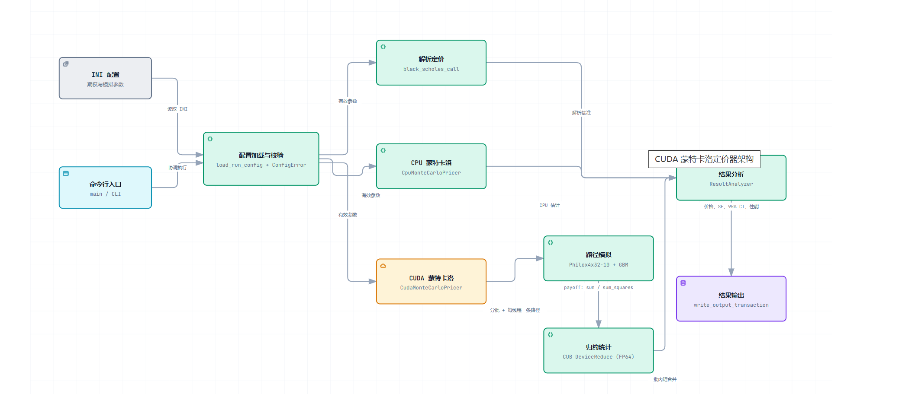
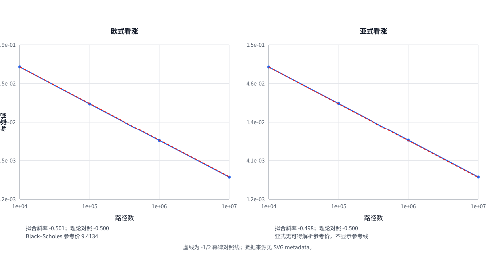
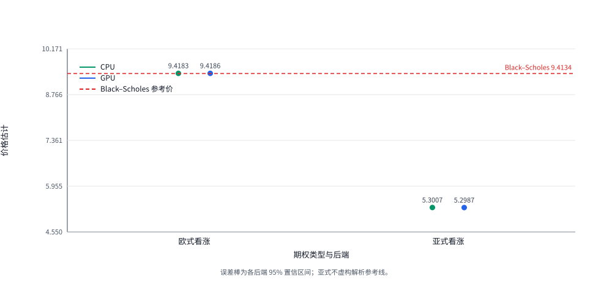
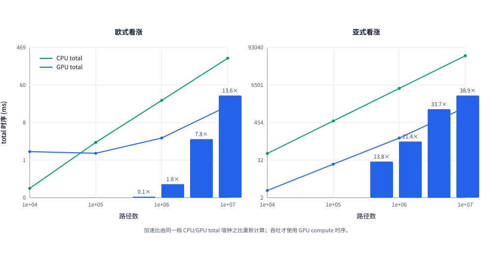
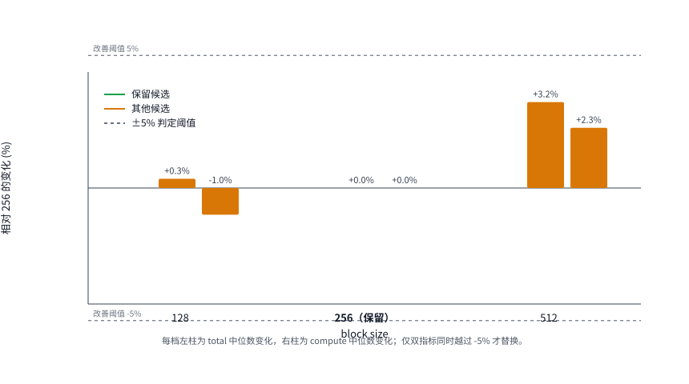
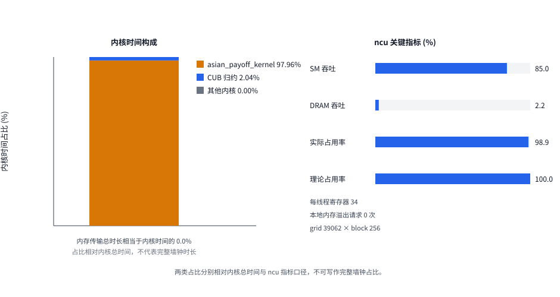

# 金融衍生品定价与风险估计 CUDA 报告

报告日期：2026-09-15<br>
冻结结果根：`results/final-report-20260915/`<br>
运行环境：RTX 4060 Laptop GPU / CUDA 12.9 / SM89 / Release / fast-math OFF / seed 1234

## 摘要与关键结论

本项目实现了一个基于 C++17/CUDA 的蒙特卡洛期权定价工具，覆盖欧式看涨和离散算术平均亚式看涨两类产品。程序提供 Black-Scholes 解析值、单线程 CPU 基线和 CUDA GPU 实现，并输出价格、标准误、95% 置信区间与性能日志。

实现中有三处直接影响实验结果：Philox 将路径编号固定映射到随机流；程序按可用显存分批计算，每批只回传 `sum` 和 `sum_squares`；收益及其平方以 FP64 完成 CUB 归约。这样既能控制显存占用，也便于在大规模路径数下稳定统计和复现实验。

| 关键指标 | 冻结结果 |
| --- | --- |
| 正确性门槛 | 86/86 CTest 通过；两个 CUDA 测试程序的 Compute Sanitizer 均为 `ERROR SUMMARY: 0 errors` |
| 收敛行为 | 欧式标准误斜率 −0.5014，亚式 −0.4980，均符合理论 −0.5 |
| 最大端到端加速 | FP64 亚式、1000 万路径为 **38.90×** |
| 关键性能边界 | FP64 欧式在 1 万路径为 **0.135×**，GPU 因固定开销反而更慢 |

文中的数值均来自本轮冻结产物。CPU/GPU 加速比统一按对应的 `total_runtime_ms` 计算。离散算术平均亚式期权没有闭式解析解，因此不设置虚构的 `reference_price` 或 `absolute_error`。

## 目录

- [1. 问题、方案与贡献](#1-问题方案与贡献)
- [2. 金融模型与数值方法](#2-金融模型与数值方法)
  - [2.1 欧式与亚式收益](#21-欧式与亚式收益)
  - [2.2 随机数、统计与时间口径](#22-随机数统计与时间口径)
- [3. 系统架构与 CUDA 设计](#3-系统架构与-cuda-设计)
  - [3.1 路径与内存策略](#31-路径与内存策略)
  - [3.2 归约与可观测性](#32-归约与可观测性)
- [4. 实验环境与复现](#4-实验环境与复现)
- [5. 正确性与收敛](#5-正确性与收敛)
- [6. CPU/GPU 性能](#6-cpugpu-性能)
- [7. P1 剖析与 block-size 决策](#7-p1-剖析与-block-size-决策)
- [8. 精度取舍](#8-精度取舍)
- [9. 整体结论](#9-整体结论)
- [10. 局限与后续方向](#10-局限与后续方向)
- [11. 附录：证据索引](#11-附录证据索引)

## 1. 问题、方案与贡献

蒙特卡洛定价需要生成大量相互独立的价格路径，路径之间几乎没有数据依赖，因此适合放到 GPU 上并行执行。本项目关注的不只是给出一个价格，还要检查 CPU/GPU 的统计结果能否相互印证、结果是否带有不确定度描述，以及性能结论是否有端到端计时和剖析数据支撑。

CPU 部分采用单线程实现，作为便于核对的正确性和性能基线。它并不代表最优 CPU 性能，因此本文的加速比应理解为单线程 CPU 与 GPU 的对比。对这类任务，路径规模和单条路径的计算量比“是否使用 GPU”更关键：亚式期权每条路径的计算更重，更容易摊薄 GPU 的固定开销。

## 2. 金融模型与数值方法

### 2.1 欧式与亚式收益

在风险中性测度下，欧式看涨的终端价格按一步 GBM 生成：

$$S_T = S_0 \exp\left[(r-q-\tfrac{1}{2}\sigma^2)T+\sigma\sqrt{T}Z\right],\quad Z\sim N(0,1)$$

欧式看涨的折现收益为 $e^{-rT}\max(S_T-K,0)$。本轮实验的 Black-Scholes 参考价为 **9.413403383853016**。

离散算术平均亚式看涨以 $m$ 个监控点价格的平均值计算收益：

$$\mathrm{Payoff}=\max\left(\frac{1}{m}\sum_{i=1}^{m}S_{t_i}-K,0\right)$$

初始价格 $S_0$ 不计入平均值。离散算术平均亚式没有闭式解析解，因而主要通过 CPU/GPU 的统计一致性、置信区间和收敛情况判断实现是否合理。

### 2.2 随机数、统计与时间口径

GPU 使用 `curandStatePhilox4_32_10_t`。`curand_init(seed, batch_offset + local_path, 0)` 将全局路径编号作为 subsequence，因此即使改变分批策略，同一条路径仍使用同一随机流。CPU 使用 `mt19937_64`，两端随机流不同，不应要求逐路径或逐位结果一致。

标准误由路径收益的样本方差计算，95% 置信区间为 $\hat{V}\pm1.96\cdot\mathrm{SE}$。比较 CPU 与 GPU 时，使用 $\sqrt{SE_{cpu}^2+SE_{gpu}^2}$ 作为合并标准误，衡量两项独立估计之差的正常波动范围。

`total_runtime_ms` 包含初始化、分配、计算和回传；`compute_runtime_ms` 只统计核函数区间。本文的 CPU/GPU 加速比均采用 `total_runtime_ms`，反映实际端到端等待时间。

## 3. 系统架构与 CUDA 设计



图 1 展示了当前实现的模块关系。命令行读取并校验 INI 配置后，程序选择 Black-Scholes、CPU 蒙特卡洛或 CUDA 蒙特卡洛路径；`ResultAnalyzer` 负责统一统计结果，并以事务方式写入 JSON 和性能 CSV。

### 3.1 路径与内存策略

CUDA 实现采用一线程一条路径和 grid-stride loop。欧式期权只需生成终端价格；亚式期权则在单个线程内推进 256 个时间步，并同步维护路径平均值。程序不保存完整的路径矩阵。

`choose_batch()` 根据可用显存确定批大小，并预留约 20% 空间。每批只从设备端回传两个 FP64 标量，主机通过 `merge_raw_moments()` 合并各批矩。因此，路径数增加不会带来完整路径结果的主机传输负担。

### 3.2 归约与可观测性

payoff 及 payoff 平方分别通过 `cub::DeviceReduce::Sum` 归约，输入、输出和最终统计均为 FP64。NVTX 可以标记 `simulate_paths`、`reduce_moments` 和 `copy_batch_moments`，便于把端到端时间拆分为具体的 GPU 活动。

## 4. 实验环境与复现

| 项目 | 值 |
| --- | --- |
| GPU | NVIDIA GeForce RTX 4060 Laptop GPU，8188 MiB，compute capability 8.9 |
| 软件 | CUDA 12.9 / 驱动 595.71 / CMake 3.28.3 / Ninja 1.11.1 |
| 构建 | Release，SM89，fast-math OFF，正式构建 NVTX OFF |
| 实验 | seed 1234；GPU 预热 1 次；正式运行 5 次取中位数 |
| 路径数 | 10,000 / 100,000 / 1,000,000 / 10,000,000 |

正式结果固定写入 `results/final-report-20260915/`。附录给出了构建、Sanitizer、扫描、剖析和绘图命令；该目录保存环境清单、输入哈希、原始 CSV/JSON、日志和 Nsight 导出物。

## 5. 正确性与收敛



图 2 中，欧式和亚式的标准误经验斜率分别为 **−0.5014** 和 **−0.4980**，与蒙特卡洛理论值 −0.5 接近。欧式绝对误差不必随路径数单调下降；判断误差量级时，应结合标准误，而不是只看估计值偏离参考价的方向。



在 1000 万路径下，欧式期权的 CPU、GPU 估计都覆盖 Black-Scholes 参考值。亚式期权的 CPU/GPU 差异为 2.04e−3，合并标准误为 3.465e−3，前者约为后者的 0.59 倍。由于两端使用不同随机流，这种统计比较比逐路径相等更合适。

## 6. CPU/GPU 性能



图 4 使用端到端时间比较性能。对于 FP64 欧式期权，1 万路径时 CPU 总耗时为 0.214687 ms，GPU 为 1.590332 ms，加速比只有 **0.135×**；此时初始化、分配和同步成本尚未被计算量摊薄。路径数增至 1000 万后，加速比达到 **13.595×**。

亚式期权每条路径需要推进 256 个时间步，计算密度更高：1 万路径时已达到 **13.759×**，1000 万路径时为 **38.898×**。这说明 GPU 的优势取决于任务规模和计算密度，小规模任务并不一定适合迁移到 GPU。

| 1000 万路径，FP64 | CPU total (ms) | GPU total (ms) | 加速比 |
| --- | ---: | ---: | ---: |
| 欧式看涨 | 260.402149 | 19.154564 | 13.595× |
| 亚式看涨 | 51,688.686487 | 1,328.820065 | 38.898× |

## 7. P1 剖析与 block-size 决策



以 256 为基准时，只有候选 block size 的 `total_runtime_ms` 和 `compute_runtime_ms` 都至少改善 5%，才会替换当前配置。128 的 total 反而增加 0.35%；512 的 total 和 compute 分别增加 3.24% 和 2.27%。因此本轮保留 **256**。



剖析结果显示，`asian_payoff_kernel<float>` 占内核时间的 97.96%，SM 吞吐为 84.97%，DRAM 吞吐只有 2.24%，实际占用率为 98.88%，本地内存溢出请求为 0。该负载主要受计算吞吐限制，而不是 DRAM 带宽限制；在这一前提下，小幅调整 block size 的收益有限。批处理只回传标量，D2H 时间约为内核总时间的 0.02%。

## 8. 精度取舍

当前冻结指标中，FP32 与 FP64 的可用计时字段口径不一致，不能据此比较两种精度的性能，也不报告性能倍数。两种精度的价格估计处于采样误差的相近量级；但本轮 FP32/FP64 同时改变了随机流，不能把差异全部归因于数值精度。若要单独考察精度影响，需要使用共同随机数，并在同一计时边界下记录 FP32/FP64 的 `compute_runtime_ms`。

## 9. 整体结论

**数值结果通过了本轮验证。** 86/86 CTest 通过，两个 CUDA 测试程序的 Compute Sanitizer 均报告 `ERROR SUMMARY: 0 errors`。欧式和亚式的标准误斜率分别为 **−0.5014**、**−0.4980**；欧式结果覆盖解析值，亚式结果则通过合并标准误比较进行核对。

**GPU 的收益取决于负载。** FP64 亚式在 1000 万路径下的端到端加速为 **38.90×**，欧式为 13.59×；但欧式在 1 万路径下只有 **0.135×**。因此，对计算量较小的任务，GPU 未必比单线程 CPU 更合适。

**block_size = 256 是本轮扫描的保守选择。** 亚式核函数的 SM 吞吐为 84.97%，实际占用率为 98.88%，且未出现本地内存溢出。128、256、512 三种 block size 中，没有候选值同时让 total 与 compute 中位数改善至少 5%，因此继续采用 256。

## 10. 局限与后续方向

1. **性能适用范围。** 本轮结果只对应 RTX 4060 Laptop GPU、驱动 595.71、WSL2 和当时的热状态，未进行长时间温控测试，也不应直接外推到其他硬件。
2. **CPU 基线公平性。** CPU 为单线程串行基线。加速比体现的是它与大规模并行 GPU 的差异，不等同于最优 CPU 与最优 GPU 的比较。
3. **随机流差异。** CPU 使用 `mt19937_64`，GPU 使用 Philox；跨后端只能比较统计一致性，不能要求逐路径或逐位相同。
4. **精度解耦不足。** FP32/FP64 对照同时改变了随机流。要隔离纯精度影响，需要采用共同随机数或固定随机流。
5. **方差缩减未实现。** 尚未使用对偶变量、控制变量或重要性采样，收敛仍处于标准的 −1/2 级别。
6. **剖析为代表性采样。** nsys/ncu 指标来自一次 FP32 亚式代表负载采集，并非多次统计结果。
7. **亚式没有解析基准。** 离散算术平均亚式没有闭式解，只能借助跨后端一致性和收敛证据建立信心。

后续可先加入对偶变量等方差缩减方法，再补充多线程 CPU 基线和共同随机数下的精度实验，最后评估 block-size 与 batch 策略的自动调优。

## 11. 附录：证据索引

### 11.1 复现入口

```bash
python3 scripts/run_final_report.py \
  --source-root . --build-dir build-final-report-20260915 \
  --output-root results/final-report-20260915 --phase validate
python3 scripts/run_final_report.py \
  --source-root . --build-dir build-final-report-20260915 \
  --output-root results/final-report-20260915 --phase block-sweep
python3 scripts/run_final_report.py \
  --source-root . --build-dir build-final-report-20260915 \
  --output-root results/final-report-20260915 --phase formal
python3 scripts/render_final_report_figures.py \
  --input-root results/final-report-20260915 --output-dir report/figures
```

NVTX 构建与 nsys/ncu 采集命令记录在 `results/final-report-20260915/profiling/asian-fp32/profile_commands.txt`。输出根名称受脚本保护，避免误写入已废弃的 `final-report-20260909`。

### 11.2 图表与原始产物

| 图 | 数据源 |
| --- | --- |
| 图 1 系统架构 | `report/figures/figure-01-system-architecture.png`；源 `Docs/architecture/derivative_pricer.architecture.json` |
| 图 2 收敛 | `convergence/{european,asian}-fp32/convergence_summary.csv` |
| 图 3 正确性与 CI | `benchmark/{european,asian}-fp64/benchmark_summary.csv` |
| 图 4 性能扩展 | `benchmark/{european,asian}-fp64/benchmark_summary.csv` |
| 图 5 block-size | `block-sweep/asian-fp32/block_sweep.csv` |
| 图 6 Nsight 瓶颈 | `profiling/asian-fp32/{nsys-*.csv,ncu-details.csv}` |

`manifest.json` 记录环境与构建选项，`input-sha256.txt` 记录 33 个输入文件与可执行文件哈希，`validation/` 保存构建、CTest 和两份 memcheck 日志，`report/figures/report_metrics.json` 保存每个派生指标的源文件、行键与公式。五张数据 SVG 的 metadata 内嵌生成脚本、结果根、输入相对路径和 SHA-256，用于避免历史结果混入。
