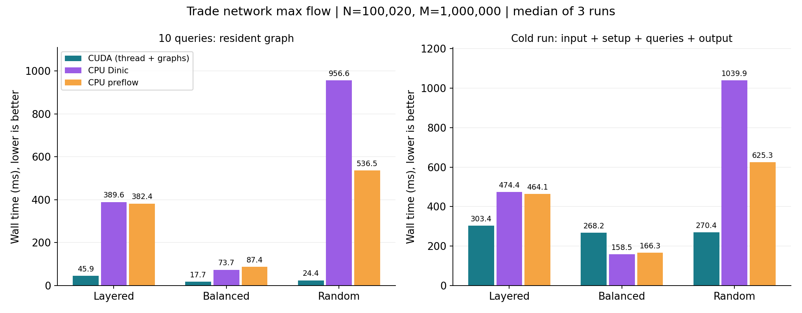

# 选题六总结：贸易网络最大流量规划

本项目实现了单 GPU 的精确整数最大流值计算，支持 CSR 二进制输入、多源汇独立查询、int32 容量和 int64 结果。正式验收规模为 100,020 个节点、1,000,000 条原始有向边、10 个不同源汇对。三类图均与 CPU Dinic 一致，并通过最大预流／最小割证书检查。

最终版本在 WSL2 的 RTX 4070 Laptop GPU 上，查询阶段相对两种 CPU 基线中较快的一种加速 4.16–21.98 倍；包含读写、CPU 预处理、CUDA 冷初始化的完整运行在随机图与随机容量分层图上分别加速 2.31 和 1.53 倍。等容量分层图只有十次查询时，冷启动版本慢于 CPU，报告保留这一结果。

## 1. 任务对应关系

| 验收项 | 实现与验证 |
|---|---|
| CSR 输入，结果每行 source target maxflow | `graph.cpp` 严格解析，`main.cpp` 写规定格式 |
| 至少十万节点、百万条边 | 三类 N=100020、M=1000000 图实测 |
| 容量覆盖 1–10000，结果 int64 | 容量可到 INT32_MAX；总流量 2,147,500,000 及 4,294,967,294 案例通过 |
| 至少十个不同源汇 | 三类图各十对；每次重新初始化 residual、excess、incoming、height |
| 主要计算在 GPU | 源点预流初始化、反向 BFS、推送、重标号、活跃状态归约均为 CUDA kernel |
| GPU 常驻拓扑 | 构造求解器时一次上传 CSR、反向边映射、原始容量；查询只上传两个节点编号 |
| 小图 CPU 一致性 | 100 张随机图的 400 个查询，另有经典／边界图，两种 CPU 与两种 GPU 模式交叉验证 |
| 预处理、TTFQ、总时间、TPQ | 全部输出到 JSON，并明确时间口径 |
| 总结、程序、测试 | 本报告、正式源码、独立验证脚本、实测记录 |

仅验证 NVIDIA 平台，不宣称支持国产平台或浮点容量。程序输出题目要求的最大流**数值**，未输出逐边可行流或具体运输路径。

## 2. 算法设计

### 2.1 为什么使用推送—重标号

增广路算法需要不断发现并更新 s-t 路径，单条路径内部依赖强。推送—重标号允许节点暂存超额流量，许多节点可以同时向相邻节点发送流量，适合 GPU。采用 Goldberg–Tarjan 预流思想，以残量网络、节点 excess 和高度标号组织计算。[原始论文](https://www.cs.princeton.edu/courses/archive/fall07/cos521/handouts/p921-goldberg.pdf)。

本实现只求最大流值，因此停在最大预流阶段：与汇点已隔离的超额无需退回源点。对不能到达汇点的节点停止工作，可减少回退推送；最终仍用独立证书检查最大流值。这个选择只适用于当前数值输出需求，如果需要每条航道的实际运输量，必须继续做预流到可行流的转换。

### 2.2 残量网络与数据类型

CPU 把每条原始边 u→v 扩展为一对残量边，容量分别为 c 和 0；保存反向索引 `rev[e]`。扩展后仍按节点组织 CSR。原始反向边和重边各自拥有独立残量对，不合并、不共享反向索引，因此不会因反向边容量相加导致 int32 残量溢出。自环保留在图结构中，源点初始化跳过自环，推送条件也不允许沿自环发送流量。

- `row/col/rev/original/residual/height/frontier`：32 位整数。
- `excess/incoming`：无符号 64 位整数，调用 CUDA 的 64 位整数原子加。
- 输出与 CPU 参考的流值、证书余额和割容量：有符号 64 位整数。
- 输入限制 M≤floor(INT32_MAX/2)，故总容量小于 2^61，64 位计数不会溢出。
- 单个残量对总容量始终为 c≤INT32_MAX，单边残量也不会超出该范围。

原始容量与工作残量分开保存。每个查询只在 GPU 内执行 D2D 复制及工作数组清零，不再次传输图拓扑。

### 2.3 查询流程

1. 将原始容量复制到残量数组，清零 excess 和 incoming，上传本次 s、t。
2. 并行饱和源点出边，创建初始预流，累加邻点 excess。
3. 从 t 在**反向残量网络**上做 BFS，得到到汇点的距离。源点排除，无法到达汇点的高度设为 N。
4. 同步推送轮：固定高度快照与本轮初始 excess，只沿 `h[u] == h[v] + 1` 的正残量边发送；发送量受源节点剩余 excess 与边残量双重限制。
5. 更新轮：合并 incoming，并对仍有超额的节点按 `min(h[v]+1)` 重标号，截断至 N。高度使用双缓冲，不在读取邻居旧高度时覆写它。
6. 每 8 轮读取一次块级活跃计数；每 64 轮执行一次全局重标号。没有高度低于 N 的非源汇活跃点时，汇点 excess 即答案。

轮数上限默认为一百万，达到上限仍活跃则报错，不能把未完成的预流值当答案。批次数为偶数，保证 CUDA Graph 重放前后高度缓冲区位置不变。尾批次可能包含几轮无工作迭代，记录的 `rounds` 包括这些轮次。

### 2.4 并发安全

excess 和 incoming 分离：节点只写自己的剩余 excess，其他节点只原子累加到该节点的 incoming；内核边界之后再合并。这样不会把本轮新收到的流量无序地重复消费。

高度在整个推送 kernel 内只读。同一残量对不可能同时满足两个相反方向的可推送条件。残量读写使用整数原子操作，避免一个方向读容量时，另一个方向刚好添加反向残量的读写竞争。每个残量边只有其所属节点的线程／warp 可能沿它推送，所有推送量均受边容量限制。

随后在同一非默认 stream 的独立 kernel 中更新 excess 和下一份高度；stream 顺序提供阶段间依赖。warp 方案只在完整 warp 的一致控制流下调用带完整掩码的 shuffle；更新阶段的块内计数也由整个 block 参与。相关原子操作和 CUDA Graphs 接口依据 [CUDA 12.4 编程指南](https://docs.nvidia.com/cuda/archive/12.4.1/cuda-c-programming-guide/index.html)。

### 2.5 正确性与证书

初始饱和源出边形成预流，非源节点的净流入非负。推送不会超过容量或节点拥有的超额，因此保持预流约束。对残量正边维持 `h[u] <= h[v] + 1`，高度 N 的非源点不能通过长度小于 N 的简单残量路径到达高度 0 的汇点。每轮中各可推送节点消费自身超额，不能推送而仍活跃时提高标号；全局 BFS 重新取得有效距离标签。

终止时能到达 t 的非终点没有超额。令 T 为残量网络中能够到达 t 的顶点集合，S 为其补集。没有从 S 到 T 的正残量边，原图上 S→T 的容量均已用满，T→S 没有正流。因此进入 T 的净流等于割容量，又因 T 内除 t 外余额均为零，得到 `excess[t] = capacity(S,T)`，即最大流值。

`--check` 会把最终残量和 excess 取回 CPU，独立检查：

- 每条残量非负，正反残量和等于初始正反容量和。
- 每条原始边容量约束，重新计算的非源余额非负且等于 GPU excess。
- 残量网络中不存在 s→t 路径。
- 能到达 t 的非终点余额为零。
- 汇点余额、输出结果和最小割容量完全相等。

同时用另一套 CPU Dinic 求值并比较。证书开销完全排除在求解时间之外，单列 `validation_ms`。

## 3. 并行化与优化记录

### 3.1 线程、warp 两种粒度

默认 `thread` 模式：一个线程负责一个顶点，按 CSR 顺序扫描出边。平均度较低时可以让一个 warp 同时服务 32 个顶点，跳过无 excess 的节点。

`warp` 模式：一个 warp 负责一个顶点，32 条边共同读取；用 64 位 warp 前缀和把有限 excess 分配给多个可推送边，每条边获得 `min(capacity, max(excess-prefix_before,0))`。64 位前缀避免多个大容量边相加溢出。

最初以 warp 模式为主，测试发现三个百万边用例都是 thread 更快。平均残量出度约为 20，很多 warp 的 lane 没有有效边，且活跃节点少时浪费更多线程；因此把 thread 设为最终默认，保留 warp 供高出度场景比较。上述性能原因是结合图结构和对照实验的解释，未获得硬件占用率计数器直接验证。

### 3.2 全局重标号和 CUDA Graphs

BFS 使用一个 warp 遍历一个前沿节点，避免汇点／枢纽大出度完全串行；通过 `atomicCAS` 只入队一次，两个 N 元素队列交替使用。每一层只回传一个计数。推送迭代用 CUDA Graphs 一次提交 8 轮共 16 个 kernel，减少 CPU 启动次数；批末只回传 ceil(N/256) 个活跃计数及最终 8 字节结果。

工作区一次分配。无查询内部 cudaMalloc，无重新读取图文件，无逐次上传完整拓扑。空间复杂度 O(N+M)。稀疏高直径图的 BFS 层数、同步轮数可能很大，当前实现没有对此提供快速最坏情况保证。

### 3.3 同一输入的优化对照

下表为 10 次查询总耗时（ms），三次独立进程运行的中位数；每个结果均核对一致。

| 配置 | 分层随机容量 | 分层等容量 | 随机有向图 |
|---|---:|---:|---:|
| warp，逐 kernel 启动 | 91.202 | 23.351 | 54.545 |
| warp，CUDA Graphs | 87.705 | 21.214 | 47.361 |
| thread，逐 kernel 启动 | 57.447 | 20.974 | 31.243 |
| **thread，CUDA Graphs（默认）** | **45.924** | **17.709** | **24.410** |

最终默认相对最初 warp + 逐 kernel 方案分别快约 1.99、1.32、2.23 倍。Graphs 在 thread 方案下分别使查询时间降低约 20.1%、15.6%、21.9%。未声称这些优化在所有图上成立。

## 4. 实验环境和口径

实测日期：2026-09-19。环境原文见 [environment.txt](reports/environment.txt)。

| 项目 | 实测配置 |
|---|---|
| 系统 | Windows / WSL2，Ubuntu 26.04 LTS，Linux 6.18.33.2-microsoft-standard-WSL2 |
| GPU | NVIDIA GeForce RTX 4070 Laptop GPU，8188 MiB 显存，SM 89 |
| CPU | Intel Core i7-12800HX；WSL 显示 24 个逻辑 CPU，基线均单线程 |
| 工具 | CUDA 12.4.131；GCC 13.4；CMake 4.2.3；Python 3.14.4 |
| 编译 | C++17 / CUDA17，Release / -O3 / -lineinfo；未开 fast-math |
| 分析 | Nsight Systems 2023.4.4；Compute Sanitizer 2024.1.1 |

没有锁定 GPU 时钟，没有把 Windows 显示负载隔离，也没有绑定 CPU 核心。图文件位于 `/mnt/d`，读写时间会受 WSL 挂载和缓存影响。每类配置运行 3 次，轮换配置顺序，取中位数；每次重新启动进程，不扣除首次 CUDA 初始化。基准前执行一次全量正确性检查，因此文件缓存属于热缓存附近状态，不能称为物理磁盘冷缓存测试。CPU 基线使用同一残量 CSR 和同一输入边序，内存复用，每次重置残量；没有使用故意低效的 CPU 增广路基线。

### 4.1 计时定义

- `input_read_ms`：图／查询文件读取与验证。
- `preprocess_ms`：构造残量 CSR、求解器分配、CUDA 上下文首次初始化、一次图上传、Graphs 捕获／上传；不含输入读取。
- `first_query_ms`：第一个查询的完整 wall time，包括 GPU 内重置、kernel、BFS、主机控制、结果传回及等待。
- `ttfq_ms`：`preprocess_ms + first_query_ms`。
- `startup_ttfq_ms`：从进入 main 到第一次查询完成，包含文件读取与参数解析等。
- `total_query_ms`：所有完整单查询 wall time 的和，含残量初始化和同步，排除可选验证和结果文件输出。
- `tpq_ms`：`total_query_ms / query_count`。
- `query_phase_wall_ms`：查询循环实际 wall time；开启 `--check` 时含穿插的验证。
- `process_until_log_ms`：从 main 到写性能 JSON 前，包含输入、预处理、全部查询、结果文本落盘，不含日志写入及析构；报告“含启动与读写”采用此口径。

采用主机单调时钟而非仅 kernel event 时间，可以反映 WSL 调用、全局重标号多层同步和数据拷贝的实际成本。不同列各自取中位数，所以中位数列之间不保证严格相加。

### 4.2 数据集

所有数据由 `scripts/generate.py`、Python 随机种子 2026 生成，不使用外部私有数据，三个用例均恰好 N=100020、M=1000000、Q=10。

1. **layered**：10 个源候选、10 个汇候选，100000 个内部节点均分为 8 层。源连第一层，最后一层连汇；各层有贯穿骨干边和随机附加前向边，容量均匀取 1–10000。
2. **balanced**：同类宽分层结构，所有边容量 10000，有足够完整骨干路径，流值容易达到边界容量。作为容易实例观察启动成本，不能用它替代不规则图验证。
3. **random**：每条边独立随机选择起点终点，容量取 1–10000，允许重边和自环；查询 `(0,N-10)` 至 `(9,N-1)`。

三类图的结果原文和每次运行的日志均保存于 [reports/metrics](reports/metrics)。所有十个查询都独立初始化，未复用上一查询的残量。

## 5. 正确性结果

独立 Python Edmonds–Karp 先合并平行容量，以 Python 任意精度整数求值，与 C++／CUDA 的 CSR 实现不共享算法代码。100 张随机小图每张 4 个查询，再加经典 23 流量图的所有不同源汇、自环、重边、双向边、死端、零容量、空图、64 位总流量、INT32_MAX 边界以及 1024 节点长链。

共 **1794 次 query×mode 数值核对通过**；14 类非法图／查询输入被拒绝。详见 [validation.json](reports/validation.json) 和 [tests.txt](reports/tests.txt)。经典图重复查询三次，随机图在同一求解器中处理多个源汇，验证了状态隔离。

三个百万边数据集另各执行 10 次 CPU Dinic 等值和完整割证书检查，共 30 个大图查询通过。全部性能运行也比较结果文件，四种 GPU 选项与两种 CPU 算法均一致。

主机端 C++ 使用 UndefinedBehaviorSanitizer 重新构建并运行同一测试集，全部通过。[构建日志](reports/ubsan_build.txt)、[测试日志](reports/ubsan_tests.txt)。此检查覆盖 C++ 主机输入处理、CPU 算法和主程序，不代表 GPU kernel 获得 UBSan 检查。

## 6. 最终性能

### 6.1 要求的四项指标

默认 thread + Graphs，单位 ms，中位数。

| 图 | T_preprocess | 首查询计算 | TTFQ | T_total（10 次） | TPQ |
|---|---:|---:|---:|---:|---:|
| layered | 192.175 | 5.710 | 197.885 | 45.924 | 4.592 |
| balanced | 183.598 | 2.333 | 185.920 | 17.709 | 1.771 |
| random | 190.710 | 2.152 | 192.862 | 24.410 | 2.441 |

### 6.2 与 CPU 的公平比较

| 图 | CPU Dinic 查询总时间 | CPU FIFO 预流查询总时间 | 默认 GPU 查询总时间 | 对较快 CPU 加速 |
|---|---:|---:|---:|---:|
| layered | 389.617 | 382.415 | 45.924 | 8.33× |
| balanced | 73.678 | 87.436 | 17.709 | 4.16× |
| random | 956.650 | 536.465 | 24.410 | 21.98× |

随机图若只对 Dinic 报告，可得到 39.19×；本文使用两个基线中较快的 CPU 值，采用更保守的 21.98×。

| 图 | 较快 CPU 含启动／读写 | GPU 含启动／读写 | 整体加速比 |
|---|---:|---:|---:|
| layered | 464.138 | 303.427 | 1.53× |
| balanced | 158.490 | 268.162 | 0.59× |
| random | 625.314 | 270.410 | 2.31× |

GPU 冷初始化使其 TTFQ 明显高于 CPU。对于简单、短批次的图，推荐 CPU；对于复杂图和拓扑常驻的重复查询，GPU 可以摊薄固定开销。没有宣称总体性能在所有拓扑、所有查询数和所有硬件上必然更好。



完整原始采样：[benchmark.csv](reports/benchmark.csv)；汇总：[summary.json](reports/summary.json)。

### 6.3 显存

R=2M 条残量边，程序显式分配的主要缓冲区字节数为：

```text
4 * ((N+1) + 4*R + 4*N + 3 + ceil(N/256)) + 16*N
```

在 N=100020、M=1000000 时为 **35,602,300 bytes，约 33.95 MiB**。其中四份 R 数组是目标、反向索引、原始容量、工作残量；四份 N 个 int 数组是两份高度和两份 BFS 队列；两份 N 个 uint64 是 excess/incoming。此数不含 CUDA 上下文、驱动、Graphs 内部存储和 CPU 缓冲区，不是 nvidia-smi 所显示的整进程显存。

## 7. Nsight 分析与工具限制

执行 `scripts/profile_wsl.sh` 对百万边 random 数据集的十个查询采样。发行版 nsys 没有自动找到 importer，脚本使用已安装的 `QdstrmImporter` 成功生成报告，并导出 CUDA API 汇总。[采集记录](reports/nsys_capture.txt)、[导入记录](reports/nsys_import.txt)、[汇总](reports/nsys_summary.csv)。

本机 Nsight Systems 2023.4.4 取得 CUDA API 事件，但导出的 SQLite 不包含 GPU kernel 或设备内存活动记录。故不能由该轨迹给出真实 kernel 占比、SM 利用率或设备带宽，不把 API 启动耗时当作 kernel 执行时间。

可观察的 API 结果：

| API | 调用次数 | CPU API 总耗时 |
|---|---:|---:|
| cudaMalloc | 14 | 125.653 ms |
| cudaStreamSynchronize | 253 | 25.305 ms |
| cudaMemcpyAsync | 275 | 13.791 ms |
| cudaLaunchKernel | 176 | 4.117 ms |
| cudaGraphLaunch | 113 | 0.933 ms |

首个 cudaMalloc 最大耗时约 124.094 ms，支持“首次 CUDA 初始化占预处理大头”的解释。多次 stream 同步主要来自反向 BFS 的逐层计数和每批收敛检查；未来可考虑把 BFS 多层处理和活跃队列控制移入设备端。Graph 重放仅用 113 次主机启动调用提交推送／重标号批次，补充说明了优化对照中查询阶段受益的来源。该采样带分析工具开销，不参与第 6 节性能中位数。

Compute Sanitizer memcheck 报告 `Failed to initialize WDDM debugger interface`，继而 `Device not supported`。这是调试接口初始化失败，**不能解释为 GPU 内存检查通过，也不能认定为 kernel 已发现两处内存错误**。原始日志为 [sanitizer_memcheck_thread.txt](reports/sanitizer_memcheck_thread.txt)。脚本随失败停止，后续 racecheck、initcheck、synccheck 及 warp 模式未在此环境执行。没有改动 Windows 主机的调试注册表。NVIDIA 对该接口的要求见 [Compute Sanitizer 文档](https://docs.nvidia.com/compute-sanitizer/ComputeSanitizer/index.html#operating-system-specific-behavior)。

## 8. 仍可改进的方面

1. 稀疏活跃点时仍扫描 N 个节点；使用去重活跃工作队列、按度混合调度有望减少无效线程。
2. 全局重标号按固定轮次触发；可按边扫描工作量、活跃比例调整，并比较参数敏感性。
3. 高直径图反向 BFS 的逐层主机同步较昂贵；考虑持久化 kernel 或设备端队列，但需要保留清晰的全局同步和终止证明。
4. 可封装长驻进程服务，让更多独立查询共享同一次 CUDA 初始化，改善真实请求的首次启动摊销。
5. 如需要逐边运输方案，补充最大预流到可行流的转换，并输出容量约束及全节点流量守恒证书。
6. 在支持调试的新版本分析环境中补全 GPU sanitizer、硬件计数器，再验证其他 NVIDIA 型号或国产平台。

## 9. 复现与提交

```bash
cd /mnt/d/Jiaying/Documents/ChatGPT/InfiniTensor/Learning-CUDA/06_trade_planning/jiaying
bash scripts/build_wsl.sh -DCMAKE_CUDA_ARCHITECTURES=89
export LD_LIBRARY_PATH=/usr/lib/wsl/lib${LD_LIBRARY_PATH:+:$LD_LIBRARY_PATH}
python3 scripts/benchmark.py
python3 scripts/plot.py
bash scripts/profile_wsl.sh
bash scripts/ubsan_wsl.sh
python3 scripts/package.py
```

代码按 clang-format 格式化，正式程序与验证脚本分目录。提交位置为 Learning-CUDA 的 `2026-summer-project` 分支下 `06_trade_planning/jiaying/`，使用独立提交分支向上游发起 PR。打包不包含大图、构建产物和庞大分析中间文件；输入由固定种子脚本重新生成。ZIP 包和 SHA256 清单用于校验交付内容。
