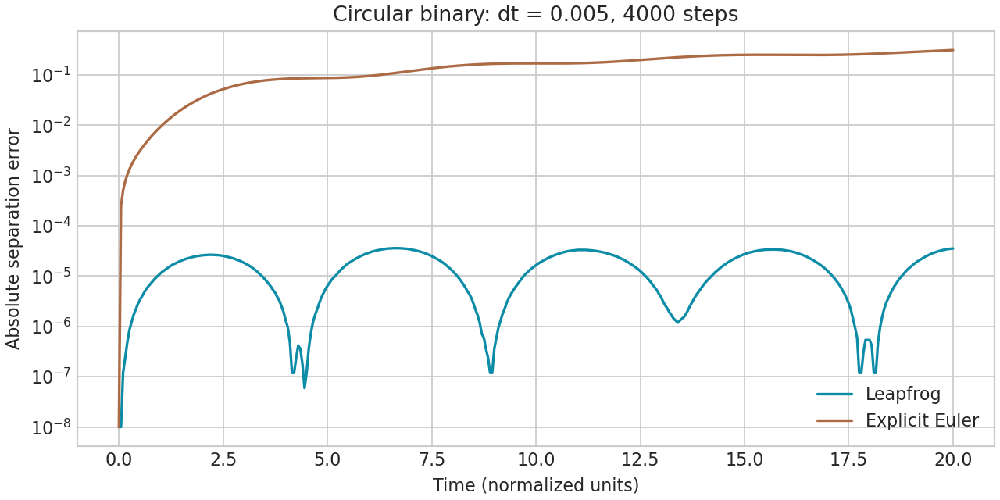
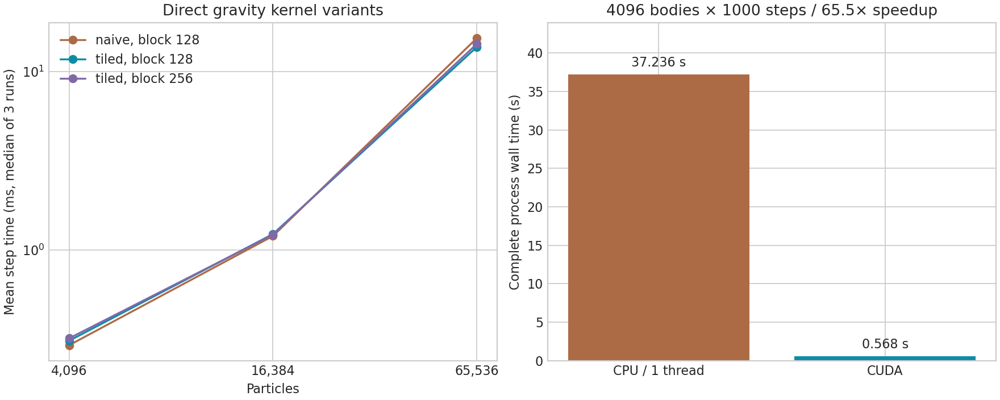

# 选题八：N 体引力模拟与可视化总结报告

作者目录：`08_nbody/jiaying`；实验日期：2026-09-17。

## 1. 完成范围与实验环境

完成 CUDA N 体模拟、两种数值积分、CPU 对照、粒子优先二进制轨迹、二维/三维动画、近距离风险标记、验证和性能报告。基础规模 **4096 × 1000** 和进阶规模 **65536 × 1000** 均实际运行，后者写出 101 帧、79,429,640 字节轨迹并通过全文件有限数值检查。没有采用近似引力算法。

| 环境 | 实测配置 |
|---|---|
| 系统 | Windows 主机上的 WSL2，Ubuntu 26.04 |
| GPU | NVIDIA GeForce RTX 4070 Laptop GPU，8188 MiB |
| CPU | Intel Core i7-12800HX；WSL 暴露 24 个逻辑 CPU |
| 编译 | CUDA 12.4.131，GCC 13.4，CMake 4.2.3；Release `-O3` |
| 架构 | 实测 SM 89；默认构建兼容 SM 75/86/89 |
| Python | 3.14.4、NumPy 2.3.5、Matplotlib 3.10.7 |
| 数据位置 | WSL `/mnt/d/…`，轨迹写入 Windows 挂载盘 |

完整配置见 [environment.txt](reports/environment.txt)。本机同时承担桌面显示任务，GPU 频率、功耗及文件缓存会影响结果；报告不把一次测量的末位数字视为稳定性能保证。

## 2. 物理模型和积分

直接累加每个粒子的加速度：

\[
\mathbf a_i = G \sum_{j\ne i}m_j
\frac{\mathbf r_j-\mathbf r_i}{(\lVert\mathbf r_j-\mathbf r_i\rVert^2+\epsilon^2)^{3/2}}.
\]

这是 Plummer 软化后的引力，不发生粒子接触、反弹、吞并或质量变化。正质量、有限坐标与速度、正 dt、非负 G、可表示的正软化平方都在输入阶段检查。完全重合的不同粒子具有零位移、有限软化势，不会因除零而产生 NaN。

默认采用 kick–drift–kick leapfrog，也可视为存储整步速度的 velocity Verlet：

\[
\mathbf v_{n+1/2}=\mathbf v_n+\tfrac12\Delta t\,\mathbf a_n,\qquad
\mathbf r_{n+1}=\mathbf r_n+\Delta t\,\mathbf v_{n+1/2},\qquad
\mathbf v_{n+1}=\mathbf v_{n+1/2}+\tfrac12\Delta t\,\mathbf a_{n+1}.
\]

初始加速度计算一次，此后每步只需一次引力计算，1000 步共 1001 次。它是二阶、时间可逆的辛积分方法；固定步长、有限精度和近距离强相互作用仍会影响误差，不能认为任意 dt 都稳定。

Euler 对照使用显式更新 `r_next = r + dt*v`、`v_next = v + dt*a(r)`，主要用于展示数值积分的影响。所有状态存储和演化为 FP32；诊断在 CPU 使用 FP64 累加。

能量采用与加速度匹配的软化势：

\[
E=\sum_i\tfrac12m_i\lVert\mathbf v_i\rVert^2-
G\sum_{i<j}\frac{m_i m_j}{\sqrt{\lVert\mathbf r_i-\mathbf r_j\rVert^2+\epsilon^2}}.
\]

相对能量误差为 `abs(E1-E0)/max(abs(E0),1e-30)`。动量报告绝对漂移，以及除以初态 `sum(m_i*|v_i|)` 的归一化漂移，以避免初始总动量接近零时直接计算相对误差失真。初始速度全零时应主要看绝对动量漂移。

## 3. CUDA 设计与优化过程

### 3.1 数据与并行分工

- 每个线程负责一个目标粒子，顺序累加源粒子的贡献；不使用原子操作。
- 位置与质量合并到一个 16 字节 `float4`；速度、加速度各一个 `float4`。
- 三个设备数组占用 `48N` 字节：4096 粒子 192 KiB，65536 粒子 3 MiB。这是程序显式分配量，不是包含驱动和 CUDA context 的 GPU 总占用。
- CPU 负责解析、初态生成、文件布局、计时汇总和 FP64 诊断；GPU 完成全部力、位置和速度演化。
- 状态常驻显存，只在记录点复制位置；末态另外复制完整位置和速度。记录缓冲使用页锁定内存。当前采用同步复制，没有宣称计算与传输重叠。

### 3.2 从基线到分块

保留 `naive` 核作为基线，每个目标线程从全局地址读全部源粒子。`tiled` 核将 128/256 个源粒子协作加载到共享内存，供块内线程重复使用，分别需要 2/4 KiB 共享内存。该设计参考 NVIDIA 对 all-pairs N 体计算的讨论：[GPU Gems 3, Chapter 31](https://developer.nvidia.com/gpugems/gpugems3/part-v-physics-simulation/chapter-31-fast-n-body-simulation-cuda)。代码为本项目独立实现。

引力累加使用 `rsqrtf`，源粒子循环按 8 展开。没有启用全局 `--use_fast_math`，避免改变整个程序的数值语义。最后半步速度更新合并到加速度写回，leapfrog 每步只需要两个核：一个半踢加漂移核，一个计算新加速度并完成半踢的核。

位置漂移和引力计算必须分成不同核：引力核只读位置，避免同一 kernel 内不同 block 同时读写位置。尾块中超出 N 的线程也参加共享内存屏障；只有有效目标进行累加，源 tile 只遍历有效长度，避免越界和 barrier 死锁。验证专门覆盖 127、128、129、255、256、257 等规模。

### 3.3 轨迹和错误处理

二进制严格为小端 `int32 P,R` 加 `float32 positions[P,R,3]`，包含初态、每个间隔和末态。真实 step 列表在 JSON 旁文件中。使用 Linux mmap 直接写目标布局，消除额外的全轨迹转置缓冲；仅在记录间隔传回位置。主机 page cache 可能缓存整个输出文件，这并不等于常数主机内存。

所有 CUDA API、核启动、文件打开/同步失败均返回非零退出码；拒绝未知参数、重复配置、不合法数值和输入输出同一路径。写帧和最终状态均检查非有限值。C++ 内存与事件使用 RAII 管理。

## 4. 正确性证据

[validate.py](tests/validate.py) 是独立验证脚本，使用 NumPy FP64 广播实现作为短程演化参考，没有调用 CUDA 实现中的受测函数。正式功能源码与验证文件分开存放。

| 验证项 | 实测结果 |
|---|---|
| 1/2/31/127/128/129/255/256/257 粒子，两种积分，FP64 对照 | 全部通过；所有位置/速度最大绝对误差 ≤ 6.62×10⁻⁷ |
| CPU 单线程/双线程、CUDA naive、CUDA block=256 | 全部通过 FP64 对照 |
| 二体圆轨道，dt=0.002，7000 步，约 3.15 周期 | 分离距离最大误差 1.01×10⁻⁵，末态能量相对误差 2.40×10⁻⁶ |
| 椭圆轨道步长 0.02 → 0.01 | 位置误差 3.53×10⁻⁴ → 8.85×10⁻⁵，误差比 3.989，符合二阶收敛 |
| 256 粒子星团，1000 步 | 能量误差 7.76×10⁻⁸，归一化动量漂移 1.45×10⁻⁷ |
| **4096 粒子 × 1000 步** | **能量误差 3.93×10⁻⁸，归一化动量漂移 3.73×10⁻⁹** |
| 4096 粒子 CPU/GPU 全部 101 帧 | 坐标最大绝对差 7.15×10⁻⁷ |
| 65536 粒子全 101 帧 | 大小/布局正确；全部坐标有限 |
| 零步、单粒子匀速、完全重合粒子 | 通过 |
| 15 个非法输入、截断轨迹、路径别名保护 | 正确拒绝且输入文件不被覆盖 |
| 三维近距离空间哈希 | 与独立暴力距离矩阵得到的配对数、粒子标记一致 |
| 主机 UndefinedBehaviorSanitizer 构建 | 完整验证通过，无已报告的主机未定义行为 |

最终验证共 **27 个检查组**，包括上述组合和边界。证据：[validation.json](reports/validation.json)、[tests.txt](reports/tests.txt)、[ubsan_tests.txt](reports/ubsan_tests.txt)、[summary.json](reports/summary.json)。能量与动量数值描述的是所选初态、步长下的末态误差，不是任意初态下的误差上界。大规模测试关闭了 CPU O(N²) 守恒量诊断，因此没有声称已经验证 65536 粒子的能量守恒。

另外在相同二体初态、dt=0.005、4000 步时，显式 Euler 能量误差为 **0.2316**，leapfrog 为 **4.74×10⁻⁶**。轨道分离误差曲线展示了长期积分方法选择的重要性：



## 5. 性能实验与分析

### 5.1 计时口径

- `compute_ms`：CUDA event 度量每段演化流的时间，包含初始加速度、核执行和该流中的主机提交间隙，排除帧复制与文件写入；不是 Nsight 的纯 kernel 时间总和。CPU 对应演化计算用 steady_clock 计时。
- `simulation_wall_ms`：已分配并初始化状态后的演化墙钟时间，包括记录点复制、内存映射写入和末态回传，GPU context 创建、分配及初始 H2D 不在此值内。
- `trajectory_flush_ms`：最终 `msync` 单独计时。
- `process_wall_ms`：Python 在子进程外侧计时，包含程序启动、CUDA 初始化、解析、诊断、演化、落盘和退出；用于完整流程加速比。
- `mean_step_ms = compute_ms/steps`；`particle_steps_per_second = N*steps*1000/compute_ms`。初始力计算成本已计入。

CPU 基准与 GPU 使用相同 FP32 初态、直接 O(N²) 力模型、相同步长/软化、相同积分、记录策略和 FP64 诊断。CPU 单线程使用 `-O3 -march=native`。另给出 OpenMP 12 线程结果；没有把它与单线程混在同一加速比里。

### 5.2 基础与进阶实际运行

| 工作量 | 计算时间 | 演化墙钟 | 完整进程 | 更新速率 | 设备数组 |
|---|---:|---:|---:|---:|---:|
| 4096×1000，CPU 单线程 | 37.118 s | 37.127 s | 37.236 s | 0.110 M particle-steps/s | 0 |
| 4096×1000，CUDA tiled128 | 0.256 s | 0.280 s | 0.568 s | 15.977 M particle-steps/s | 192 KiB |
| 65536×1000，CUDA tiled128 | 13.986 s | 14.131 s | 14.976 s | 4.686 M particle-steps/s | 3 MiB |

4096 的**计算加速 144.8×**、演化墙钟加速 **132.8×**、**完整进程加速 65.5×**。4096 的最终轨迹同步耗时约 28 ms，65536 约 420 ms。完整运行各执行一次，核配置对照各执行三次，二者不混称为重复中位数结果。

100 步、无轨迹/诊断的附加 CPU 对照：单线程计算 3729.2 ms，12 线程计算 665.4 ms。相同工作量下 tiled128 的三次 CUDA 计算中位数为 31.03 ms，对 12 线程 CPU 的计算加速约 21.4×。这只是本机此规模的补充对照。

### 5.3 分块优化实测

以下各运行 100 步，关闭轨迹和诊断，各 3 次，表中为每步毫秒中位数：

| 粒子数 | naive128 | tiled128 | tiled256 |
|---:|---:|---:|---:|
| 4096 | 0.293 | 0.310 | 0.320 |
| 16384 | 1.198 | 1.229 | 1.219 |
| 65536 | 15.367 | **13.704** | 14.261 |

65536 时 tiled128 相对 naive 的吞吐提升约 **12.1%**（耗时减少 10.8%）。小规模下共享内存同步的成本，以及缓存对基线的帮助，可能抵消显式分块收益；这是对测量现象的解释推测，当前没有硬件计数器证据直接归因。没有把“用了共享内存”当作每个规模都更快的保证。默认 128 是本次三个规模的折中，未来可按 N 自动选择核与块大小。



原始 33 次记录在 [benchmark.csv](reports/benchmark.csv)，每次完整 JSON 在 [reports/metrics](reports/metrics)。脚本固定随机种子 2026，所有对照按顺序运行，性能实验期间未同时运行其他 CUDA 项目负载；桌面显示和系统活动未隔离。

## 6. 工具使用、实际限制与可视化

### 6.1 分析工具

Nsight Systems 2023.4 可以捕获 CUDA API：4096 粒子、100 步、每 10 步记录时，共 **201 次核启动**，与 101 次力计算 + 100 次漂移一致；共 **14 次 cudaMemcpy**，对应初始 2 次 H2D、10 次位置记录和末态 2 次回传。首次 cudaMalloc 约 121 ms，说明短任务的 CUDA 初始化成本不可忽略。该数据在分析器下采集，不代替无分析器的性能表。

本机旧版 Nsight 没有采到 GPU kernel activity 或 memory activity，`nsys_summary.csv` 明确记录 SKIPPED；因此不提供虚构的内核占比、带宽或 occupancy。打包提供 API 汇总、捕获与转换日志；原始 trace 在本地 `output/`，不计入提交包。

Compute Sanitizer 尝试执行 memcheck 后报告 `Failed to initialize WDDM debugger interface` 和 `Device not supported`，退出失败。这里的 “2 errors” 是调试接口初始化错误，不能解释为本程序已经发现两处设备内存错误，也不能解释为检查通过。没有修改主机调试设置；racecheck/synccheck/initcheck 未继续执行。[原文](reports/sanitizer_memcheck.txt)。在支持调试的 NVIDIA/WSL 环境可运行 `scripts/sanitize_wsl.sh` 完成四种检查。

主机 UBSan 验证独立执行通过，覆盖解析、轨迹和 CPU 演化；它不检查 CUDA 设备代码。重现：

```bash
cmake -S . -B build-ubsan -DCMAKE_BUILD_TYPE=Release \
  -DCMAKE_CUDA_ARCHITECTURES=89 -DCMAKE_CXX_COMPILER=g++-13 \
  -DCMAKE_CUDA_HOST_COMPILER=g++-13 \
  -DCMAKE_CXX_FLAGS='-fsanitize=undefined -fno-sanitize-recover=all' \
  -DCMAKE_EXE_LINKER_FLAGS=-fsanitize=undefined
cmake --build build-ubsan -j4
LD_LIBRARY_PATH=/usr/lib/wsl/lib ctest --test-dir build-ubsan --output-on-failure
```

### 6.2 可视化交付

提供 [动画画廊](reports/gallery.html)，包括二体轨道、4096 星团二维/三维、扰动环、双星团近距离演化。实际生成 GIF 并检查预览，动画脚本使用 NumPy memmap 读取题目二进制格式，Matplotlib FuncAnimation 驱动。

红色表示该记录时刻真实三维距离小于阈值的粒子。空间哈希检查全部粒子，和显示抽样相互独立。它不推断碰撞概率，也不对未记录时刻给出保证。Plummer 初态做了半径分位截断和质心校正，是演示用近似平衡模型，不保证严格分布函数平衡。

## 7. 后续改进

1. 使用可支持当前驱动的分析工具获取内核计数器，并完成设备级 sanitizer 检查。
2. 小规模自动选择 naive 或 tiled；测试每线程多目标、不同展开程度和 CUDA Graphs 对启动开销的改善。
3. 使用双页锁定缓冲、独立 stream 和事件实现演化与轨迹写入重叠。
4. 直接法仍为 O(N²)，更大粒子数可考虑 Barnes–Hut/FMM，但要给出近似误差而非直接替换本报告的精确求和基准。
5. 增加自适应步长或高精度/补偿累加用于高动态范围系统；连续碰撞检测需要额外半径模型及时间插值。

当前所有验收数据针对 NVIDIA 平台；未声称适配国产 GPU。
