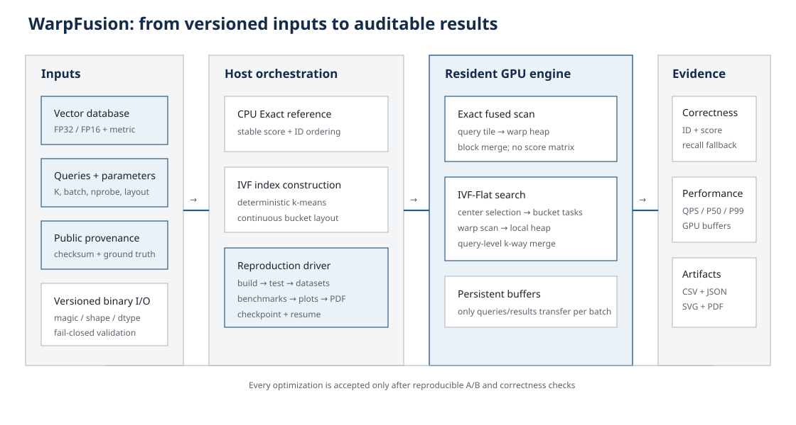
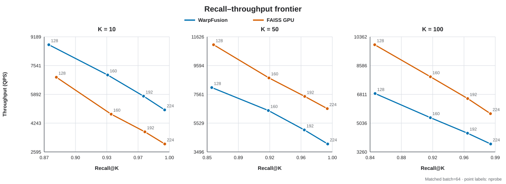
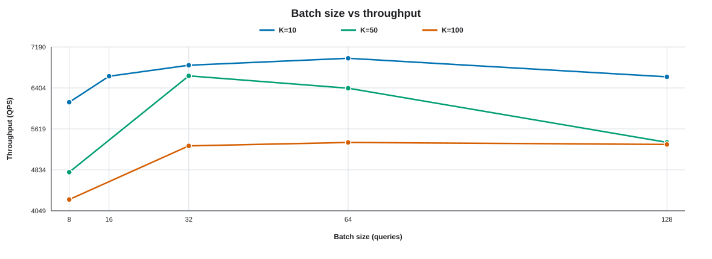

# WarpFusion：GPU Exact 与 IVF-Flat 向量检索引擎

这是 2026 夏季训练营 CUDA 方向“GPU 向量检索引擎”项目的独立实现。

项目从容易理解、结果正确的精确检索 baseline 逐步演进到 GPU Top-K、
IVF-Flat、多轮性能优化、并行索引构建和真实数据评测。



## 当前功能

- FP32/FP16 向量库与查询文件读写
- FP16 在 GPU 上保持 16 位存储，距离计算使用 FP32 累加
- L2、内积和余弦相似度
- CPU 精确检索参考实现
- CUDA 精确距离计算 baseline
- 四种 GPU Top-K：simple、block、two-stage，以及不生成完整距离矩阵的
  fused 路径
- 精确检索与 IVF 均支持 K = 1、10、50、100（也支持其他 K≤100）
- 批量查询
- GPU 数据库和工作区常驻显存，区分一次性初始化与稳定查询性能
- CPU/GPU 结果自动对比测试
- IVF-Flat CPU baseline：采样 k-means、连续倒排桶、索引保存/加载、固定
  `nprobe` 查询和 recall@K
- L2 使用普通 k-means；内积和余弦使用归一化中心的球面 k-means，避免
  相似度聚类因中心模长造成严重桶倾斜
- GPU IVF：中心、桶 offsets 和索引向量常驻显存，GPU 完成中心选择、
  每桶 block 并行扫描、局部 Top-K 与最终归并；支持 scalar、2/4/8-warp
  和按 K 自动选择并发度的 compact 扫描路径
- 实验性 `score_mass` 自适应 nprobe：依据每个 query 的中心分数分布选择
  probe 前缀，支持实际 probe 明细导出和 masked/grouped 调度 A/B
- 可选实验扩展：GPU 元数据过滤与融合评分

IVF-Flat 的索引、CPU 正确性基线、全 GPU 查询路径、K=1/10/50/100 以及
100k/百万规模参数扫描、桶扫描优化、FAISS CPU/GPU 对照和首轮自适应
nprobe 实验已经完成；提交结论与最新数字以 `docs/FINAL_REPORT.md` 为准。

## 正式结果与报告

完整方法、实验口径、负结果和复现命令见
[`docs/FINAL_REPORT.md`](docs/FINAL_REPORT.md)；本轮正式环境、训练差异、
数据/索引校验和、完整命令和延迟定义见
[`docs/REPRODUCIBILITY.md`](docs/REPRODUCIBILITY.md)。提交前可按
[`docs/SUBMISSION_CHECKLIST.md`](docs/SUBMISSION_CHECKLIST.md) 逐项核验。
第八阶段的维度/dtype/metric/batch/K 覆盖与安全回退规则见
[`docs/STABILITY_MATRIX.md`](docs/STABILITY_MATRIX.md)；CLI 和常驻执行器示例见
[`docs/API.md`](docs/API.md)。
图表由原始 CSV 直接生成：





重新生成全部图表：

```bash
python3 scripts/plot_results.py \
  --results-dir results/formal_100k15 \
  --batch-results-dir results/million \
  --output-dir results/figures
```

## 编译

```bash
export PATH=/usr/local/cuda/bin:$PATH
cmake -S . -B build -G Ninja -DCMAKE_BUILD_TYPE=Release \
  -DCMAKE_CUDA_ARCHITECTURES=native
cmake --build build
ctest --test-dir build --output-on-failure
```

`native` 会在配置时检测当前 GPU，因此切换 GPU 型号时不需要修改
README。如果要生成能在多种 GPU 上运行的二进制，可显式传入用分号分隔的
多个架构编号。切换设备后建议删除旧 `build/` 或使用新的构建目录，
避免复用 CMake 缓存中的旧架构。

## 一条命令复现

在已安装 CUDA、CMake、Ninja、Python 依赖和 GPU 版 FAISS 的 Linux 主机上，
以下命令依次执行干净构建、CTest、公开数据准备、WarpFusion/FAISS 正式实验、
绘图、PDF 报告生成和发布校验。长任务应由 `nohup` 托管；每一步的日志与断点
状态都会立即写到结果目录：

```bash
mkdir -p results/real/reproducibility/logs
nohup python3 scripts/reproduce.py --project-root "$PWD" --resume \
  > results/real/reproducibility/nohup.log 2>&1 &
```

若数据已准备好，可加 `--skip-download`；若索引已完成，可再加
`--skip-index-build`。只查看将执行的命令而不改变状态：

```bash
python3 scripts/reproduce.py --project-root "$PWD" --dry-run
```

断点文件为 `results/real/reproducibility/checkpoint.json`。更换源码、配置或数据后
应使用新的结果目录，避免把旧断点误认为新实验已完成。

## 推荐起点

这些值是正式单卡实验的起点，不是跨数据和跨 GPU 的通用最优参数：

| 场景 | 默认/推荐值 | 说明 |
|---|---|---|
| Exact | `warp + fused`, batch 64 | K≤100；未验证 query tile 自动回退 tile1 |
| SIFT1M / Yahoo IVF | nlist 1024, batch 64 | 建库 100k 样本、15 轮、seed 2026 |
| IVF K=10 | `bucket_major` | 扫描 nprobe 后按目标 recall 选点 |
| IVF K=50 | 完整 heap 回退 | 真实数据上分区路径未稳定获益 |
| IVF K=100 | `bucket_major_partitioned` | 4×40 局部候选后最终归并 |
| 基准计时 | warmup 1, repeat 5 | 报告稳定查询 QPS，另列一次性 H2D |

RTX 4090 D 上公开真实数据的代表点如下，完整曲线和同预算 FAISS 对照以原始
CSV 与最终报告为准：

| 数据集 | 查询 | K | nprobe | Recall@K | QPS |
|---|---|---:|---:|---:|---:|
| SIFT1M | Exact fused | 10 | — | 1.0000 | 7,038 |
| SIFT1M | IVF-Flat | 10 | 160 | 0.99987 | 24,579 |
| Yahoo MiniLM 384 | Exact fused | 10 | — | 1.0000 | 3,610 |
| Yahoo MiniLM 384 | IVF-Flat | 10 | 160 | 0.9939 | 15,733 |

## 已知限制

- 单进程、单 GPU、内存内静态索引；无在线增删、压缩、超显存分片或多 GPU。
- 正式性能只在 RTX 4090 D 上验证；更换维度、分布、K 或 GPU 必须重新扫参。
- Exact fused 仍落后于 FAISS GPU Flat；当前强项是可解释、可验证的 IVF 路径。
- IVF recall 依赖训练样本和数据分布；固定 nprobe 不保证逐 query 的最低 recall。
- 当前交付提供源码级 API，不承诺稳定 ABI，也未提供并发服务层。

## 生成测试数据

```bash
python3 scripts/generate_data.py \
  --database data/database.bin \
  --queries data/queries.bin \
  --num-vectors 10000 \
  --num-queries 20 \
  --dim 128 \
  --dtype fp32 \
  --metric l2 \
  --seed 2026
```

## 执行检索

```bash
./build/vector_search \
  --database data/database.bin \
  --queries data/queries.bin \
  --params configs/exact_l2.conf \
  --backend gpu \
  --output results/exact_l2.txt
```

结果文件中每一行依次为 `query_id vector_id score`。

### 融合 Exact 路径

设置 `distance_mode=warp`、`topk_mode=fused` 后，每个 warp 在计算距离时
直接维护局部 Top-K，每个 query/chunk 只写回 K 个候选，再由一个小型 kernel
完成最终归并。该路径不再物化 `batch_size × num_vectors` 的完整距离矩阵。
K=10/50/100 的参考配置分别为
`configs/exact_million_k{10,50,100}_fused_batch64.conf`。

第七阶段增加 `exact_query_tile=2/4/8` 和 `exact_fused_blocks=N` 以复用跨 query
数据库读取。`exact_fused_layout=block_tile` 是保留的负实验入口；默认值始终为
`warp_query`，不应把 block-tile 用作推荐配置。选择依据与完整 A/B 数字见
`docs/REPRODUCIBILITY.md`。

百万条 FP32、128 维、1000 queries、Cosine、batch=64、预热 1 次并重复 5 次
的当前测试结果如下；旧 matrix 路径保留用于 A/B：

| K | matrix QPS | fused QPS | 加速 | matrix / fused 缓冲区 |
|---:|---:|---:|---:|---:|
| 10 | 1775.10 | 5563.72 | 3.13× | 734.34 / 488.44 MiB |
| 50 | 715.87 | 5123.32 | 7.16× | 732.49 / 488.94 MiB |
| 100 | 443.78 | 4700.80 | 10.59× | 732.53 / 489.56 MiB |

所有成对结果的 Top-K ID 集合一致，记录的最大分数误差为 0。原始数据见
`results/exact_fused/million_compare.csv`，可重新运行：

```bash
python3 scripts/benchmark_exact_fused.py \
  --search-binary ./build/vector_search \
  --database data/exact_million/cosine_db.bin \
  --queries data/exact_million/cosine_q.bin \
  --baseline-configs configs/exact_l2_batch64.conf,configs/exact_million_k50_batch64.conf,configs/exact_million_k100_batch64.conf \
  --fused-configs configs/exact_million_k10_fused_batch64.conf,configs/exact_million_k50_fused_batch64.conf,configs/exact_million_k100_fused_batch64.conf \
  --output-dir results/exact_fused/million_outputs \
  --csv results/exact_fused/million_compare.csv \
  --warmup 1 --repeat 5
```

## IVF-Flat baseline

先构建可持久化索引：

```bash
./build/ivf_build \
  --database data/database.bin \
  --output data/database.ivf \
  --nlist 1024 \
  --iterations 15 \
  --training-samples 100000 \
  --threads 16
```

再运行 CPU IVF 正确性/质量基线；`--nprobe` 可覆盖配置文件，便于扫描：

```bash
./build/ivf_search \
  --index data/database.ivf \
  --queries data/queries.bin \
  --params configs/ivf_flat.conf \
  --nprobe 16 \
  --backend gpu \
  --warmup 1 \
  --repeat 5 \
  --output results/ivf_flat.txt

python3 scripts/evaluate_recall.py \
  --exact results/exact_l2.txt \
  --approximate results/ivf_flat.txt
```

输出同时包含 recall、最低单 query recall，以及按名次计算的平均/最大绝对
分数误差。

`configs/ivf_flat_100k_{balanced,high_recall,exact_check}.conf` 是
100k × 128、K=10 实验的三档参考配置。`nlist` 必须与索引构建参数一致；
迁移到百万级或不同数据分布时，应重新扫描 `nlist/nprobe`，不要直接把这组
参数当成通用最优值。`ivf_flat_100k_scalar_baseline.conf` 保留旧的
thread-per-vector 桶扫描，用于和默认 warp 协作版本做 A/B 对照。
`nprobe` 可取 `1..nlist`；使用 `nprobe=nlist` 可作为结果完整性校验，但
近似检索应根据目标 recall 和延迟选取更小的值。

百万规模 K=10 初测提供四档配置：

- `ivf_flat_million_fast.conf`：偏吞吐。
- `ivf_flat_million_balanced.conf`：约 0.87 recall 的平衡档。
- `ivf_flat_million_high_recall.conf`：约 0.97 recall。
- `ivf_flat_million_near_exact.conf`：约 0.99 recall。

大 K 使用独立模板实例和 warp 共享内存堆；`warp_compact` 在 K≤10、
11≤K≤50、K>50 时分别使用 8、2、1 个 warp。K=100 的单 warp 路径在
RTX 4090 D 上比旧两 warp 路径快 9.7%–15.1%。局部 heap 进一步缓存根节点、
以空穴下沉替代逐层交换，并让单 warp 直接写回有序结果；nprobe=160 的正式
A/B 提升 2.40%，与 bucket-major 组合后累计提升 3.65%。K=100 的推荐配置
进一步使用 `bucket_major_partitioned`：4 个 warp 各维护 40 项局部候选，再
合并为 Top-100。`nprobe=160` 的 100 次 A/B 从 5503.11 提高到 7204.54 QPS，
提升 30.92%；输出逐字一致，recall@100 保持 0.91758，Compute Sanitizer 为
0 errors。推荐从
`ivf_flat_million_k50.conf` 或
`ivf_flat_million_k100.conf` 开始；新平台实测默认 batch 分别为 40 和 64，并提供
batch=8/32/64/128 以及 warp1/2/4/8 的 A/B 配置。百万级 K10 的 nlist=256
三档配置默认 batch=64。切换数据、维度或 GPU 后仍应重新扫参。

K=50 先启用 `bucket_major`：GPU 将已选 probe 任务按中心桶分组，以
提高同一 batch 内的 L2 复用。nprobe=160、batch=40 的 100 次 A/B 从
6009.22 提高到 6964.16 QPS，提升 15.89%，recall@50 保持 0.92482。
低 nprobe 时收益较小；原始 probe-major 基线可使用
`ivf_flat_million_k50_warp_compact_batch40.conf`。完整扫描见
`results/formal_4090d_20260908/k50_bucket_major_sweep.csv`。
当前 `bucket_major` 和 `bucket_major_partitioned` 只支持固定 nprobe；
score-mass 自适应策略继续使用
`warp_compact`。

K=50 默认配置在 bucket-major 上继续使用 4×16 分区局部 Top-K。固定
batch=40、nprobe=160、预热 5 次并重复 100 次，完整 heap 为 7165.23 QPS，
4×16 为 7934.10 QPS，提升 10.73%，输出逐字一致，Compute Sanitizer 为
0 errors。FAISS GPU IVF-Flat 为 8328.11 QPS / 0.92312 recall@50；
WarpFusion 为 7934.10 QPS / 0.92482 recall@50，吞吐差距为 4.97%。原始结果
见 `results/formal_4090d_20260908/k50_partitioned_tight/` 和
`results/formal_4090d_20260908/faiss_gpu_batch40.csv`。

### MNIST 真实数据验证

除百万规模合成数据外，项目提供 MNIST 转换脚本。训练图像作为数据库，测试
图像作为查询，像素展开为 784 维 FP32 向量并使用 L2：

```bash
python3 scripts/import_mnist.py \
  --input data/mnist/mnist.npz \
  --database data/mnist/database.bin \
  --queries data/mnist/queries.bin
```

RTX 4090 D 上，60k 数据库和 10k queries 的 Exact K=10 为 23.1k QPS；
IVF nprobe=8 达到 0.9784 recall@10 和 197.7k QPS，nprobe=32 达到
0.9991 recall@10 和 76.6k QPS。原始数据见
`results/formal_4090d_20260908/mnist_ivf.csv`。

这些 recall 只对应固定随机种子生成的测试数据。可用脚本在新数据或新 GPU
上重新生成 CSV，而不是沿用旧机器的结论：

```bash
python3 scripts/benchmark_ivf_sweep.py \
  --search-binary ./build/ivf_search \
  --index data/million/inner_fp32_nlist256_spherical_100k15.ivf \
  --queries data/million/inner_fp32_q.bin \
  --params configs/ivf_flat_million_batch64.conf \
  --exact results/million/inner_exact_gpu_k10.txt \
  --output-dir results/million/sweep_n256 \
  --csv results/million/sweep_n256.csv \
  --nlist 256 \
  --nprobes 64,128,160,192,224,256 \
  --training-samples 100000 \
  --training-iterations 15
```

### 第六阶段公开真实数据

正式外部验证使用两套互补数据：TexMex SIFT1M（1,000,000 × 128，L2）和
VIBE `yahoo-minilm-384-normalized`（677,305 × 384，文本 embedding，
cosine）。两者都带公开 Top-100 ground truth。准备脚本固定并验证公开文件
校验和：SIFT archive MD5 为 `b23d1b3b2ee8469d819b61ca900ef0ed`，VIBE
HDF5 SHA-256 为
`8b0519850249d7ea4aea258eb43ae837dca1bb2f7a85ee0a5145afdb699c4136`。
VIBE 文件的 `distance=normalized` 会先经过逐块单位范数检查，再明确映射到
WarpFusion cosine；不会把它静默当作普通 L2 数据。

```bash
python3 scripts/prepare_real_datasets.py \
  --dataset all \
  --raw-dir data/real/raw \
  --output-dir data/real
```

数据准备需要 NumPy 和 `h5py`。转换后的每套数据都包含 `database.bin`、
`queries.bin`、`groundtruth.ivecs` 和记录输入/输出 SHA-256 的
`manifest.json`。完整 K/nprobe 矩阵可用一条命令运行：

```bash
python3 scripts/run_real_benchmarks.py \
  --dataset sift1m \
  --nlist 1024 \
  --nprobes 32,64,128,160,192,224 \
  --warmup 1 --repeat 5

python3 scripts/run_real_benchmarks.py \
  --dataset yahoo-minilm-384 \
  --nlist 1024 \
  --nprobes 32,64,128,160,192,224 \
  --warmup 1 --repeat 5
```

2026-09-10 的 RTX 4090 D 正式结果已经完成。下表固定 `batch=64`、
`nprobe=160`，同时列出各自独立训练、相同训练预算下的 FAISS GPU IVF-Flat：

| 数据集 | K | WarpFusion recall / QPS | FAISS recall / QPS | 吞吐比 |
|---|---:|---:|---:|---:|
| SIFT1M | 10 | 0.999870 / 24579 | 0.999120 / 13617 | 1.81× |
| SIFT1M | 50 | 0.999706 / 19237 | 0.999516 / 13443 | 1.43× |
| SIFT1M | 100 | 0.999565 / 17362 | 0.999457 / 13102 | 1.33× |
| Yahoo MiniLM 384 | 10 | 0.993900 / 15733 | 0.995300 / 6216 | 2.53× |
| Yahoo MiniLM 384 | 50 | 0.991520 / 14950 | 0.991280 / 6157 | 2.43× |
| Yahoo MiniLM 384 | 100 | 0.989230 / 14196 | 0.989080 / 6060 | 2.34× |

K=50 的 4×16 分区路径在 SIFT1M 和 Yahoo 上分别损失 0.000326 和
0.000980 recall，均超过 `1e-4` 安全阈值，因此正式曲线自动采用完整 heap。
K=100 的 4×40 路径在两套数据上均为零 recall 损失，`nprobe=160` 下相对
完整 heap 分别加速 1.38× 和 1.72×。可提交的 CSV、验证 JSON 和 SVG 位于
`results/real/`；原始 Top-K 输出和日志按数据集保留在实验机 `/data`。

该命令依次记录自研 IVF 建库、Exact K=10/50/100、公开 ground truth
交叉验证、自研与 FAISS GPU IVF 扫描、QPS、run/batch P50/P99、显存和图表。
K=50/100 会同时运行分区局部 Top-K 与完整 heap；若任一 nprobe 的 recall
损失超过 `1e-4`，最终曲线自动回退到完整 heap，同时保留两套原始 CSV 和
`partitioned_topk_validation.json`。结果写入 `results/real/<dataset>/`。

## FAISS 公平对照

`scripts/benchmark_faiss.py` 直接读取相同的项目数据文件，支持
FAISS CPU/GPU、Flat/IVF-Flat、多个 K/nprobe，并把索引构建/加载、GPU
转移、稳定查询 QPS、run/batch P50/P99 及其样本数、recall、平均/最大绝对
分数误差和 FAISS GPU 内存分类写入 CSV。
运行它的 Python 环境需要 NumPy 和与当前 CUDA 环境兼容的 FAISS 包。

```bash
python3 scripts/benchmark_faiss.py \
  --database data/million/inner_fp32_db.bin \
  --queries data/million/inner_fp32_q.bin \
  --reference-results results/million/inner_exact_gpu_k100.txt \
  --index-dir data/million/faiss \
  --output-dir results/million/faiss_gpu \
  --csv results/million/faiss_gpu.csv \
  --backends gpu \
  --index-types flat,ivf_flat \
  --top-ks 10,50,100 \
  --nlist 256 \
  --nprobes 128,160,192,224 \
  --batch-size 64 \
  --train-samples 100000 \
  --iterations 15 \
  --seed 2026 \
  --warmup 1 \
  --repeat 5
```

脚本默认将 FAISS CPU 线程数固定为 1；可用 `--cpu-threads` 显式改变。
FAISS Flat 会先与 WarpFusion exact 结果交叉验证，候选 ID 不一致时终止。
长矩阵每完成一项都会立即更新 CSV，中断时不会丢失已经完成的行。

## 实验性自适应 nprobe

固定策略仍是默认。设置 `nprobe_policy=score_mass` 后，`nprobe` 表示允许的
最大值；策略将排序后的中心分数转换为相对概率质量，并在
`adaptive_nprobe_min..nprobe` 内按 `adaptive_nprobe_step` 选择每个 query
的实际 probe 数。`adaptive_temperature` 使用当前 query 的中心分数跨度归一化，
因此不依赖绝对分数尺度。

```bash
python3 scripts/benchmark_adaptive_nprobe.py \
  --search-binary ./build/ivf_search \
  --index data/million/inner_fp32_nlist256_spherical.ivf \
  --queries data/million/inner_fp32_q.bin \
  --params configs/ivf_flat_million_adaptive_k10.conf \
  --exact results/million/inner_exact_gpu_k10.txt \
  --output-dir results/million/adaptive_k10 \
  --csv results/million/adaptive_k10.csv \
  --max-nprobe 224 --min-nprobe 64 --step 16 \
  --temperature 0.2 --target-masses 0.80,0.90,0.93,0.97,0.99
```

百万级均匀合成数据上的首轮实验没有超过相同平均 probe 的固定策略：平均
151.632 probes 的代表点在 K10/K50/K100 上分别慢约 1.0%/2.6%/3.6%，
recall 也略低。因此配置和脚本用于研究与复现，尚不作为推荐生产默认值。
切换到更异质的真实查询分布后应重新校准并重新判断是否保留。

## 可选扩展：Agent 记忆检索

本节不属于当前课程项目主报告，只保留已经实现的实验接口。

元数据文件按原始向量 ID 保存 `timestamp`、`importance`、`session_id` 和
`source_type`。`fused` 在桶扫描读取向量前执行过滤，并在局部 Top-K 前融合
语义分数、重要性和指数时间衰减；`rerank` 先取语义 Top-(K×factor)，再由
独立 GPU kernel 过滤和重排，作为 A/B baseline。L2 仍保持分数越低越好，
内积和 Cosine 保持越高越好。

```bash
python3 scripts/generate_memory_metadata.py \
  --output data/memory.bin --num-vectors 100000 --seed 2026

./build/ivf_search \
  --index data/database.ivf --queries data/queries.bin \
  --params configs/ivf_flat_memory_fused.conf \
  --memory-metadata data/memory.bin --memory-mode fused \
  --filter-session-id any --filter-source-type 1 \
  --backend gpu --warmup 2 --repeat 5 \
  --output results/memory_fused.txt
```

使用 `scripts/benchmark_memory_modes.py` 可在完全相同的过滤、评分和批量参数
下运行 fused/rerank 并保存 CSV。`any` 表示不限制对应的离散元数据字段；
若过滤后不足 K 个候选，输出会诚实返回少于 K 条，而不会写入伪造 ID。

索引使用版本化二进制格式，保存 FP32 聚类中心、桶 offsets、原始向量 ID
以及按桶连续排列的 FP32/FP16 原始向量。GPU backend 会将这些索引数据
常驻显存；每批只上传 queries，中心选择、桶扫描和 Top-K 均在 GPU 完成。

GPU backend 会先创建常驻检索引擎，数据库只上传一次，然后让
`--warmup` 和 `--repeat` 的每轮查询复用同一份 GPU 数据和工作区。
程序分别输出：

- GPU 一次性初始化和数据库 H2D 时间。
- 估算冷启动端到端时间。
- 数据库常驻后的查询时间和 QPS。
- 引擎显式分配的 GPU 缓冲区总量。
- query H2D、距离 kernel、Top-K kernel 和结果 D2H 分段时间。

`configs/exact_l2_batch*.conf` 保留生成完整距离矩阵的历史 batch 扫描配置。
新实验推荐以 fused batch=64 配置为起点；融合路径会根据 batch size 调整每个
query 的 chunk 数，使总并发块数维持在合理范围，同时避免产生过多局部候选。
切换数据规模、维度或 GPU 后仍应重新扫描 batch size。

第七阶段新增 `exact_query_tile=2/4/8`，用于在同一 block 内跨 query 复用数据库
读取；`exact_fused_blocks=N` 可固定 `grid.x` 做受控 sweep，省略时使用并行度
启发式。RTX 4090 D、batch=64 的已验证选择为：K=10/128 维使用 tile4，
K=10/384 维使用 tile8/160 blocks，K=50/384 维使用 tile4；128 维 K=50 和
全部 K=100 继续使用 tile1 baseline。切换维度、metric、batch 或 GPU 时必须
重新运行 `scripts/benchmark_exact_query_tile.py`，不能直接套用该表。

## 项目原则

1. 正确性优先，每个 GPU 版本都和 CPU 参考答案比较。
2. 先实现简单版本，再逐步优化；不直接堆叠难以解释的 CUDA 技巧。
3. 每次优化都保存测试环境、参数和优化前后的性能数据。
4. 扩展实验不得替代 Exact、IVF、FAISS 对照和真实数据主线。
