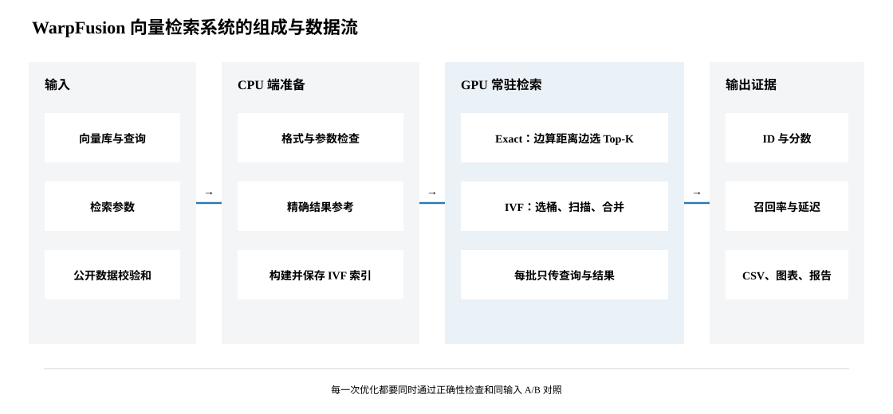
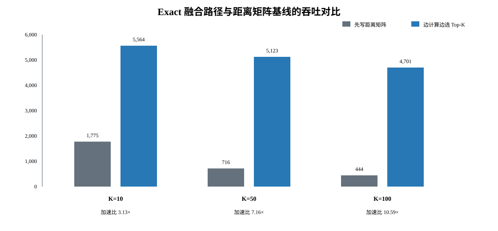
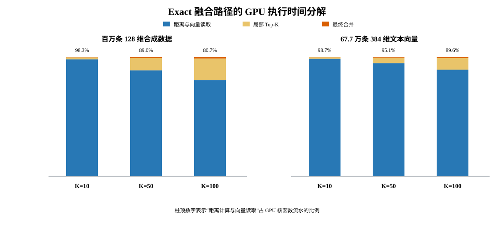
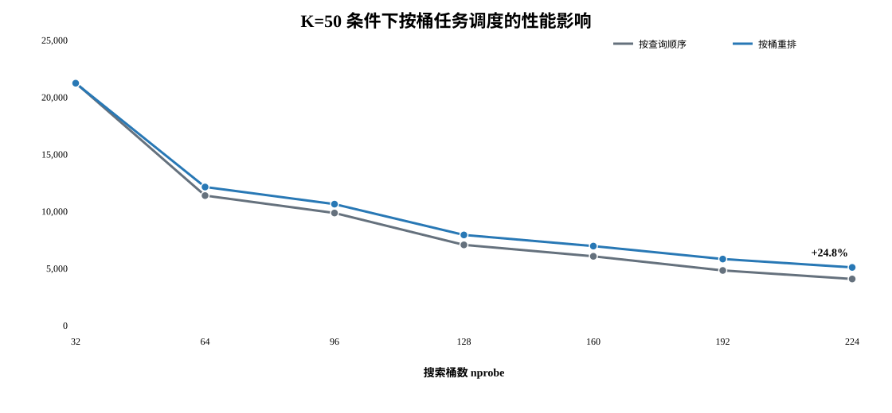
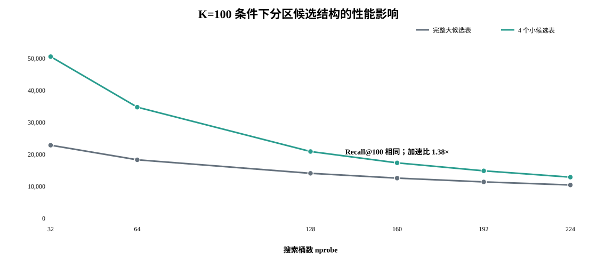
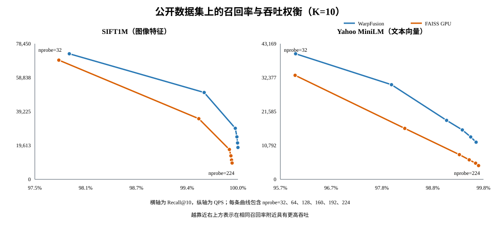
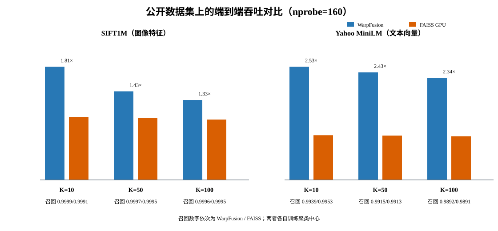

# WarpFusion：面向大规模向量检索的 CUDA 并行设计与性能优化

**作者：花生　　学员 ID：PurplePulse**

## 摘要

面向百万级高维向量的近邻检索，系统需要同时承担距离计算、候选筛选、索引访问和批量调度等开销。仅优化单个距离计算核函数，通常难以显著改善完整检索流程的吞吐和延迟。本文设计并实现了单 GPU 向量检索系统 WarpFusion。系统提供精确检索（Exact Search）和基于倒排文件的 IVF-Flat 近似检索两条路径，支持 FP32 与 FP16 数据，以及 L2 距离、内积和余弦相似度三种度量方式。

在精确检索中，本文将距离计算与局部 Top-K 选择合并执行，避免生成规模为查询数乘以数据库向量数的完整距离矩阵。在 IVF-Flat 路径中，针对不同 K 值下的候选维护开销，设计了按桶任务调度和分区局部 Top-K 两项优化，并以结果一致性和召回率阈值决定是否启用优化。系统还配套实现了索引持久化、CPU 参考计算、异常输入检查、稳定性测试和实验复现流程，用于验证功能正确性和性能结果。

在 NVIDIA GeForce RTX 4090 D 上，Exact 融合路径相较距离矩阵基线的加速比为 3.13× 至 10.59×，并将显式 GPU 缓冲区减少约三分之一。在 SIFT1M 与 Yahoo MiniLM 两个公开数据集上，当训练样本数、聚类轮数、批大小和 `nprobe` 保持一致时，WarpFusion IVF-Flat 在六组 K 值实验中的吞吐为 FAISS GPU IVF-Flat 的 1.33× 至 2.53×。除 Yahoo MiniLM 的 K=10 配置外，其余五组实验的召回率均不低于 FAISS；在该例外配置中，WarpFusion 的 Recall@10 低 0.14 个百分点。实验还表明，分区候选结构在 K=50 和 K=100 时具有不同的适用性，因此候选容量需要结合真实数据分布验证，不能仅依据合成数据确定。

**关键词：** GPU 向量检索；CUDA；IVF-Flat；Top-K 选择；并行调度；近似最近邻

## 1　研究背景与目标

向量检索广泛应用于图像匹配、语义搜索、推荐系统和检索增强生成等任务。给定查询向量，系统需要从数据库中返回距离最近或相似度最高的 K 个向量。随着数据库规模和向量维度增加，检索过程不仅包含大规模距离计算，还需要持续维护候选集合并完成跨线程结果归并。对于百万规模数据，系统瓶颈往往由显存访问、Top-K 更新和任务调度共同决定。

精确检索需要比较查询与数据库中的全部向量。若查询数为 Q、数据库规模为 N、向量维度为 D，其计算复杂度约为 O(QND)。朴素 GPU 实现通常先生成大小为 Q×N 的距离矩阵，再执行 Top-K 选择。该方法结构清晰，适合作为正确性与性能基线，但会产生大量中间结果读写。IVF-Flat 则通过聚类将数据库划分为多个倒排桶，查询时只扫描与查询最相关的部分桶，从而以一定的召回率损失换取更高吞吐。FAISS 等成熟向量检索系统也采用了这类 GPU 并行检索方法[1]。

本文的目标不是构建完整的在线向量数据库，而是研究单机单卡、数据常驻显存条件下的 CUDA 向量检索实现与优化。具体目标包括：

1. 实现从数据读取、索引构建、GPU 查询到结果输出的完整检索流程；
2. 支持 Exact 与 IVF-Flat 两种检索方式、FP32 与 FP16 两种数据类型、三种距离度量，并支持 K 分别取 1、10、50 和 100；
3. 对距离计算、候选筛选和任务调度进行协同优化，而非仅比较孤立核函数；
4. 通过 CPU 参考计算、公开数据的标准近邻集合和 FAISS 对照验证正确性与性能；
5. 保留原始实验数据、未采用方案和复现脚本，明确结论的适用范围。

本文的主要工作可概括为三点。第一，构建了可执行、可测试的单 GPU 检索系统，并统一了不同计算路径的排序规则和错误处理方式。第二，针对完整距离矩阵和大 K 候选维护的开销，分别实现融合 Exact、按桶调度和分区局部 Top-K。第三，在合成数据与三个真实数据集上进行端到端评估，并结合召回率、延迟、显存占用和稳定性分析性能收益。

## 2　系统架构与检索流程

**图 1.** WarpFusion 的系统组成与数据流。CPU 端负责输入校验、索引构建与参考计算，GPU 端执行主要检索流程，最终输出查询结果及性能、正确性记录。

### 2.1　数据组织与接口语义

向量数据库和查询文件采用带版本号的二进制格式。文件头记录数据形状、数值类型和距离度量；加载阶段检查文件标识、版本、维度及数据长度，避免程序在未报错的情况下接受截断文件或类型不匹配的数据。索引文件保存聚类中心、桶边界、原始向量 ID 以及按桶连续排列的向量。训练和分桶完成后，系统可以直接加载索引，无需在每次查询前重新聚类。

系统支持 L2 距离、内积和余弦相似度。L2 距离采用普通 k-means 训练中心；内积和余弦相似度采用中心归一化的球面 k-means，以减轻中心模长差异造成的桶规模失衡。不同计算路径均遵循统一排序规则：首先比较距离或相似度分数，分数相同时优先返回较小的原始向量 ID。该规则用于减少并行执行顺序不同造成的结果歧义。

### 2.2　Exact 检索路径

距离矩阵基线包含两个主要阶段：首先计算全部 Q×N 个距离或相似度分数并写入全局显存；随后逐查询读取矩阵并选择 Top-K。虽然该实现便于验证，但中间矩阵的写回与再次读取会增加显存流量，其空间开销也随 Q×N 线性增长。

WarpFusion 的融合 Exact 路径将距离计算与局部候选筛选合并。一个 CUDA 线程束（warp）负责扫描数据库中的连续区域，距离计算完成后立即更新线程束内部的局部 Top-K 缓冲区，仅将少量候选写入全局显存。随后由第二个规模较小的 GPU 核函数归并各局部结果。该方法没有改变精确检索的计算范围，但将中间数据量从完整距离矩阵缩减为与局部候选数量相关的缓冲区，因而主要收益来自减少全局显存读写。

### 2.3　IVF-Flat 检索路径

IVF-Flat 的建库阶段将数据库划分为 `nlist` 个聚类桶。查询阶段首先计算查询与全部聚类中心的分数，再选择最相关的 `nprobe` 个桶，仅扫描这些桶中的原始向量。与乘积量化方法[2]不同，IVF-Flat 不压缩桶内向量，因此已扫描候选的距离仍按原始精度计算；它的近似性来自只扫描部分倒排桶，而非扫描整个数据库。

单批查询的 GPU 流程包括以下五个阶段：

1. 计算查询向量与聚类中心的距离或相似度；
2. 选择每个查询对应的 `nprobe` 个倒排桶；
3. 将“查询-桶”组合转换为可并行执行的扫描任务；
4. 扫描桶内向量并维护局部 Top-K 候选；
5. 合并同一查询的局部候选，输出最终 ID 与分数。

数据库向量、聚类中心和主要工作区在查询期间常驻显存。每批查询只传输查询向量与最终结果，因此稳定查询性能不包含数据库重复上传成本。索引加载和数据库上传作为一次性开销单独记录。

### 2.4　评价指标

本文使用以下指标评价正确性、性能与资源占用。

| 指标 | 定义与用途 |
|---|---|
| QPS | 每秒完成的查询数量，用于评价系统吞吐 |
| Recall@K | 近似 Top-K 与精确 Top-K 的平均重合比例，用于评价检索精度 |
| P50 / P99 | 延迟分布的第 50 / 99 百分位数；本文分别对整轮延迟和批次延迟进行统计 |
| 显式 GPU 缓冲区 | 程序可直接统计的索引与工作区内存，不包含驱动和运行时内部保留 |
| nlist | 建库阶段的聚类中心数量，决定倒排索引粒度 |
| nprobe | 单次查询扫描的桶数量，通常越大召回率越高、计算量也越大 |

## 3　CUDA 并行设计与优化

### 3.1　面向不同 K 值的候选维护

候选维护开销与 K 密切相关。K 较小时，局部 Top-K 缓冲区较小，可以为同一桶分配更多线程束以提高扫描并行度；K 增大后，复制多份候选缓冲区会增加共享内存占用、候选更新和最终归并成本。WarpFusion 因此按照 K 的范围调整每个桶的线程束数量，并对 K=50 与 K=100 分别评估更细的候选结构。

| K 范围 | 基础并行方式 | 设计依据 |
|---:|---|---|
| 1-10 | 每个桶 8 个局部候选缓冲区 | 候选集合较小，可通过增加扫描并行度提高吞吐 |
| 11-50 | 每个桶 2 个局部候选缓冲区 | 在扫描并行度与归并开销之间折中 |
| 51-100 | 每个桶 1 个完整候选缓冲区 | 限制大候选集合的复制与维护成本 |
| K=50/100 优化 | 多个容量受限的分区候选缓冲区 | 降低单个大候选结构的更新成本 |

该策略的核心不是预设某种数据结构一定更优，而是针对不同 K 值控制局部状态规模和并行任务数量。所有候选结构均以端到端查询时间和最终输出正确性为验收依据。

### 3.2　分区局部 Top-K

当 K 较大时，单个完整候选缓冲区的更新与排序开销逐渐增加。分区局部 Top-K 将同一扫描任务分配给多个线程束，每个线程束只保留一定数量的局部候选，最后再归并全部局部结果。下文以“4×40”表示 4 个线程束各保留 40 项候选；例如 K=100 时，系统最终从 160 个中间候选中选出 100 项。类似地，“4×16”表示 4 个线程束各保留 16 项候选。

该方法以较小的局部状态换取更高并行度，但局部容量不足可能在归并前丢弃真实 Top-K 元素。因此本文不将吞吐提升作为唯一启用条件，而是同时运行完整候选路径进行对照。若任一 `nprobe` 配置的召回率损失超过 1 × 10^(-4)，该数据集的正式结果自动回退到完整候选路径。这一机制使优化策略与正确性约束保持一致。

### 3.3　按桶任务调度

常规任务顺序以查询为主：完成一个查询的多个桶任务后，再处理下一个查询。该顺序实现简单，但来自不同查询、访问同一倒排桶的任务在时间上可能相距较远。WarpFusion 增加按桶调度方式，对一个批次内的“查询-桶”任务重新排序，使访问相同或相邻桶的任务更集中地提交给 GPU。

任务重排不减少距离计算次数，也不改变候选集合及最终输出。其潜在收益来自相邻任务对相同桶向量的重复访问，从而提高缓存数据被再次使用的机会。由于当前实验环境无法获取 Nsight Compute 的缓存命中率等硬件计数器，本文将缓存复用作为基于访问模式和计时结果的机制解释，而不将其表述为已经直接测量的硬件结论。

### 3.4　多线程索引构建

IVF 建库主要包含训练样本到中心的分配，以及全部数据库向量到倒排桶的分配。两部分均采用固定连续区间的 CPU 多线程并行方式：各线程维护局部统计，完成后再按固定次序合并。与共享计数器上的细粒度同步相比，该设计减少了锁竞争，同时保持建库结果和桶内布局的确定性。

## 4　实验设计

### 4.1　实验平台与数据集

正式 GPU 实验运行在 NVIDIA GeForce RTX 4090 D 上，显存容量为 24,564 MiB，CUDA 计算能力为 8.9，CUDA 工具链版本为 12.8.61。CPU 平台为双路 Intel Xeon Platinum 8358P，共 64 个物理核心。程序采用 Release 模式，并针对当前 GPU 架构编译。

实验使用一组合成数据和三个真实数据集，以覆盖参数分析、公开基准、文本向量和非均匀数据分布。

| 数据集 | 数据规模与维度 | 查询数 | 距离度量 | 主要用途 |
|---|---:|---:|---|---|
| Synthetic-1M | 1,000,000 × 128 | 1,000 | 内积 | 参数扫描与优化消融 |
| MNIST | 60,000 × 784 | 10,000 | L2 | 非均匀真实分布检查 |
| SIFT1M | 1,000,000 × 128 | 10,000 | L2 | 公开标准近邻集合与 FAISS 对照 |
| Yahoo MiniLM | 677,305 × 384 | 1,000 | 余弦 | 文本嵌入数据与 FAISS 对照 |

SIFT1M 和 Yahoo MiniLM 均提供预先计算的 Top-100 标准近邻集合（ground truth）[3]。数据准备阶段检查公开文件的校验和，并记录格式转换后文件的 SHA-256，以降低数据版本差异对结果的影响。

### 4.2　对照设置与计时方法

WarpFusion 与 FAISS 使用相同的数据集、K、批大小、`nlist`、`nprobe`、训练样本数和训练轮数。两套系统分别训练聚类中心，因此本文比较的是相同训练与搜索预算下的端到端系统表现，而不是共享同一索引后单个 CUDA 核函数的速度。

不同实验采用与其目的相匹配的重复设置。图 2 的距离矩阵与融合路径成对 A/B 实验预热 1 次并重复 5 次；Synthetic-1M 后续正式参数对照预热 5 次并重复 100 次；公开数据实验预热 1 次并重复 5 次。QPS 根据查询总数和整轮平均时间计算；整轮延迟和批次延迟均分别统计 P50 与 P99。索引加载和数据库上传不计入稳定查询 QPS，但相关耗时和显存占用仍保留在原始结果中。进行优化前后对照时，除被考察因素外，其余输入和运行参数均保持一致。

### 4.3　正确性与优化验收标准

Exact 路径逐查询比较 Top-K 向量 ID 和分数。IVF 路径报告 Recall@K、最低单查询召回率和分数误差。对于距离完全相同但 ID 不同的候选，系统重新计算原始分数，以区分数值或排序错误与等价近邻的不同选择。

任何优化在出现以下情况之一时均不进入默认路径：Exact 输出集合不一致；分数误差超过预设容差；IVF 召回率损失超过设定阈值；或 Compute Sanitizer 检测到越界访问。该验收规则用于避免以正确性退化换取表面性能提升。

## 5　实验结果与分析

### 5.1　正确性与稳定性

发布验证在全新构建目录中完成 CTest 18/18。稳定性测试覆盖 FP32/FP16、L2/内积/余弦、64/128/384/768 维、批大小 1/8/32/40/64/128，以及 K=1/10/50/100。边界场景包括 65 维非对齐输入、查询数不足一个完整批次、空桶、倾斜桶、重复向量和全零查询。

完整测试矩阵包含 576 组 Exact CPU/GPU 对照和 48 组 IVF 极端桶分布对照。`compute-sanitizer --tool memcheck` 对稳定性测试报告 0 个错误。在发布前的最小 GPU 查询测试中，Exact 与全桶 IVF 均与 CPU 候选集合一致，平均绝对分数误差为 3.04 × 10^(-6)，最大分数误差为 9.6 × 10^(-6)。这些结果表明，后续性能比较所采用的实现已经通过边界条件和内存安全检查。

### 5.2　Exact 融合路径

**图 2.** Synthetic-1M 上距离矩阵基线与融合 Exact 路径的吞吐对比。随着 K 增大，距离矩阵路径的二次读取与 Top-K 选择开销更为显著。

| K | 距离矩阵 QPS | 融合路径 QPS | 加速比 | 显式 GPU 缓冲区（基线 / 融合） |
|---:|---:|---:|---:|---:|
| 10 | 1,775 | 5,564 | 3.13× | 734 / 488 MiB |
| 50 | 716 | 5,123 | 7.16× | 732 / 489 MiB |
| 100 | 444 | 4,701 | 10.59× | 733 / 490 MiB |

两条路径返回的 Top-K 候选集合完全一致，记录的最大分数误差为 0。融合路径的吞吐优势随 K 增大而扩大：K=10 时加速比为 3.13×，K=100 时达到 10.59×。这一趋势说明，基线的主要额外成本不仅是距离矩阵写回，还包括随后针对更大 K 执行的矩阵读取和候选选择。融合实现同时将显式 GPU 缓冲区从约 733 MiB 降至约 490 MiB，减少约三分之一。

为验证 GPU 实现相对 CPU 精确检索的实际收益，本文在相同的 Synthetic-1M、FP32、内积和批大小 64 条件下，将 WarpFusion Exact 与单线程 FAISS CPU Flat 进行对照。GPU 结果预热 5 次并重复 100 次，CPU 结果重复 20 次；两者均执行完整精确检索，不涉及召回率损失。

| K | FAISS CPU Flat QPS | WarpFusion Exact QPS | GPU / CPU 加速比 |
|---:|---:|---:|---:|
| 10 | 76.45 | 6,678 | 87.35× |
| 50 | 76.45 | 5,974 | 78.15× |
| 100 | 73.55 | 5,406 | 73.51× |

该对照表明，WarpFusion Exact 在百万规模数据上相对单线程 CPU 基线取得 73.51× 至 87.35× 的吞吐提升，满足主要计算由 GPU 加速的项目目标。表中数据来自独立的正式重复实验，因此不与图 2 中专门用于比较两条 GPU 路径的成对 A/B 数据混用。

上述结果证明融合设计优于项目内部基线，但不能据此得出 Exact 已超过成熟库的结论。在 SIFT1M 上，WarpFusion Exact 仍比 FAISS GPU Flat 慢 2.94 至 3.51 倍；在 384 维 Yahoo MiniLM 上慢 5.88 至 6.25 倍。为进一步定位内部耗时，本文拆分了融合路径的 GPU 执行阶段。

**图 3.** Exact 融合路径的 GPU 执行时间分解。距离计算及数据库读取占总核函数时间的 80.7% 至 98.7%，最终候选归并占比较低。

在 128 维、K=100 的配置中，局部候选维护约占 18.3%，说明大 K 已使 Top-K 更新成为不可忽略的成本；在 384 维数据上，距离计算和数据库读取仍占绝对主导。由此可见，仅继续缩短最终归并阶段难以显著提高整体吞吐。更有价值的方向包括跨查询复用数据库读取，以及为 K=50/100 设计更低开销的候选选择结构。

Nsight Systems 2024.6.2 的代表性采样进一步验证了这一判断。在 Synthetic-1M、K=10、批大小 64 的运行中，融合距离计算与局部 Top-K 核函数占 GPU 核函数总时间约 99.9%，最终归并核函数约占 0.1%。程序内部阶段计时得到的结果与之相符：融合核函数平均耗时 144.49 ms，最终归并平均耗时 0.21 ms。由此可以确认，当前 Exact 路径的主要优化对象是数据库读取、距离计算和局部候选维护，而不是最终归并。该分析使用 Nsight Systems 的时间线和核函数统计；由于平台未开放性能计数器，本文不据此推断缓存命中率或实际显存带宽。

### 5.3　K=50 条件下的按桶调度

**图 4.** Synthetic-1M、批大小 40、K=50 时，按查询顺序与按桶顺序调度的吞吐对比。随着 `nprobe` 增加，按桶调度的相对收益逐步扩大。

在 `nprobe=160` 的 100 次正式对照中，原始任务顺序达到 6,009 QPS，按桶调度达到 6,964 QPS，提升 15.89%；整轮 P99 从 169.04 ms 降至 145.53 ms，且输出逐项一致。该结果说明，在计算量和候选集合不变的条件下，改变任务访问顺序即可改善吞吐与尾部延迟。

在按桶调度基础上采用 4×16 分区候选后，吞吐进一步提高至 7,934 QPS，相较完整候选路径提高 10.73%。同为批大小 40、`nprobe=160` 时，FAISS GPU IVF-Flat 达到 8,328 QPS、Recall@50 为 0.92312；WarpFusion 达到 7,934 QPS、Recall@50 为 0.92482。以 WarpFusion 为基准，FAISS 的吞吐高 4.97%。

但 4×16 分区候选在两套公开数据上分别产生 0.000326 和 0.000980 的召回率损失，即 0.0326 和 0.0980 个百分点，均超过 1 × 10^(-4) 的验收阈值。因此，公开数据的 K=50 正式结果使用完整候选路径。该结果表明，合成数据上的输出一致不能替代真实数据上的召回率验证，局部候选容量需要随数据分布重新评估。

### 5.4　K=100 条件下的分区候选结构

**图 5.** SIFT1M 上 K=100 的完整候选路径与 4×40 分区候选路径。两条路径在全部测试 `nprobe` 点上取得相同 Recall@100。

与 K=50 不同，K=100 的 4×40 分区候选在两套公开数据上均通过召回率检查。在 `nprobe=160` 时，SIFT1M 的吞吐从 12,591 QPS 提高到 17,362 QPS，加速比为 1.38×；Yahoo MiniLM 从 8,261 QPS 提高到 14,196 QPS，加速比为 1.72×。两套数据的全部六个 `nprobe` 点均未观测到召回率下降，因此 K=100 的正式路径保留分区候选优化。

K=50 与 K=100 使用相似的分区思路，却在公开数据上表现出不同的可靠性。这说明分区数量和局部容量之间不存在仅由 K 决定的通用配置；候选分布、桶规模和数据相似度结构都会影响局部截断风险。因此，每个数据集和参数点都需要用完整候选路径复核，不能将合成数据上的最优配置直接视为通用配置。

### 5.5　公开数据集上的 FAISS 对照

**图 6.** SIFT1M 与 Yahoo MiniLM 在 K=10 时的 Recall-QPS 曲线。每条曲线包含 `nprobe=32/64/128/160/192/224` 六个实测点，展示增加搜索桶数量后召回率提高、吞吐下降的完整变化过程。

在 SIFT1M 的六个 `nprobe` 点上，WarpFusion 的 Recall@10 均略高于 FAISS，吞吐比从 1.05× 增加到 1.95×。在 Yahoo MiniLM 上，`nprobe=32` 时两者召回率几乎相同，WarpFusion 的吞吐比为 1.21×；随着 `nprobe` 增加到 224，吞吐比提高到 2.70×，但 Recall@10 低 0.05 个百分点。由于两套系统分别训练聚类中心，曲线不能视为共享索引条件下的核函数对照，但它表明下表所选的 `nprobe=160` 并非孤立的有利参数点。

**图 7.** SIFT1M 与 Yahoo MiniLM 在 `nprobe=160`、批大小 64 条件下的端到端吞吐。柱顶给出 WarpFusion 相对 FAISS 的吞吐比，柱下给出两者 Recall@K。

| 数据集 | K | WarpFusion Recall / QPS | FAISS GPU Recall / QPS | 吞吐比 |
|---|---:|---:|---:|---:|
| SIFT1M | 10 | 0.999870 / 24,579 | 0.999120 / 13,617 | 1.81× |
| SIFT1M | 50 | 0.999706 / 19,237 | 0.999516 / 13,443 | 1.43× |
| SIFT1M | 100 | 0.999565 / 17,362 | 0.999457 / 13,102 | 1.33× |
| Yahoo MiniLM | 10 | 0.993900 / 15,733 | 0.995300 / 6,216 | 2.53× |
| Yahoo MiniLM | 50 | 0.991520 / 14,950 | 0.991280 / 6,157 | 2.43× |
| Yahoo MiniLM | 100 | 0.989230 / 14,196 | 0.989080 / 6,060 | 2.34× |

在 SIFT1M 上，WarpFusion 的三组 Recall@K 均略高于 FAISS，对应吞吐比为 1.33× 至 1.81×。在 Yahoo MiniLM 上，K=50 和 K=100 的召回率与 FAISS 接近，吞吐比分别为 2.43× 和 2.34×；K=10 的吞吐比为 2.53×，但 Recall@10 低 0.0014，即低 0.14 个百分点。因而 Yahoo K=10 的结果应理解为较高吞吐下的轻微精度差异，而不能只报告速度优势。

两套系统分别训练聚类中心，因此倒排桶及候选集合并不完全相同。这组对照反映的是在相同训练参数和搜索预算下，完整 IVF-Flat 流程的系统表现，而不是单个 GPU 核函数之间的直接速度比较。公开标准近邻集合与 WarpFusion Exact 结果之间存在极少数分数相同但 ID 不同的情况；重新计算原始分数后，两套数据按分数判断的等价查询比例均为 1.0。SIFT1M 的名次和分数误差均为 0，Yahoo 的最大分数误差为 2.98 × 10^(-7)，说明召回率结果没有因 Exact 参考结果错误而被系统性抬高。

### 5.6　延迟、显存与索引构建

在 Synthetic-1M 的 IVF-Flat 推荐配置上，K=10/50/100 分别达到 5,697、7,934 和 7,205 QPS，整轮 P99 分别为 176.8、127.8 和 140.6 ms，显式 GPU 缓冲区约为 497 至 508 MiB。K=50 的吞吐高于 K=10 并不表示更大的 K 天然更快，而是因为不同 K 使用了不同批大小、并行配置和候选路径，结果应在各自推荐配置内解释。

公开数据 `nprobe=160` 时，WarpFusion IVF 的显式 GPU 缓冲区在 SIFT1M 上为 498 至 509 MiB，在 Yahoo MiniLM 上为 1,000 至 1,011 MiB。FAISS 分别报告 504 MiB 和 1,022 MiB 的索引显存，并额外预留 1,536 MiB 临时显存。由于两套系统的内存统计口径并非完全相同，本文仅将其作为资源规模参考，不据此宣称确定的显存优势。

Synthetic-1M 的索引构建时间从单线程 67.53 秒降至 16 线程 6.48 秒，加速 10.43 倍。继续增加到 32 或 64 线程后性能反而下降，表明该双路 CPU 平台已受到同步、归并和 NUMA 访问开销影响。因此默认线程上限设为 16，而不是简单使用全部逻辑核心。

### 5.7　MNIST 补充实验

MNIST 的规模小于两套百万级数据，但其分布与均匀随机向量存在明显差异。Exact K=10 达到约 23,100 QPS；IVF 在 `nprobe=8` 时取得 Recall@10=0.9784 和约 197,700 QPS，在 `nprobe=32` 时取得 Recall@10=0.9991 和约 76,600 QPS。该实验一方面说明实现并非只在均匀合成数据上有效，另一方面展示了 IVF 的基本精度-性能权衡：增加搜索桶数量可以提高召回率，但会增加扫描工作量并降低吞吐。

## 6　未采用方案及原因分析

为了避免仅保留正向结果，本文同时记录未进入默认实现的优化方案。

1. **预计算余弦范数。** 该方案在 Yahoo K=100 上提高约 2.5%，但在其他配置中下降 1% 至 2.6%。收益缺乏一致性，因此未作为默认路径。
2. **线程块级数据库分块。** 该实现优于项目早期基线，但仍比最终采用的跨查询线程束方案慢 2.3% 至 31.4%。其额外同步与数据搬运未能抵消局部复用收益，故仅保留为实验入口。
3. **自适应 `nprobe`。** 在当前 Synthetic-1M 上，该方案相较相同平均搜索桶数的固定策略慢 1.0% 至 3.6%，召回率也略低。由于合成查询的难度差异有限，自适应决策成本没有转化为有效收益。

这些负向结果进一步明确了潜在优化方向。Exact 路径的首要问题仍是数据库读取与高维距离计算；大 K 场景需要更高效且具有安全容量约束的候选结构；自适应搜索则更适合在查询难度差异显著的数据集上重新评估。

## 7　适用范围、局限与复现

### 7.1　结论适用范围

本文实验结论受以下条件约束：

1. 正式 GPU 数据来自单张 RTX 4090 D，不能直接外推至 T4、A100、H100、Blackwell 或其他架构；
2. 系统面向单进程、单 GPU、数据常驻显存的静态 IVF-Flat，不包含 PQ/SQ 压缩、动态增删、超显存分块和多 GPU 执行；
3. Exact 融合路径虽然显著优于内部距离矩阵基线，但仍明显落后 FAISS GPU Flat；当前性能优势主要出现在本文测试的 IVF-Flat 配置中；
4. IVF 参数与分区候选容量依赖数据分布、维度和硬件，更换平台或数据后需要重新扫描并执行召回率回退检查。

### 7.2　硬件分析的限制

当前实验环境无法读取 Nsight Compute 的硬件计数器，因此本文未直接报告 GPU 占用率（occupancy）、实际显存带宽、缓存命中率和线程停顿原因。关于按桶调度改善缓存复用、Exact 主要受数据库读取限制等判断，来自对访问模式、阶段计时和性能趋势的综合分析，尚未得到硬件计数器的直接验证。该限制不影响吞吐和正确性结果本身，但使本文暂时无法对底层原因作进一步的定量归因。

### 7.3　参数迁移要求

IVF 的最优 `nlist`、`nprobe`、批大小和候选分区容量与数据分布、向量维度及 GPU 架构相关。本文给出的推荐配置仅代表 RTX 4090 D 和当前数据集上的测量结果。迁移至其他数据或硬件时，应重新执行吞吐-召回率扫描，并以完整候选路径复核分区候选结构，避免直接沿用参数导致精度或性能退化。

### 7.4　实验复现与材料组织

`scripts/reproduce.py` 将全新构建、CTest、公开数据准备、WarpFusion 与 FAISS 基准测试、绘图、PDF 生成和发布校验组织为连续流程。各阶段分别保存日志，并通过检查点（checkpoint）支持中断后继续执行。发布校验会检查公开数据 CSV 字段、稳定性矩阵、SVG 图表和最终 PDF。

仓库保留原始 CSV、运行环境快照、数据校验和、标准近邻集合检查结果以及 Compute Sanitizer 日志。公开数据的完整实验命令见 `docs/REPRODUCIBILITY.md`，命令行参数和错误处理规则见 `docs/API.md`。这些材料用于支持结果核验和实验复现，是保证实验结论可信的重要依据。

## 8　结论与可扩展方向

本文完成了 WarpFusion 单 GPU 向量检索系统的设计、实现与评估。系统覆盖数据格式、索引构建、CPU 参考计算、GPU Exact、GPU IVF-Flat、结果验证和性能记录，重点研究距离计算、候选维护和任务调度之间的协同优化。

实验结果表明，融合距离计算与局部 Top-K 可以避免完整距离矩阵的中间读写，使 Exact 路径相较内部基线的加速比达到 3.13× 至 10.59×，相对单线程 FAISS CPU Flat 的加速比达到 73.51× 至 87.35×。K=50 时，按桶任务调度使吞吐提高 15.89%；分区候选在合成数据上又提高 10.73%，但未通过公开数据的召回率门槛。K=100 时，4×40 分区候选在两套公开数据上均未降低召回率，内部加速比为 1.38× 至 1.72×。在相同训练参数和搜索预算下，WarpFusion IVF-Flat 在 SIFT1M 和 Yahoo MiniLM 六组实验中的吞吐为 FAISS GPU IVF-Flat 的 1.33× 至 2.53×。

上述结果说明，GPU 向量检索性能不能仅依靠距离计算核函数优化，还取决于中间结果规模、候选结构和任务访问顺序。实验也表明，合成数据上的最优策略未必能够安全应用于真实数据，因此性能优化必须与正确性和召回率检查共同进行。

在现有工作基础上，系统仍可从三个方向进一步扩展：利用 Nsight Compute 对显存访问与缓存行为进行定量分析；研究面向 K=50/100 的低开销、可证明容量安全的候选选择结构；在不同 GPU 架构和更大规模数据上重新评估参数与性能，以判断当前优化的硬件适用范围。上述方向超出本文的实验范围，不影响当前系统实现、正确性验证与性能结论的完整性。

## 参考文献

1. J. Johnson, M. Douze, and H. Jégou. Billion-scale similarity search with GPUs. IEEE Transactions on Big Data, 2019.
2. H. Jégou, M. Douze, and C. Schmid. Product quantization for nearest neighbor search. IEEE Transactions on Pattern Analysis and Machine Intelligence, 2011.
3. M. Aumüller, E. Bernhardsson, and A. Faithfull. ANN-Benchmarks: A benchmarking tool for approximate nearest neighbor algorithms. Information Systems, 2020.
